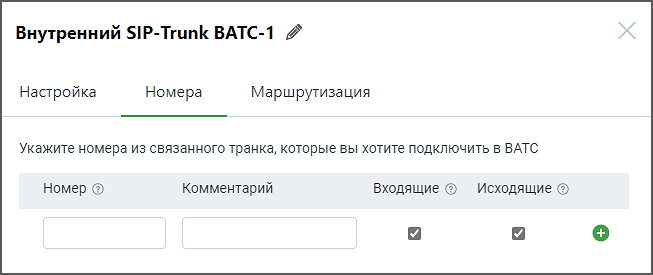

#### 5.3.2.2. Номера

> Трассировка: PDF §5.3.2.2 · сквозные стр. 534-535 · источники: ч.2 `kb/sources/mango-lk-manual/LK_manual_v-125-281-566.pdf` с.254-255.

> **Описание иллюстрации LK-§5.3.2.2-1** (к §5.3.2.2 «Номера», стр. 534; 653×275 px). Снимок экрана / схема Личного кабинета.
> Относится к тексту руководства: «…начало раздела».
> Текст на изображении (OCR, требует сверки): Внутренний SIP-Trunk ВАТС-1 4; Настройка; Номера; Маршрутизация; Укажите номера из связанного транка, которые вы хотите подключить в ВАТС; Номер ©; Комментарий; Входящие @ Исходящие ©

Заполните поля:

Номер – здесь необходимо указать номера для связанного транка из ВАТС-2 Формат ввода номера - E.164 без пробелов, например 74951234567.

При заполнении остальных полей формы, руководствуйтесь инструкциями, предоставленными в разделе Номера для внешнего SIP Trunk.
