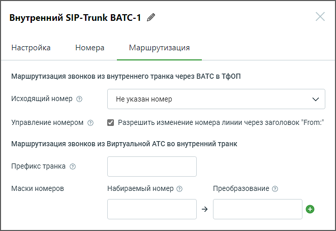

#### 5.3.2.3. Маршрутизация

> Трассировка: PDF §5.3.2.3 · сквозные стр. 535-536 · источники: ч.2 `kb/sources/mango-lk-manual/LK_manual_v-125-281-566.pdf` с.255-256.

> **Описание иллюстрации LK-§5.3.2.3-1** (к §5.3.2.3 «Маршрутизация», стр. 535; 661×455 px). Снимок экрана / схема Личного кабинета.
> Относится к тексту руководства: «…начало раздела».
> Текст на изображении (OCR, требует сверки): Внутренний SIP-Trunk ВАТС-1 4; Настройка; Номера; Маршрутизация; Маршрутизация звонков из внутреннего транка через ВАТС в ТфОП; Исходящий номер @; Не указан номер; Управление номером ©; Разрешить изменение номера линии через заголовок "Ргогп:"; Маршрутизация звонков из Виртуальной АТС во внутренний транк; Префикс транка ©; Маски номеров; Набираемый номер ©; Преобразование ©

При заполнении полей формы, руководствуйтесь инструкциями, предоставленными в разделе Маршрутизация для внешнего SIP Trunk.
