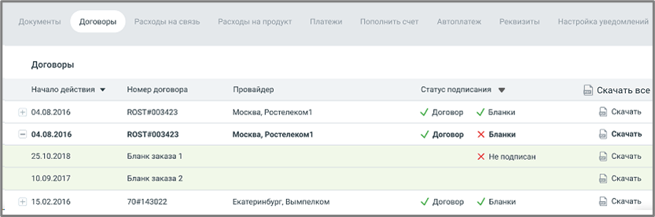

## 2.2. Договоры

> Трассировка: PDF §2.2 · сквозные стр. 30-31 · источники: ч.1 `kb/sources/mango-lk-manual/LK_manual_v-125-1-280.pdf` с.30-31.

В разделе отображается список договор пользователя, с возможностью скачивания документов.

Видимость списка зависит от настроек прав доступа роли текущего пользователя. Список доступен также пользователям со стандартными ролями «Руководитель компании», «Бухгалтер» и «Администратор».

> **Описание иллюстрации LK-§2.2-1** (к §2.2 «Договоры», стр. 30; 833×277 px). Снимок экрана / схема Личного кабинета.
> Относится к тексту руководства: «…роек прав доступа роли текущего пользователя. Список доступен также пользователям со стандартными ролями «Руководитель компании», «Бухгалтер» и «Администратор».».
> Текст на изображении (OCR, требует сверки): Документы; Договоры; Расходы на связь; Расходы на продукт; Платежи; Пополнить счет; Автоплатеж; Реквизиты; Настройка уведомлений; Начало действия у; Номер договора; Провайдер; Статус подписания У; Е скачать все; + 04.08.2016; ROST #003423; Москва, Ростелеком1; М Договор; М Бланки; & Скачать; — 04.08.2016; ROST#003423; V Договор; Х Бланки; lo) скачать; 25.10.2018; Бланк заказа 1; Х Не подписан; 5) Скачать; 10.09.2017; Бланк заказа 2; 5 Скачать; + 15.02.2016; 70#143022; Екатеринбург, Вымпелком; J Договор; J Бланки; B&B Скачать

Таблица договоров содержит следующие поля:

> **Описание иллюстрации LK-§2.2-2** (к §2.2 «Договоры», стр. 31; 33×31 px). Пиктограмма (значок элемента интерфейса).
> Относится к тексту руководства: «…Таблица договоров содержит следующие поля:».
> Текста на изображении нет; назначение значка — см. текст, к которому он относится.

> **Описание иллюстрации LK-§2.2-3** (к §2.2 «Договоры», стр. 31; 33×31 px). Пиктограмма (значок элемента интерфейса).
> Относится к тексту руководства: «…осится к тексту руководства: «…Таблица договоров содержит следующие поля:». > Текста на изображении нет; назначение значка — см. текст, к которому он относится.».
> Текста на изображении нет; назначение значка — см. текст, к которому он относится.

Пиктограммы / – закрытый/открытый список бланков заказа, в составе договора. Если с договором есть хотя бы один связанный бланк заказа, то вначале строки договора отображается пиктограмма "+". При нажатии пиктограмма разворачивает список бланков заказа. Чтобы свернуть список бланков кликните по пиктограмме "-";

Начало действия – начало действия договора. По умолчанию новые договора размещены в начале списка;

Номер договора – номер заключенного договора;

Название провайдера – провайдер, с которым заключен договор;

> **Описание иллюстрации LK-§2.2-4** (к §2.2 «Договоры», стр. 31; 22×28 px). Пиктограмма (значок элемента интерфейса).
> Относится к тексту руководства: «…Название провайдера – провайдер, с которым заключен договор;».
> Текста на изображении нет; назначение значка — см. текст, к которому он относится.

> **Описание иллюстрации LK-§2.2-5** (к §2.2 «Договоры», стр. 31; 24×22 px). Пиктограмма (значок элемента интерфейса).
> Относится к тексту руководства: «…ководства: «…Название провайдера – провайдер, с которым заключен договор;». > Текста на изображении нет; назначение значка — см. текст, к которому он относится.».
> Текста на изображении нет; назначение значка — см. текст, к которому он относится.

Статус подписания – документ подписан, документ не подписан. Доступна сортировка по статусу.

Скачать – сохраните документ, используя стандартные средства Windows;

Скачать все – сохраните все документы, отображаеме в таблице выдачи.

В случае наличия неподписанных документов справа от списка выводится предупреждение о возможном приостановлении услуг связи и информационное сообщение:

> **Описание иллюстрации LK-§2.2-6** (к §2.2 «Договоры», стр. 31; 353×311 px). Снимок экрана / схема Личного кабинета.
> Относится к тексту руководства: «…В случае наличия неподписанных документов справа от списка выводится предупреждение о возможном приостановлении услуг связи и информационное сообщение:».
> Текст на изображении (OCR, требует сверки): @ Как подписывать договоры Скрыть; и бланки заказа; Подписать договоры/бланки заказов:; . через ЭДО (электронный документооборот); . распечатать электронную версию и отправить; нам на фактический адрес; „ запросить бумажную версию, второй экземпляр; необходимо вернуть нам.; Остались вопросы?; E-mail: mango@mangotele.com; Ten: 8 800 333 06 64
