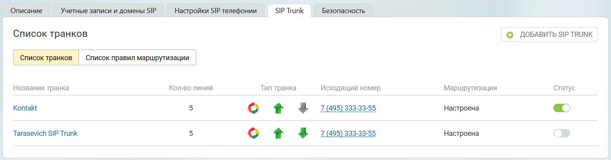

### 5.4.1. Список транков

> Трассировка: PDF §5.4.1 · сквозные стр. 538-539 · источники: ч.2 `kb/sources/mango-lk-manual/LK_manual_v-125-281-566.pdf` с.258-259.

> **Описание иллюстрации LK-§5.4.1-1** (к §5.4.1 «Список транков», стр. 538; 1538×404 px). Снимок экрана / схема Личного кабинета.
> Относится к тексту руководства: «…начало раздела».
> Текст на изображении (OCR, требует сверки): Описание; Учетные записи и домены SIP; SIP Trunk; Безопасность,; Настройки SIP телефонии; Список транков; © ДОБАВИТЬ SIP TRUNK; ‘Список транков; ‘Список правил маршрутизации; Кол-во линий; Название транка; Тип транка; Исходящий номер; Маршрутизация; Статус; Kontakt; ort 4; 495) 333-33-5:; Настроена; Tarasevich SIP Trunk; or 4

Название транка - название транка, установленное пользователем;

Количество линий - максимальное количество одновременных звонков, устанавливаемое пользователем во вкладке «Настройки»;

Тип транка - направление вызова для данного транка, устанавливаемое пользователем во вкладке «Номера»;

> **Описание иллюстрации LK-§5.4.1-2** (к §5.4.1 «Список транков», стр. 538; 25×25 px). Пиктограмма (значок элемента интерфейса).
> Относится к тексту руководства: «…Тип транка - направление вызова для данного транка, устанавливаемое пользователем во вкладке «Номера»;».
> Текста на изображении нет; назначение значка — см. текст, к которому он относится.

● исходящие вызовы

> **Описание иллюстрации LK-§5.4.1-3** (к §5.4.1 «Список транков», стр. 538; 25×28 px). Пиктограмма (значок элемента интерфейса).
> Относится к тексту руководства: «…● исходящие вызовы».
> Текста на изображении нет; назначение значка — см. текст, к которому он относится.

● входящие вызовы

> **Описание иллюстрации LK-§5.4.1-4** (к §5.4.1 «Список транков», стр. 538; 24×26 px). Пиктограмма (значок элемента интерфейса).
> Относится к тексту руководства: «…● входящие вызовы».
> Текста на изображении нет; назначение значка — см. текст, к которому он относится.

● для данного транка установлены правила маршрутизации звонков;

> **Описание иллюстрации LK-§5.4.1-5** (к §5.4.1 «Список транков», стр. 538; 27×27 px). Пиктограмма (значок элемента интерфейса).
> Относится к тексту руководства: «…● для данного транка установлены правила маршрутизации звонков;».
> Текста на изображении нет; назначение значка — см. текст, к которому он относится.

● для данного транка не установлены правила маршрутизации звонков;

Исходящий номер - номер, установленный в качестве исходящего во вкладке «Маршрутизация»;

Маршрутизация - поле имеет статус “настроена”, если пользователь указал префикс транка или маски номеров во вкладке «Маршрутизация»;

Статус транка :

> **Описание иллюстрации LK-§5.4.1-6** (к §5.4.1 «Список транков», стр. 538; 35×23 px). Пиктограмма (значок элемента интерфейса).
> Относится к тексту руководства: «…Статус транка :».
> Текста на изображении нет; назначение значка — см. текст, к которому он относится.

● транк активирован, у транка присутствует подключение;

> **Описание иллюстрации LK-§5.4.1-7** (к §5.4.1 «Список транков», стр. 538; 35×24 px). Пиктограмма (значок элемента интерфейса).
> Относится к тексту руководства: «…● транк активирован, у транка присутствует подключение;».
> Текста на изображении нет; назначение значка — см. текст, к которому он относится.

● транк активирован, у транка отсутствует подключение;

> **Описание иллюстрации LK-§5.4.1-8** (к §5.4.1 «Список транков», стр. 538; 34×21 px). Пиктограмма (значок элемента интерфейса).
> Относится к тексту руководства: «…● транк активирован, у транка отсутствует подключение;».
> Текста на изображении нет; назначение значка — см. текст, к которому он относится.

● транк деактивирован;
