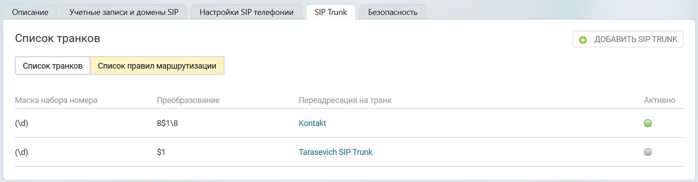

### 5.4.2. Список правил маршрутизации

> Трассировка: PDF §5.4.2 · сквозные стр. 539 · источники: ч.2 `kb/sources/mango-lk-manual/LK_manual_v-125-281-566.pdf` с.259.

> **Описание иллюстрации LK-§5.4.2-1** (к §5.4.2 «Список правил маршрутизации», стр. 539; 1537×403 px). Снимок экрана / схема Личного кабинета.
> Относится к тексту руководства: «…начало раздела».
> Текст на изображении (OCR, требует сверки): Описание; Учетные записи и домены SIP; SIP Trunk; Безопасность,; Настройки SIP телефонии; Список транков; © ДОБАВИТЬ SIP TRUNK; ‘Список правил маршрутизации; | ‘Список транков; Маска набора номера; Преобразование; Переадресация на транк; Активно; 8$1\8; Kontakt; Tarasevich SIP Trunk

Маска набора номера - задается пользователем во вкладке «Маршрутизация»;

Преобразование - задается пользователем во вкладке «Маршрутизация»;

Переадресация на транк - название транка, для которого установлена данная маска;

Активно - отображает текущий статус маски.
