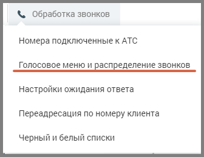
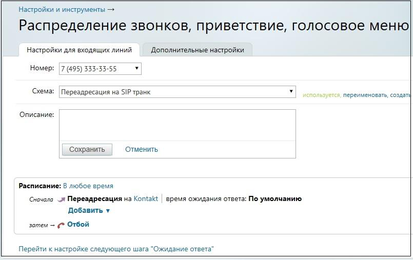
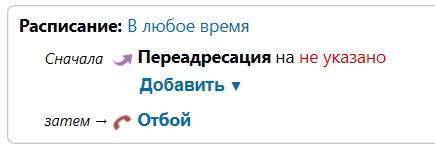
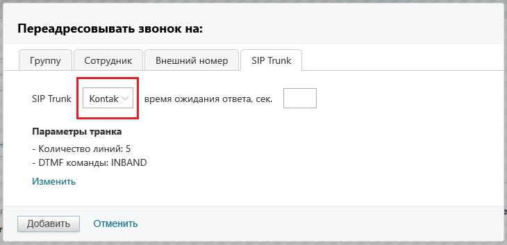
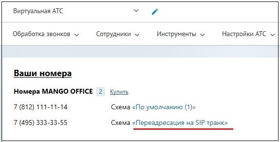

## 5.5. Настройка схемы распределения звонков в Личном кабинете

> Трассировка: PDF §5.5 · сквозные стр. 539-542 · источники: ч.2 `kb/sources/mango-lk-manual/LK_manual_v-125-281-566.pdf` с.259-262.

Для настройки схемы распределения звонков откройте подраздел “Голосовое меню и распределение звонков” в разделе “Обработка звонков” в Личном кабинете пользователя ВАТС.

> **Описание иллюстрации LK-§5.5-1** (к §5.5 «Настройка схемы распределения звонков в Личном кабинете», стр. 539; 336×259 px). Снимок экрана / схема Личного кабинета.
> Относится к тексту руководства: «…ройки схемы распределения звонков откройте подраздел “Голосовое меню и распределение звонков” в разделе “Обработка звонков” в Личном кабинете пользователя ВАТС.».
> Текст на изображении (OCR, требует сверки): &. Обработка звонков; Номера подключенные к АТС; Голосовое меню и распределение 3BOHKOB; Настройки ожидания ответа; Переадресация по номеру клиента; черный и белый списки

Панель настройки содержит вкладки:

● Настройки для входящих линий ● Дополнительные настройки

Выберите из списка телефонный номер, подключенный через сип-транк, для которого будет настраиваться схема.

Далее действуйте согласно информации раздела о создании схем переадресации.

> **Описание иллюстрации LK-§5.5-2** (к §5.5 «Настройка схемы распределения звонков в Личном кабинете», стр. 540; 805×507 px). Снимок экрана / схема Личного кабинета.
> Относится к тексту руководства: «…Далее действуйте согласно информации раздела о создании схем переадресации.».
> Текст на изображении (OCR, требует сверки): Настройки и инструменты —+; Распределение звонков, приветствие, голосовое меню; Настройки для входящих линий; Дополнительные настройки; Номер: 7 (495) 333-53-55; Схема:; Переадресация на SIP транк; переименовать, создать; Описание:; Сохранить; Отменить; Расписание: В любое время; Сначала м Переадресация на Kontakt; время ожидания ответа: По умолчанию; Добавить v; затем — ¢* Отбой; Перейти к настройке следующего шага "Ожидание ответа"

Для создания схемы, включающей переадресацию звонков на SIP Trunk кликните по ссылке “не указано”.

> **Описание иллюстрации LK-§5.5-3** (к §5.5 «Настройка схемы распределения звонков в Личном кабинете», стр. 540; 435×153 px). Снимок экрана / схема Личного кабинета.
> Относится к тексту руководства: «…Для создания схемы, включающей переадресацию звонков на SIP Trunk кликните по ссылке “не указано”.».
> Текст на изображении (OCR, требует сверки): Расписание: В любое время; Сначала м Переадресация на не указано; Добавить т; затем — ¢* Отбой

В открывшейся форме выберите вкладку SIP Trunk. В выпадающем окне содержится список всех активных транков с типом вызова «Входящий». При выборе транка в окне отображаются его параметры.

Важно: При необходимости, параметры транка можно отредактировать, кликнув по кнопке Изменить.

> **Описание иллюстрации LK-§5.5-4** (к §5.5 «Настройка схемы распределения звонков в Личном кабинете», стр. 541; 730×353 px). Снимок экрана / схема Личного кабинета.
> Относится к тексту руководства: «…Важно: При необходимости, параметры транка можно отредактировать, кликнув по кнопке Изменить.».
> Текст на изображении (OCR, требует сверки): Переадресовывать звонок на:; SIP Trunk; Группу; Сотрудник; Внешний номер; SIP Trunk Kontak время ожидания ответа, сек.; Параметры транка; - Количество линий: 5; - ОТМЕ команды: INBAND; Изменить; добавить | Omen

Установите время ожидания ответа, затем сохраните внесенные изменения кнопкой Добавить.

Настроенная схема переадресации звонка отобразится на главной панели Личного кабинета

> **Описание иллюстрации LK-§5.5-5** (к §5.5 «Настройка схемы распределения звонков в Личном кабинете», стр. 541; 575×291 px). Снимок экрана / схема Личного кабинета.
> Относится к тексту руководства: «…Настроенная схема переадресации звонка отобразится на главной панели Личного кабинета».
> Текст на изображении (OCR, требует сверки): Виртуальная АТС; Обработка звонков v; Сотрудники v; Инструменты м; Настройки АТС v; Ваши номера; Номера MANGO OFFICE 2; Купить; 7 (812) 111-11-14; Схема «По умолчанию (1)»; 7 (495) 333-33-55; Схема «Перездресация на SIP транк»
