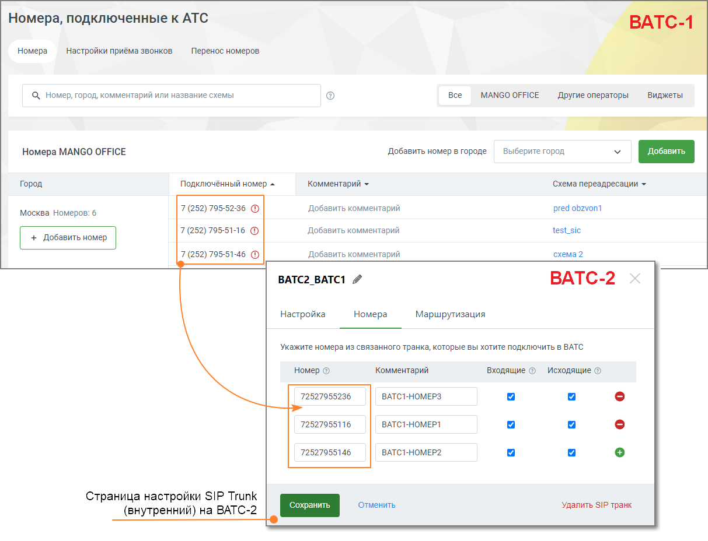
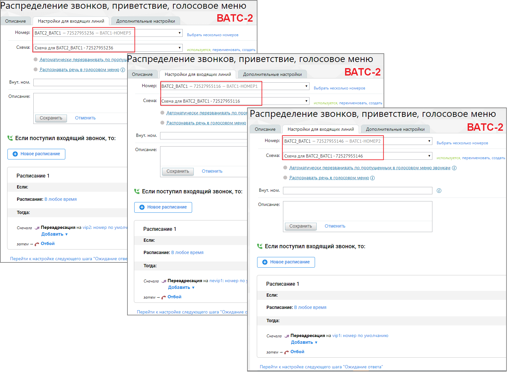
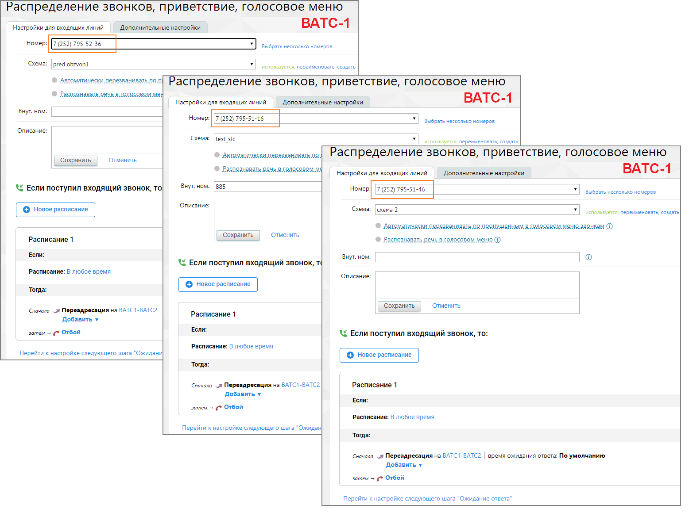
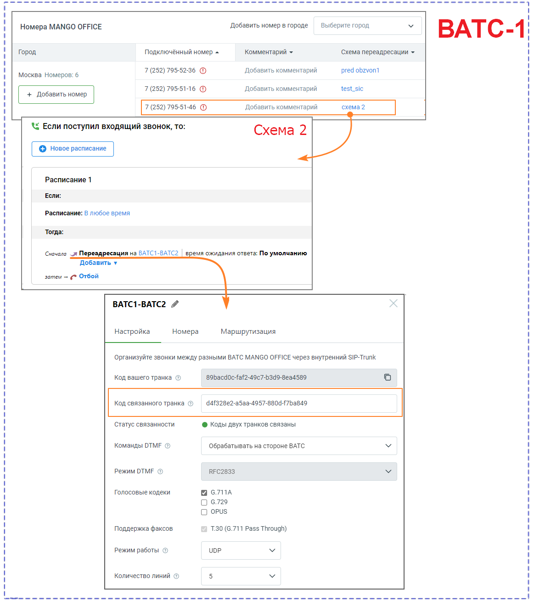
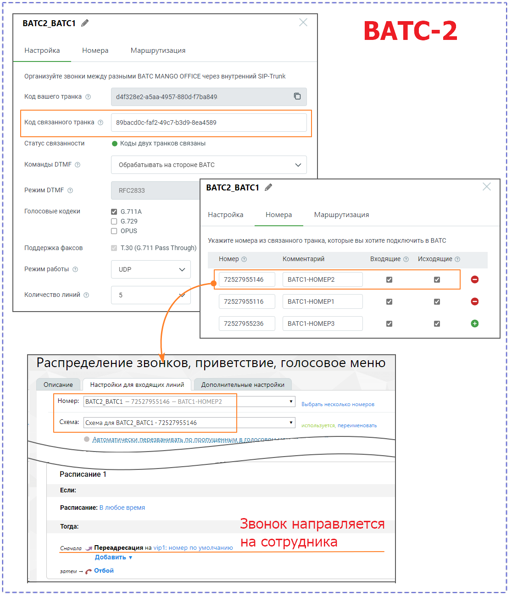
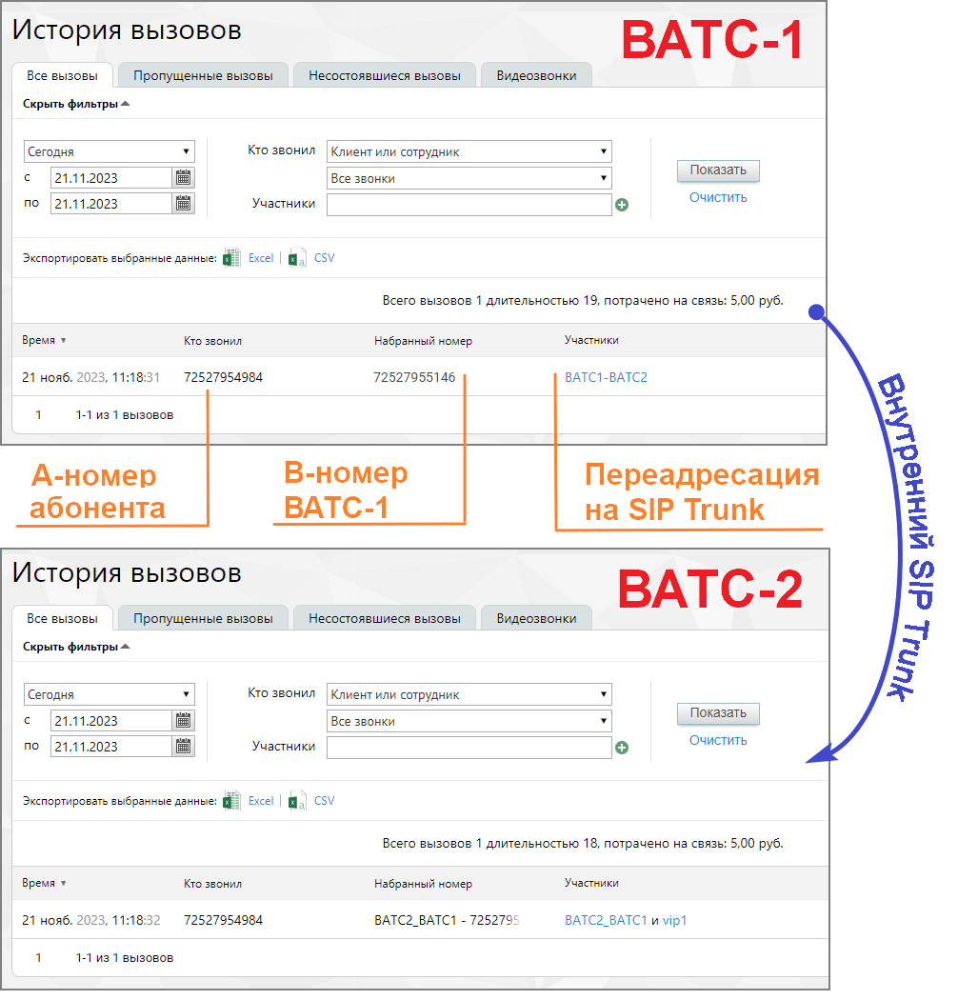

## 5.6. Примеры настройки звонков через sip trunk

> Трассировка: PDF §5.6 · сквозные стр. 542-550 · источники: ч.2 `kb/sources/mango-lk-manual/LK_manual_v-125-281-566.pdf` с.262-270.

Для совершения исходящих вызовов ВАТС должна знать какой номер, в каком формате, и по какому транку ей передать. Во вкладке «Маршрутизация» пользователь может создать несколько масок номеров. Маски перебираются по порядку сверху вниз, и как только находится совпадение в шаблоне номера, вызов отправляется в соответствующий шаблону транк.

СОВЕТ: Поскольку маски перебираются сверху вниз, первыми лучше создавать более детальные маски, например, с кодом города, после них делать маски с более общей маской например мобильники, затем уже страну. Если сделать наоборот, то сработает маска страны, но не сработают остальные.

Пример 1. Пользователь кАТС звонит сотруднику, заведенному в ВАТС, по короткому номеру 456. Что необходимо сделать:

1. Создать SIP Trunk в Личном кабинете MANGO OFFICE. 2. Настроить правило исходящей маршрутизации в PBX (например, в Asterisk), указав во вкладке Dial Patterns правило для префикса 45 или правило для префикса 4.

● Prepend - поле остается пустым ● Prefix - поле остается пустым ● Match Pattern - 4ХХ или 45X

Пример 2. Сотрудник из ВАТС совершает звонок в клиентскую АТС на номер 456. Что необходимо сделать:

1. Создать SIP Trunk в Личном кабинете MANGO OFFICE. 2. Создать правило исходящей маршрутизации во вкладке «Маршрутизация» для диапазона номеров кАТС, включающее номер 456. Например указать в поле “маска” ([1-4][0-9][0-9]|500), а в поле “преобразование номера” - $1. 3. Создать правило входящей маршрутизации в PBX (например, в Asterisk, заполнив поля вкладки Connectivity>Inbound Routes)

Пример 3. Пользователь кАТС с номером 7499308808 совершает звонок в ВАТС. Что необходимо сделать:

1. Создать SIP Trunk в Личном кабинете MANGO OFFICE. 2. Настроить схему распределения входящих звонков на этот транк. 3. Настроить правило исходящей маршрутизации в PBX (например, в Asterisk), указав во вкладке Dial Patterns:

● Prepend - поле остается пустым ● Prefix - поле остается пустым ● Match Pattern - 7499308808 или 749930ХХХХХ

Пример 4. Пользователь кАТС с номером 7499308808 совершает звонок через DID ВАТС на ТФоП. Что необходимо сделать:

1. Создать SIP Trunk, указав во вкладке «Маршрутизация» исходящий номер по умолчанию”. 2. Настроить правило исходящей маршрутизации, указав во вкладке Dial Patterns: ● Prepend - поле остается пустым ● Prefix - поле остается пустым ● Match Pattern - 7499308808 или 749930ХХХХХ

Пример 5. Звонок сотрудника из ВАТС через DID клиентской АТС. Что необходимо сделать:

1. Создать SIP Trunk в Личном кабинете MANGO OFFICE, обязательно выставив отметку “Звонить” во вкладке «Номера». 2. В Карточке сотрудника установите транк для совершения исходящих вызовов. 3. Создать правило входящей маршрутизации в PBX (например, в Asterisk, заполнив поля вкладки Connectivity → Inbound Routes)

Пример 6. Сотрудник ВАТС, у которого в качестве исходящего номера указан номер транка, набирает номер 123, который является внутренним номером другого сотрудника данной ВАТС.

Результат: Звонок проходит как внутренний для данной ВАТС без использования транка.

Пример 7. Настройка для звонка сотрудника из ВАТС-1 в ВАТС-2

Для настройки звонка из ВАТС-1 в ВАТС-2 с использованием префикса транка и/или маски номера, выполните следующую последовательность действий:

1. Настройка ВАТС1

● Создайте или выберите существующий SIP-транк для связи с ВАТС-2. ● На вкладке "Маршрутизация" настройте префикс транка и/или маску номера в соответствии с форматом номеров на ВАТС-2. Примеры: Префикс транка: Если на ВАТС-2 у сотрудника внутренний номер 1001, укажите префикс "1001" или другой, который соответствует формату на ВАТС-2. Маска номера: Если внутренние номера на ВАТС-2 имеют формат "5xxx," укажите маску "5XXX" для преобразования номера перед отправкой.

2. Настройка ВАТС-2:

● На ВАТС-2 создайте или настройте сотрудника, группу или IVR с внутренним номером, который будет соответствовать префиксу транка или маске номера на ВАТС-1. Например, если на ВАТС1 префикс транка - "1001," создайте сотрудника с внутренним номером "1001" на ВАТС-2.

● Укажите необходимые настройки для обработки вызовов на этот внутренний номер на ВАТС-2, такие как переадресация на конкретного сотрудника, группу или выполнение действий IVR.

3. Звонок из ВАТС-1 в ВАТС-2:

Теперь, чтобы совершить звонок из ВАТС-1 в ВАТС-2:

 На ВАТС-1 наберите префикс транка (например, "1001") или номер, соответствующий маске номера (например, "5XXX").  Затем наберите внутренний номер на ВАТС-2, с которым вы хотите установить связь.  ВАТС-1 автоматически преобразует введенный номер, добавляя префикс транка или применяя маску номера, и отправит вызов на ВАТС-2.  ВАТС-2 обработает вызов, перенаправив его на соответствующий внутренний номер, согласно настройкам.

Таким образом, вы сможете вызывать внутренние номера на ВАТС-2 с ВАТС-1, используя префикс транка или маску номера для преобразования номера перед отправкой вызова.

Пример 8. Настройка для звонка от клиента на ВАТС-2 через ВАТС-1 с использованием внутреннего транка и автоматического переадресации на IVR.

> **Описание иллюстрации LK-§5.6-1** (к §5.6 «Примеры настройки звонков через sip trunk», стр. 545; 1213×928 px). Снимок экрана / схема Личного кабинета.
> Относится к тексту руководства: «…Пример 8. Настройка для звонка от клиента на ВАТС-2 через ВАТС-1 с использованием внутреннего транка и автоматического переадресации на IVR.».
> Текст на изображении (OCR, требует сверки): Номера, подключенные к АТС; Номера; Настройки приёма звонков; Перенос номеров; Q Номер, город, комментарий или название схемы; все; MANGO OFFICE; Apyrne операторы; Виджеты; Номера MANGO OFFICE; ‘Добавить номер в городе; выберите город; Город; Подключённый номер =; Комментарий ~; ‘Схема переадресации ~; Добавить комментарий; pred obzvont; Москва Номеров: 6; 7 (252) 795-5116 ©; testsic; схема?; BATC2_BATC1 4; BATC-2; Настройка; Маршрутизация; ‘Укажите номера из связанного транка, которые вы хотите подключить в ВАТС; номер ©; Комментарий; входящие © — Исходящие ©; 72527955236; BATC1-HOMEP3; Lo; 7…

Для настройки звонка выполните следующую последовательность действий:

1. Настройка ВАТС-2:

На ВАТС-2 у вас уже есть внутренний SIP-транк, на вкладке "Номера" которого указаны номера DID ВАТС-1, на который дозваниваются клиенты. На рисунке выше указаны три номера.

Создайте или настройте IVR на ВАТС-2, который будет обрабатывать входящие вызовы на указанные DID номера. IVR должен предоставить клиентам опции для навигации и выполнения различных действий.

На рисунке ниже представлены настройки схемы переадресации ВАТС-2 для маршрутизации вызовов, полученных из внутреннего SIP Trunk, для каждого из трех номеров:

> **Описание иллюстрации LK-§5.6-2** (к §5.6 «Примеры настройки звонков через sip trunk», стр. 546; 1580×1171 px). Снимок экрана / схема Личного кабинета.
> Относится к тексту руководства: «…На рисунке ниже представлены настройки схемы переадресации ВАТС-2 для маршрутизации вызовов, полученных из внутреннего SIP Trunk, для каждого из трех номеров:».
> Текст на изображении (OCR, требует сверки): Распределение звонков, приветствие, голосовое меню; ' Описание.; Настройки для входящих линий; Дополнительные настройки; ВАТС-2; Номер:; BATC2_BATC1 — 72527955236 — ВАТС1-НОМЕРЗ; Выбрать несколько номеров:; Схема:; | Схема для ВАТС2_ВАТС1 -72527955236; используется, переименовать, создать; „Распределение звонков, приветствие, голосовое меню; Внуг. ном.; ВАТС2_ВАТС1 — 72527955116 — BATC1-HOMEP1; 'Описание:; |Cxema для ВАТС2_ВАТС1 -72527955116; Автоматически перезваниязть ло.прой; ' Сохранить; Отменить; bP; 12; Onncanne; << Если поступил входящий звонок, то:; BATC2_BATC1 — 72527955146 — ВАТС1-НО…

2. Настройка ВАТС-1:

На ВАТС-1 необходимо только создать связанный внутренний SIP Trunk. Здесь не потребуется специальная настройка маршрутизации транка, так как весь сценарий будет инициирован на ВАТС-2. Однако потребуется настройка схемы распределения для маршрутизации вызовов с DID-номеров во внутренний транк.

На рисунке ниже представлены настройки схемы переадресации ВАТС-1 для маршрутизации вызовов во внутренний SIP Trunk для каждого из трех номеров:

> **Описание иллюстрации LK-§5.6-3** (к §5.6 «Примеры настройки звонков через sip trunk», стр. 547; 1565×1176 px). Снимок экрана / схема Личного кабинета.
> Относится к тексту руководства: «…На рисунке ниже представлены настройки схемы переадресации ВАТС-1 для маршрутизации вызовов во внутренний SIP Trunk для каждого из трех номеров:».
> Текст на изображении (OCR, требует сверки): Распределение звонков, приветствие, голосовое меню; Настройки для входящих линий; Дополнительные настройки; ВАТС-1; Номер: [7 (252) 795-52-36; Выбрать несколько номеров:; Схема:; pred obzvon1; используется, переименовать, создать; распознавать речн в голосовом мен; Внуг. ном.; Номер:; 7 (252) 795-51-16; 'Описание:; test_sic; ' Сохранить; Отменить; распознавать речь я голосовом м; < Если поступил входящий звонок, то; 885; Номер: |7 (252) 795-51-46; [схема 2; используется, переименовать, создать]; Автоматически перезванияать п. пропущенным, в ллосовом меню. звонкам ©; Расписание 1; bP; ЕСЛИ:; < …

3. Звонок от клиента на ВАТС-2:  Клиент звонит на номер DID ВАТС-1, который указан на вкладке "Номера" в транке ВАТС-2:

A-номер 7(252) 795-49-84 (внешний номер инициатора звонка)

B-номер 7(252) 791-51-46 (DID номер принадлежит ВАТС-1)

 ВАТС-1 принимает вызов и передает его на ВАТС-2 через внутренний связанный SIP Trunk. Данная настройка задается в схеме переадресации ВАТС-1

> **Описание иллюстрации LK-§5.6-4** (к §5.6 «Примеры настройки звонков через sip trunk», стр. 548; 1163×1309 px). Снимок экрана / схема Личного кабинета.
> Относится к тексту руководства: «… ВАТС-1 принимает вызов и передает его на ВАТС-2 через внутренний связанный SIP Trunk. Данная настройка задается в схеме переадресации ВАТС-1».
> Текст на изображении (OCR, требует сверки): “See; “ee; Homepa MANGO OFFICE; Добавить номер в городе; выберите город; BATC-1; Город; Подключённый номер =; Комментарий ~; Схема переадресации ~; Добавить комментарий; pred obzvont; Москва Номеров: 6; 7 (252) 795-5116 ©; testsic; `Добавить комментарий; схема?; << Если поступил входящий звонок, то:; Схема 2; Расписание 1; Если:; Расписание: В любое время; Тогда:; Сночало _я Переадресация на ВАТС1-ВАТС2.; время ожидания ответ; : По умолчанию; Добавить у; затем — (> Отбой; BATC1-BATC2 4; Настройка; Номера; Маршрутизация; Организуйте звонки между разными ВАТС MANGO OFFICE через внутренний SIP-Tr…

 ВАТС-2, получив вызов через связанный транк, перенаправляет его на созданный IVR, который предоставляет клиенту нужные опции и информацию.

> **Описание иллюстрации LK-§5.6-5** (к §5.6 «Примеры настройки звонков через sip trunk», стр. 549; 1116×1301 px). Снимок экрана / схема Личного кабинета.
> Относится к тексту руководства: «… ВАТС-2, получив вызов через связанный транк, перенаправляет его на созданный IVR, который предоставляет клиенту нужные опции и информацию.».
> Текст на изображении (OCR, требует сверки): SSS SSS See; BATC2_BATC1 4; BATC-2; Настройка; Номера; Маршрутизация; Организуйте звонки между разными ВАТС MANGO OFFICE через внутренний SIP-Trunk; Код вашего транка; d4f328e2-a5aa-4957-880d-f7ba849.; Код связанного транка; 89bacd0c-faf2-49c7-b3d9-8ead589; Статус связанности; ® Коды двух транков связаны; Команды ОТМЕ; Обрабатывать на стороне ВАТС; режим ОТМЕ ©; ВЕС2833; Голосовые кодеки; 6.7ПА; О 6729; О opus; Укажите номера из связанного транка, которые вы хотите подключить в ВАТС; Поддержка факсов; 7.30 (6.711 Pass Through); номер ©; Комментарий; входящие © — Исходящие ©; Режим работы; ЦОР;…

Таким образом, клиент может дозвониться до ВАТС-2 через ВАТС-1 с использованием внутреннего транка, и его вызов автоматически перенаправляется на IVR для обработки.

В Истории вызовов ВАТС-1 и ВАТС-2 эти звонки выглядят так:

> **Описание иллюстрации LK-§5.6-6** (к §5.6 «Примеры настройки звонков через sip trunk», стр. 550; 1006×1050 px). Снимок экрана / схема Личного кабинета.
> Относится к тексту руководства: «…В Истории вызовов ВАТС-1 и ВАТС-2 эти звонки выглядят так:».
> Текст на изображении (OCR, требует сверки): История BbIZ0BOB; BATC-1; Все вызовы; Несостоявшиеся вызовы; Пропущенные вызовы; Видеозвонки; Скрыть фильтры ^; Сегодня; Кто звонил |Клиентили сотрудник.; 21.11.2023; Все звонки; Показать; по 21.11.2023; Участники; Очистить; Экспортировать выбранные данные:; Excel | fa) CSV; Всего вызовов 1 длительностью 19, потрачено Ha связь: 5,00 руб.; Время +; Кто звонил; Набранный номер.; 21 нояб. 2023, 11:18:31; 72527954984.; 72527955146; BATC1-BATC2; 1-13 1 вызовов,; А-номер; В-номер; Переадресация; абонента; ВАТС-1; Ha SIP Trunk; BATC-2; Всего вызовов 1 длительностью 18, потрачено Ha связь: 5,00 руб.; …
