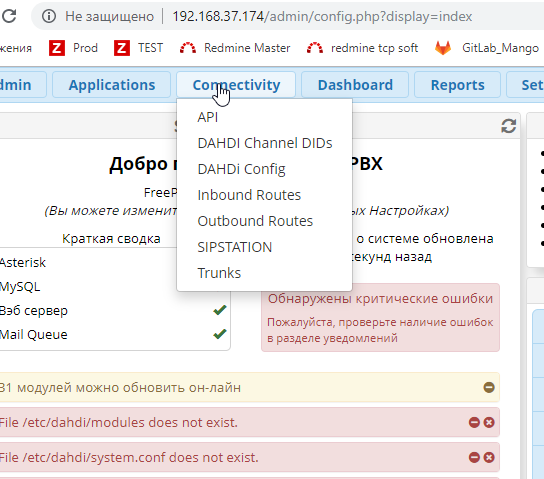
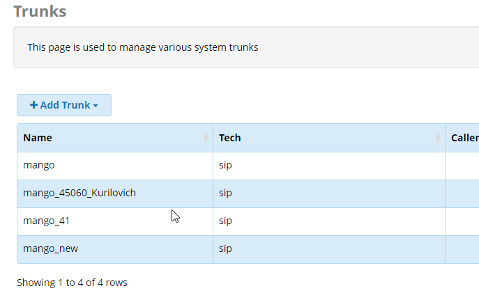
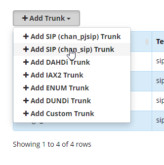
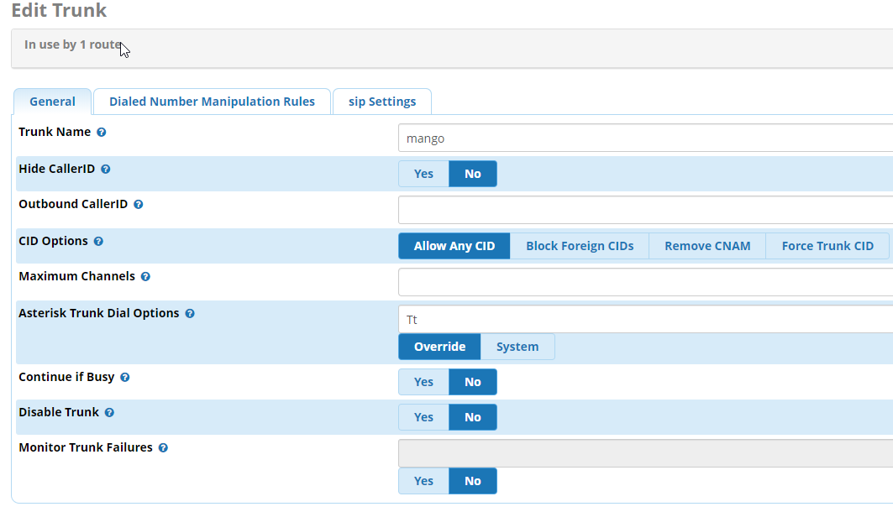
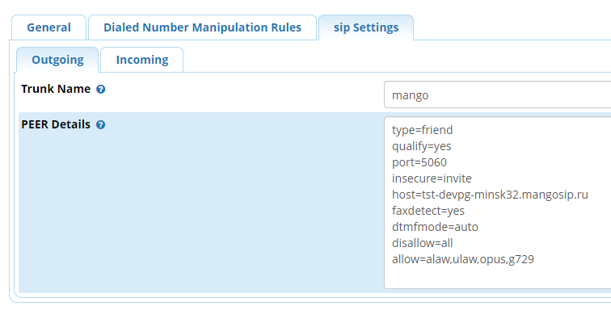
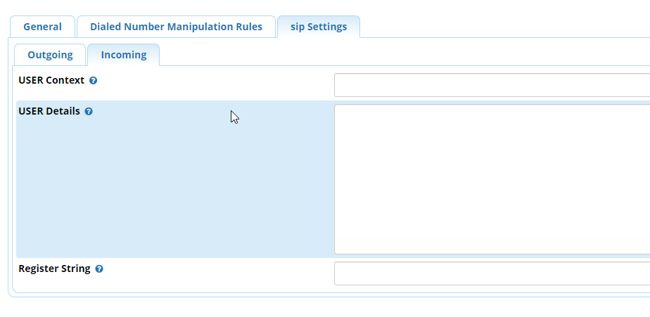

### 5.7.1. Создание SIP trunk для FreePBX (Asterisk)

> Трассировка: PDF §5.7.1 · сквозные стр. 550-557 · источники: ч.2 `kb/sources/mango-lk-manual/LK_manual_v-125-281-566.pdf` с.270-277.

Откройте меню администрирования транков во вкладке Trunks раздела

Connectivity.

> **Описание иллюстрации LK-§5.7.1-1** (к §5.7.1 «Создание SIP trunk для FreePBX (Asterisk)», стр. 551; 544×479 px). Снимок экрана / схема Личного кабинета.
> Относится к тексту руководства: «…Connectivity.».
> Текст на изображении (OCR, требует сверки): С ОФ Не защищено | 192.168.37.174/admin/config.php?display=index; кения; 2% Redmine Master; РА Prod [А TEST; 2a redmine tcp soft 4 GitLab_Mango; imin || Applications | Compectivity | slate || Reports || Set; API; ra; nu; DAHDI Channel DIDs; Добро!; РАНО! Config; ?ВХ; FreeP; Inbound Routes; (Вы можете изменит; Outbound Routes; ых Настройках); Краткая сводка; SIPSTATION; о системе обновлена; {екунд назад; Asterisk; Trunks; MySQL; Гобнаружены критические ошибки; 336 сервер; Пожалуйста, проверьте наличие ошибок; май Queue; в разделе уведомлений; 31 модулей можно обновить он-лайн; -ile /etc/dahdi/m…

Нажмите кнопку «Add Trunk» и выберите тип создаваемого транка.

> **Описание иллюстрации LK-§5.7.1-2** (к §5.7.1 «Создание SIP trunk для FreePBX (Asterisk)», стр. 552; 687×421 px). Снимок экрана / схема Личного кабинета.
> Относится к тексту руководства: «…Нажмите кнопку «Add Trunk» и выберите тип создаваемого транка.».
> Текст на изображении (OCR, требует сверки): Trunks; This page is used to manage various system trunks; + Add Trunk ~; Name; Tech; Caller; mango; sip; mango_45060_Kurilovich; mango_41; mango_new; Showing 1 to 4 of 4 rows

> **Описание иллюстрации LK-§5.7.1-3** (к §5.7.1 «Создание SIP trunk для FreePBX (Asterisk)», стр. 552; 332×334 px). Снимок экрана / схема Личного кабинета.
> Относится к тексту руководства: «…ge is used to manage various system trunks; + Add Trunk ~; Name; Tech; Caller; mango; sip; mango_45060_Kurilovich; mango_41; mango_new; Showing 1 to 4 of 4 rows».
> Текст на изображении (OCR, требует сверки): + Add SIP (chan_pjsip) Trunk; Te; _sip) Trunk; 4 Add РАНО! Tr; unk; sit; + Add 1АХ2 Trunk; sig; + Add ENUM Trunk; + Add DUNDi Trunk; Sif; + Add Custom Trunk; Le; ve; Showing 1 to 4 of 4 rows

Выберите вариант Add SIP (chan_sip) Trunk.

Вкладка General

На вкладке задаются основные параметры SIP транка.

> **Описание иллюстрации LK-§5.7.1-4** (к §5.7.1 «Создание SIP trunk для FreePBX (Asterisk)», стр. 553; 1063×610 px). Снимок экрана / схема Личного кабинета.
> Относится к тексту руководства: «…На вкладке задаются основные параметры SIP транка.».
> Текст на изображении (OCR, требует сверки): Edit Trunk; Inuse by 1 route,; General; Dialed Number Manipulation Rules; sip Settings; Trunk Мате ©; mango; Hide CallerID ©; Outbound CallerID ©; CID Options ©; Remove CNAM; Force Trunk CID; Block Foreign CIDs; Maximum Channels ©; Asterisk Trunk Di; Options ©; Overri; system; Continue if Busy ©; Disable Trunk @; Monitor Trunk Failures ©

Заполните поля формы:

Trunk Name - Название транка. В примере используем имя mango. Назначьте удобное для вас имя, для легкого распознавания среди других транков;

Hide CallerID - Опция скрытия CID при исходящем вызове;

Outbound CallerID CID, который будет передаваться при исходящем вызове;

CID Options - Настройки передачи CID – разрешить все, запретить иностранные и т.д.;

Maximum Channels - максимальное количество одновременных разговоров вне локальной сети;

Asterisk Trunk Dial Options - модификация Dial options, в данном случае оставим опцию дефолтной;

Continue if Busy - опция направления вызова на следующий транк даже если канал сообщает «BUSY» или «INVALID NUMBER»;

Disable Trunk - опция выключения транка.

Далее необходимо выполнить настройку во вкладке «sip Settings».

Вкладка «sip Settings»

Устанавливаем ключевые наcтройки sip пира. Во FreepBX они разделены на Outgoing и Incoming. Которые отвечают за исходящие type=peer и входящие вызовы type=user, соответственно.

Настройка исходящих вызовов в закладке «Outgoing»

Дублируете название транка в поле Trunk Name.

В поле Peer Details размещаются настройки:

> **Описание иллюстрации LK-§5.7.1-5** (к §5.7.1 «Создание SIP trunk для FreePBX (Asterisk)», стр. 554; 756×405 px). Снимок экрана / схема Личного кабинета.
> Относится к тексту руководства: «…В поле Peer Details размещаются настройки:».
> Текст на изображении (OCR, требует сверки): General; Dialed Number Manipulation Rules; sip Settings; Outgoing; Incoming; Trunk Name @; mango; PEER Details ©; type=friend; qualify=yes; port=5060; insecure=invite; host=tst-devpg-minsk32.mangosip.ru; faxdetect=yes; dtmfmode=auto; disallow=all; allow=alaw,ulaw,opus,g729

На скриншоте приведены наиболее распространенные параметры. Точная настройка делается администратором пользователя, в зависимости от конфигурации PBX. Очередность параметров не является обязательной.

type=friend

● peer: SIP запись, которую Asterisk может использовать для совершения исходящих вызовов (например, SIP провайдер). А также для входящих вызовов, если Вам необходимо сопоставить эту запись не с именем пользователя из поля FROM, а с IP адресом, указанным для этой записи. Для записи этого типа, для входящих вызовов, никогда не будет проверяться

соответствие имени пользователя и пароля, а только соответствие с IP адресом и номером порта источника вызова. SIP клиент, типа peer, при совершении исходящих вызовов использует авторизацию, если она будет затребована вызываемой стороной. ● user: SIP запись, через которую вызовы могут поступать из вне в Asterisk (телефон, который может только совершать вызовы). Пользователи, для которых назначены, доступные им, сервисы в определенных для них контекстах. ● friend: Запись, которая одновременно и user и peer. Этот тип наиболее подходит для телефонов и других устройств. Для SIP пользователей этого типа Asterisk создаст два объекта, один типа peer и один типа user, с одинаковыми именами.

qualify=yes посылать SIP запросы OPTIONS для проверки доступности устройства

host= sip сервер провайдера, предоставляется Mango Office

port порт сигнализации sip сервера, предоставляется Mango Office

transport=udp транспорт для sip протокола

insecure=port,invite

port - не требовать совпадения порта в инвайте

invite - не требовать аутентификации в инвайте

dtmfmode=rfc2833 использовать спецификацию rfc2833 для передачи DTMF сигналов

disallow=all запретить использование всех кодеков, чтобы затем разрешить определенные.

allow=alaw.. разрешить использование кодеков, чтобы затем разрешить определенные.

peer - SIP запись, которую Asterisk может использовать для совершения исходящих вызовов (например, SIP провайдер). А также для входящих вызовов, если Вам необходимо сопоставить эту запись не с именем пользователя из поля FROM, а с IP адресом, указанным для этой записи. Для записи этого типа, для входящих вызовов, никогда не будет проверяться соответствие имени пользователя и пароля, а только соответствие с IP адресом и номером порта источника вызова.

SIP клиент, типа peer, при совершении исходящих вызовов использует авторизацию, если она будет затребована вызываемой стороной.

Если клиент типа peer (тип friends включает в себя peer) определен с параметром host=dynamic, то он должен зарегистрироваться на Asterisk, для того, чтобы сервер мог найти его (IP адрес или имя хоста), и для того, чтобы сервер знал, что данный клиент доступен для совершения вызовов в его сторону.

Сопоставление входящих вызовов с клиентами и пирами

Обычно, Asterisk ищет подходящего SIP клиента, при поступлении входящего вызова, по полю From: username (без доменной части). Однако, если Asterisk не смог найти подходящего пользователя для поступившего вызова, то он будет использовать IP адрес звонящего для поиска подходящего SIP пира с соответствующим адресом. Если же и после этого нет совпадений, тогда вызов будет отправлен на обработку в контекст, определенный в секции [general] файла sip.conf.

Проверьте правильность заполнения полей, нажмите Submit и Apply Config.

ПОЯСНЕНИЕ: Для простоты можно сказать, что контекст транка определяет, как обрабатывать входящие вызовы, а контекст внутреннего номера - исходящие. Когда внутренний абонент куда-то звонит, в назначенном ему контексте определяется, через какие транки и куда он может позвонить. Исходящая связь через транк определяется в контекстах внутренних номеров и никак не упоминается в контексте, назначенном непосредственно транку.

Настройка входящих вызовов в закладке «Incoming»

Закладка Incoming остается пустой.

> **Описание иллюстрации LK-§5.7.1-6** (к §5.7.1 «Создание SIP trunk для FreePBX (Asterisk)», стр. 557; 924×451 px). Снимок экрана / схема Личного кабинета.
> Относится к тексту руководства: «…Закладка Incoming остается пустой.».
> Текст на изображении (OCR, требует сверки): General; Dialed Number Manipulation Rules; sip Settings; Outgoing; Incoming; USER Context ©; USER Details ©; Register String ©
