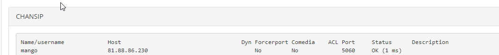

#### 5.7.1.1. Как проверить состояние транка

> Трассировка: PDF §5.7.1.1 · сквозные стр. 557 · источники: ч.2 `kb/sources/mango-lk-manual/LK_manual_v-125-281-566.pdf` с.277.

Проверить состояние транка можно через меню Reports-Asterisk Info:

> **Описание иллюстрации LK-§5.7.1.1-1** (к §5.7.1.1 «Как проверить состояние транка», стр. 557; 1067×120 px). Снимок экрана / схема Личного кабинета.
> Относится к тексту руководства: «…Проверить состояние транка можно через меню Reports-Asterisk Info:».
> Текст на изображении (OCR, требует сверки): CHANSIP; Name/username; Host; ACL Port; status; Dyn Forcerport Comedia; Description; mango; 81.88.86.230; No; 5060
