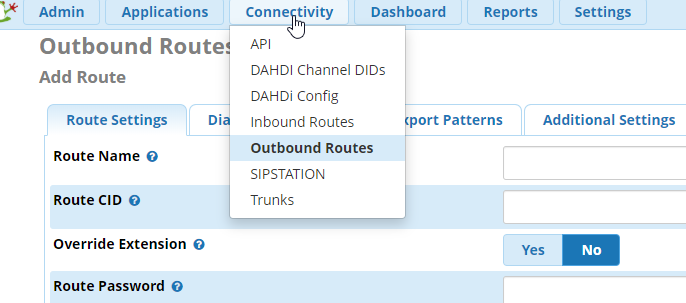
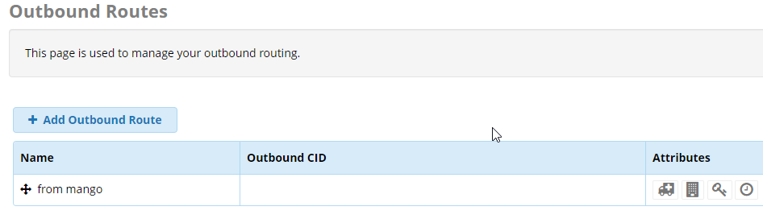
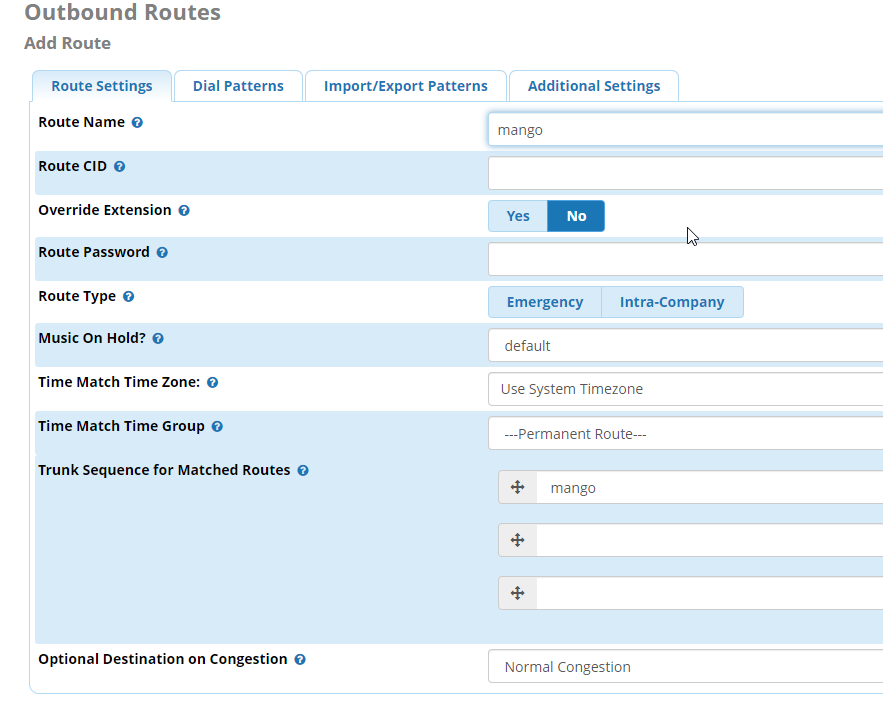
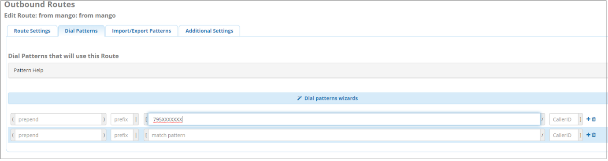

#### 5.7.1.2. Исходящая маршрутизация

> Трассировка: PDF §5.7.1.2 · сквозные стр. 557-560 · источники: ч.2 `kb/sources/mango-lk-manual/LK_manual_v-125-281-566.pdf` с.277-280.

Outbound Routes - исходящая маршрутизация FreePBX.

На основании набранного номера выбирается направление (транк) для исходящего вызова. Набираемый номер делится на префикс и паттерн и может модифицироваться после набора.

Connectivity > Outbound Routes (Подключения > Исходящая Маршрутизация)

> **Описание иллюстрации LK-§5.7.1.2-1** (к §5.7.1.2 «Исходящая маршрутизация», стр. 558; 686×303 px). Снимок экрана / схема Личного кабинета.
> Относится к тексту руководства: «…Connectivity > Outbound Routes (Подключения > Исходящая Маршрутизация)».
> Текст на изображении (OCR, требует сверки): Dashboard; Хх Admin; Applications; Reports; Settings; conn; Outbound Route:; API; Add Route; DAHDI Channel DIDs; DAHDi Config; Inbound Routes; Route Settings; Dig; sport Patterns; Additional Settings; Outbound Routes; Route Name @; SIPSTATION; Route CID ©; Trunks; Override Extension @; Route Password @

> **Описание иллюстрации LK-§5.7.1.2-2** (к §5.7.1.2 «Исходящая маршрутизация», стр. 558; 946×277 px). Снимок экрана / схема Личного кабинета.
> Относится к тексту руководства: «…Route Settings; Dig; sport Patterns; Additional Settings; Outbound Routes; Route Name @; SIPSTATION; Route CID ©; Trunks; Override Extension @; Route Password @».
> Текст на изображении (OCR, требует сверки): Outbound Routes; This page is used to manage your outbound routing.; | + Add outbound Route; Outbound ср; Attributes; | Name; aoe&oO; | + from mango

> **Описание иллюстрации LK-§5.7.1.2-3** (к §5.7.1.2 «Исходящая маршрутизация», стр. 558; 946×277 px). Снимок экрана / схема Личного кабинета.
> Относится к тексту руководства: «…ет сверки): Outbound Routes; This page is used to manage your outbound routing.; | + Add outbound Route; Outbound ср; Attributes; | Name; aoe&oO; | + from mango».
> Текст на изображении (OCR, требует сверки): Outbound Routes; This page is used to manage your outbound routing.; | + Add outbound Route; Outbound ср; Attributes; | Name; aoe&oO; | + from mango

> **Описание иллюстрации LK-§5.7.1.2-4** (к §5.7.1.2 «Исходящая маршрутизация», стр. 559; 883×719 px). Снимок экрана / схема Личного кабинета.
> Относится к тексту руководства: «…ет сверки): Outbound Routes; This page is used to manage your outbound routing.; | + Add outbound Route; Outbound ср; Attributes; | Name; aoe&oO; | + from mango».
> Текст на изображении (OCR, требует сверки): Outbound Routes; Add Route; Route Settings; Dial Patterns; Import/Export Patterns; Additional Settings; Route Name @; mango; Route CID @; Override Extension @; Route Password @; Route Туре ©; Emergency; Intra-Company; Music On Hold? @; default; Time Match Time Zone: @; Use System Timezone; Time Match Time Group @; ---Permanent Route---; Trunk Sequence for Matched Routes @; Optional Destination оп Congestion @; Normal Congestion

Route name – имя маршрута

Trunk Sequence for Matched Routes – выбор транка для данного маршрута

Вкладка Dial Pattern

Шаблон набора номера (Dial Pattern) – это уникальный набор цифр, который позволяет отправить вызов в нужный SIP–транк. Если шаблон совпадает, то вызов отправляется через SIP–транк в сторону провайдера.

Шаблон набора номера имеет 4 поля настройки: Prepend, Prefix, Match Pattern и CallerID.

Формат шаблона: (prepend) prefix | [ match pattern / caller ID ], где

● X - любое целое число от 0 до 9 ● Z - любое целое число от 1 до 9 ● N - любое целое число от 2 до 9 ● [#####] - любое целое число в скобках. Например, перечисление – [1.2.7], или диапазон чисел –[1.2.6-9], в который попадают числа 1,2,6,7,8,9 ● .(точка) -любой набор символов

> **Описание иллюстрации LK-§5.7.1.2-5** (к §5.7.1.2 «Исходящая маршрутизация», стр. 560; 1380×367 px). Снимок экрана / схема Личного кабинета.
> Относится к тексту руководства: «…ое целое число в скобках. Например, перечисление – [1.2.7], или диапазон чисел –[1.2.6-9], в который попадают числа 1,2,6,7,8,9 ● .(точка) -любой набор символов».
> Текст на изображении (OCR, требует сверки): Outbound Routes; Edit Route: from mango: from mango; {route setngs | ПОЩИиННЫ | троплорол рышеть | Adana settings; Dial Patterns that will use this Route; Pattern Help; Prepend; сео 1 +8; О СООО Е

Поля, доступные для заполнения:

Prepend - данная часть будет добавлена к номеру, перед отправкой в SIP – транк в случае совпадения шаблона.

Prefix - префикс – это часть шаблона, которая будет удалена

Match Pattern - Набранный номер.

ВАЖНО: Asterisk ищет совпадения сопоставляя поле Prefix и Match Pattern.

CallerID - данный звонок будет выполнен только в случае, если звонок инициирован с указанного CallerID. В данном поле можно использовать шаблоны. Полезно, если компания имеет несколько офисов с нумерацией виду 1XXX, 2XXX и так далее.

Указанный на скриншоте шаблон 795ХХХХХХХ соответствует номерам из 10 цифр начинающимся на 795.
