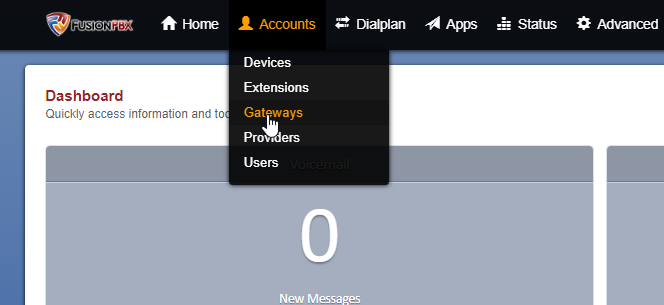
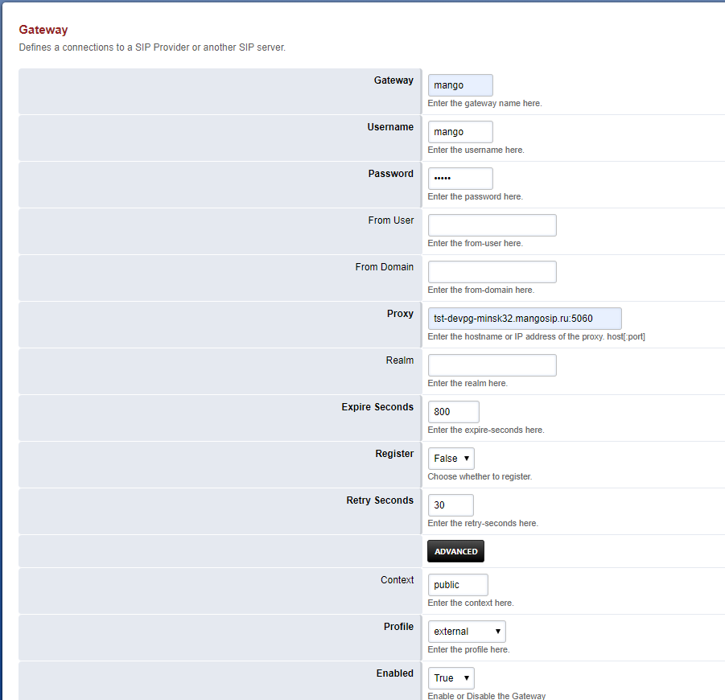
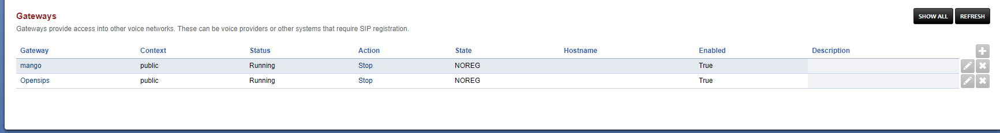

### 5.7.2. Создание SIP trunk для FusionPBX (Freeswitch)

> Трассировка: PDF §5.7.2 · сквозные стр. 560-563 · источники: ч.2 `kb/sources/mango-lk-manual/LK_manual_v-125-281-566.pdf` с.280-283.

Откройте меню администрирования транков во вкладке Gateways раздела

Accounts.

> **Описание иллюстрации LK-§5.7.2-1** (к §5.7.2 «Создание SIP trunk для FusionPBX (Freeswitch)», стр. 561; 664×305 px). Снимок экрана / схема Личного кабинета.
> Относится к тексту руководства: «…Accounts.».
> Текст на изображении (OCR, требует сверки): = Dialplan 4 Apps; == Status; 3 Advanced; Devices; Extensions; Dashboard; Quic; Providers; Users

Для добавления нового транка нажмите пиктограмму “+”.

> **Описание иллюстрации LK-§5.7.2-2** (к §5.7.2 «Создание SIP trunk для FusionPBX (Freeswitch)», стр. 561; 168×168 px). Снимок экрана / схема Личного кабинета.
> Относится к тексту руководства: «…Для добавления нового транка нажмите пиктограмму “+”.».

> **Описание иллюстрации LK-§5.7.2-3** (к §5.7.2 «Создание SIP trunk для FusionPBX (Freeswitch)», стр. 562; 901×870 px). Снимок экрана / схема Личного кабинета.
> Относится к тексту руководства: «…ch)», стр. 561; 168×168 px). Снимок экрана / схема Личного кабинета. > Относится к тексту руководства: «…Для добавления нового транка нажмите пиктограмму “+”.».».
> Текст на изображении (OCR, требует сверки): Gateway; Defines а connections to a SIP Provider or another SIP server.; mango; Enter the gateway name here,; Username; Enter the username here.; Password; Enter the password here; From User; Enter the from-user here.; From Domain; Enter the from-domain here.; {st-devpg-minsk32.mangosip.ru:5060; Enter the hostname or IP address of the proxy. hos!-por!]; Realm; Enter the realm here.; Expire Seconds; 300; Ener the expire-seconds here.; Register; False у; Choose whether to register.; Retry Seconds; 30; Enter the retry-seconds here.; Context; public; Enter the content here,; Profile; extemal; Ente…

В открывшейся форме необходимо заполнить поля:

Gateway – имя транка. В примере используем имя mango.

Username, Password- обязательные поля заполняются любыми значениями

Proxy- SIP сервер провайдера

Register – выставляем false

Context - по умолчанию Public

Profile - по умолчанию External

Enabled - True

Сохраните введенные данные кнопкой Save.

> **Описание иллюстрации LK-§5.7.2-4** (к §5.7.2 «Создание SIP trunk для FusionPBX (Freeswitch)», стр. 563; 1733×231 px). Снимок экрана / схема Личного кабинета.
> Относится к тексту руководства: «…Сохраните введенные данные кнопкой Save.».
> Текст на изображении (OCR, требует сверки): Gateways; Gateways provide access into other voice networks. These can be voice providers or other systems that require SIP registration,; Gateway; Context; Status; Action; State; Hostname; Enabled; Description; ‘mango; public; Running; Stop; NOREG; True; сабы; Opensips; ‘Stop; ва
