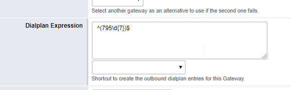
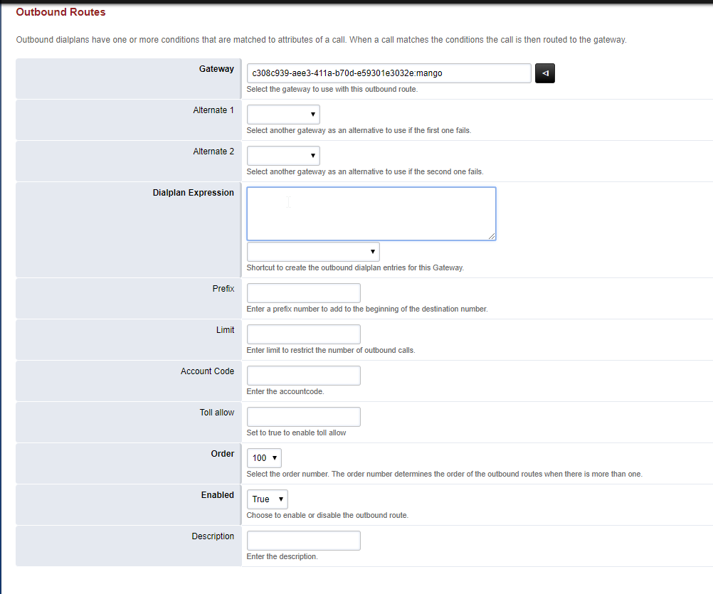

#### 5.7.2.1. Исходящая маршрутизация

> Трассировка: PDF §5.7.2.1 · сквозные стр. 563-565 · источники: ч.2 `kb/sources/mango-lk-manual/LK_manual_v-125-281-566.pdf` с.283-285.

Outbound Routes - Исходящая маршрутизация FusionPBX (Freeswitch).

Для создания правила исходящей маршрутизации выбираем Dialplan-Outbound Routes

Выберете основной gateway для вызовов

Введите шаблон (pattern) набираемого номера, например:

> **Описание иллюстрации LK-§5.7.2.1-1** (к §5.7.2.1 «Исходящая маршрутизация», стр. 563; 580×179 px). Снимок экрана / схема Личного кабинета.
> Относится к тексту руководства: «…Введите шаблон (pattern) набираемого номера, например:».
> Текст на изображении (OCR, требует сверки): Select another gateway аз ап altemative to use if the second one fails.; Dialplan Expression || a-795\g17))5; Shortcut to create the outbound dialplan entries for this Gateway.

Данный шаблон соответствует номерам из 10 цифр начинающимся на 795

> **Описание иллюстрации LK-§5.7.2.1-2** (к §5.7.2.1 «Исходящая маршрутизация», стр. 564; 1002×835 px). Снимок экрана / схема Личного кабинета.
> Относится к тексту руководства: «…Данный шаблон соответствует номерам из 10 цифр начинающимся на 795».
> Текст на изображении (OCR, требует сверки): Outbound Routes; Outbound dialplans have one or more conditions that are matched to attributes of a call. When a call matches the conditions the callis then routed to the gateway.; Gateway | -308c939-aee3-4112-b70d-25930123032e:mango; re); Select the gateway to use with this outbound route; Alternate 1; Select another gateway аз an altemative to use ifthe first one falls.; Alternate 2; Select another gateway as ап allemative to use ifthe second one fails; Dialplan Expression; ‘Shortcut to create the outbound diaiplan entries for his Gateway.; Prefix; Enter a prefix number to add tothe beginnin…
