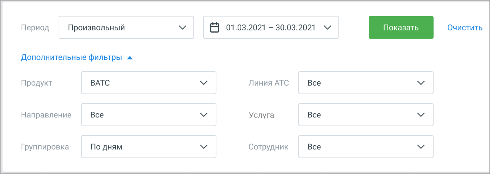
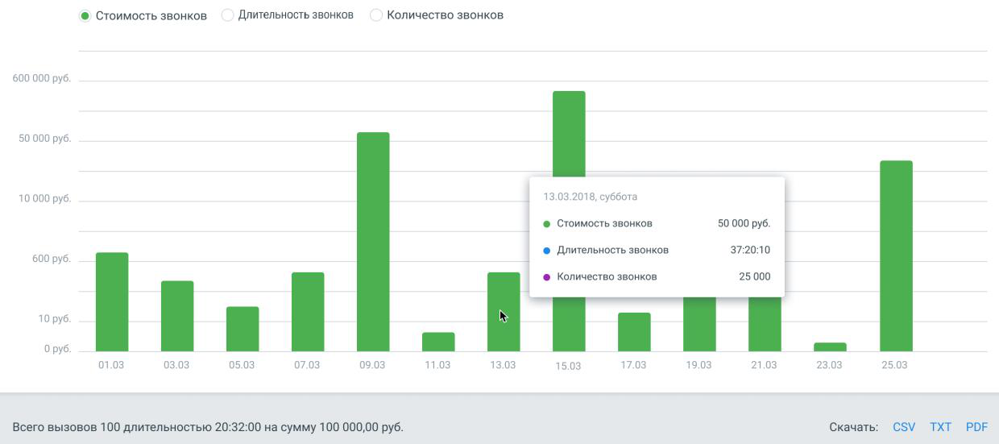

## 2.3. Расходы на связь

> Трассировка: PDF §2.3 · сквозные стр. 31-33 · источники: ч.1 `kb/sources/mango-lk-manual/LK_manual_v-125-1-280.pdf` с.31-33.

Этот раздел поможет составить полную картину расходов на телефонную связь:

 сколько было звонков;

 куда звонили;  каковая общая длительность звонков;  какая сумма потрачена на звонки.

Гибкие настройки позволят выбрать любые необходимые данные для отчета: использование услуг (например, длительность и стоимость разговоров), продукт, период, направления звонков, линии АТС и сотрудники. А также указать желаемый вариант группировки данных.

> **Описание иллюстрации LK-§2.3-1** (к §2.3 «Расходы на связь», стр. 32; 1363×486 px). Снимок экрана / схема Личного кабинета.
> Относится к тексту руководства: «…пример, длительность и стоимость разговоров), продукт, период, направления звонков, линии АТС и сотрудники. А также указать желаемый вариант группировки данных.».
> Текст на изображении (OCR, требует сверки): Период; Произвольный; В 01.03.2021 - 30.03.2021 м; Дополнительные фильтры ^; Продукт; ВАТС; Линия АТС; Все; Направление; Услуга; Группировка; По дням; Сотрудник

внимание

Отчет Расходы на связь отображается в ЛК только если на ВАТС подключена соответствующая услуга.

Варианты фильтрации:

Период – Произвольный, Текущая неделя, Текущий месяц, С прошлого месяца, С позапрошлого месяца, Текущий год, Весь период;

Продукт – все продуктовые наборы ЛК;

Направление – доступные для выбора варианты зависят от значения, выбранного в списке Услуга;

Группировка – По дням, По месяцам, По сотрудникам, По линиям, По услугам;

Линия АТС – список всех доступных активных линий на выбранном продукте ВАТС.

Услуга – Все услуги, Входящие на 8-800, Конференции, SIP, Сторонние SIP (SIP UAC), Сторонние SIP (SIP транки), SMS, Исходящий обзвон, Переадресация, Исходящие, Остальное;

Сотрудник – список всех доступных сотрудников на выбранном продукте ВАТС.

Рассмотрим пример выборки данных для составления отчетов.

Пример 1.

Узнать, сколько было звонков за март 2018г. на ВАТС №1, какова их общая длительность и стоимость, с группировкой по дням.

Выберите вкладку «Расходы на связь», а в списке «Период» — вариант «01.03.2018 – 31.03.2018». Поле «Группировка» - вариант «по дням». Поле «Продукт» - «ВАТС №1». Поля «Направления», «Линия АТС», «Услуги» и «Сотрудники» – вариант «Все».

Нажмите кнопку «Показать». На гистограмме отобразятся данные длительности и стоимости вызовов, разделеные на разряды, c разбивкой по дням (как на рисунке ниже).

> **Описание иллюстрации LK-§2.3-2** (к §2.3 «Расходы на связь», стр. 33; 1240×551 px). Снимок экрана / схема Личного кабинета.
> Относится к тексту руководства: «…Нажмите кнопку «Показать». На гистограмме отобразятся данные длительности и стоимости вызовов, разделеные на разряды, c разбивкой по дням (как на рисунке ниже).».
> Текст на изображении (OCR, требует сверки): ® Стоимость звонков.; Длительность звонков; Количество звонков.; 600 000 руб.; 50 000 руб.; 13.03.2018, суббота.; 10000 руб.; © Стоимость звонков; ® Длительность звонков.; 37:20:10; 600 руб.; ® Количество звонков; 25000; 10 руб.; О руб; ИИ; 01.03; 03.03; 05.03; 07.03; 09.03; 11.03; 13.03; 15.03; 17.03; 19.03; 21.03; 23.03; 25.03; Всего вызовов 100 длительностью 20:32:00 на сумму 100 000,00 руб.; Скачать: CSV TXT PDF

Аналогичные данные содержатся и в табличном виде.

Можно сохранить полученный отчет, кликнув по значку нужного формата файла (появится стандартное диалоговое окно браузера, позволяющее открыть или сохранить файл).
