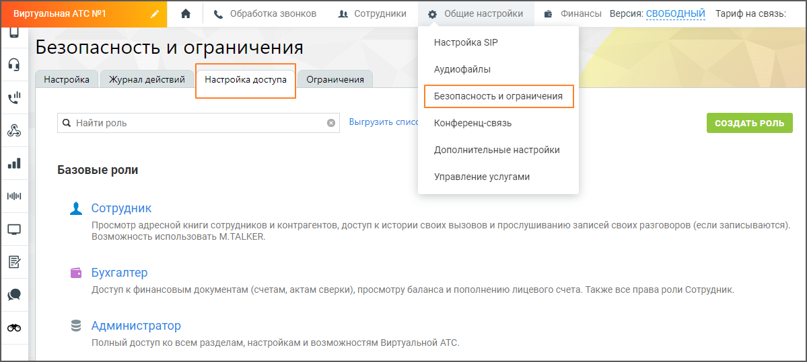

# 6. Роли и права доступа ЛК ВАТС

> Трассировка: PDF §6 · сквозные стр. 566 · источники: ч.2 `kb/sources/mango-lk-manual/LK_manual_v-125-281-566.pdf` с.286.

Пользователь ВАТС может настроить права доступа для сотрудников в зависимости от их ролей. Для настройки следует последовательно пройти в разделы Общие настройки → Безопасность и ограничения → Настройка доступа.

На продукте преднастроены:

 базовые роли - Сотрудник, Бухгалтер, Администратор, Руководитель

группы.  дополнительные роли – Старший сотрудник, Маркетолог, Руководитель

компании.

Пользовательские роли можно добавить самостоятельно, нажав на кнопку «Создать роль».

Клик по наименованию роли открывает ее для изменения прав доступа.

> **Описание иллюстрации LK-§6-1** (к §6 «Роли и права доступа ЛК ВАТС», стр. 566; 1199×539 px). Снимок экрана / схема Личного кабинета.
> Относится к тексту руководства: «…Клик по наименованию роли открывает ее для изменения прав доступа.».
> Текст на изображении (OCR, требует сверки): Виртуальная АТС №1; & Обработка звонков; зи Сотрудники; @ Общие настройки; & Финансы Версия: С; Тариф на связь:; Настройка SIP; Безопасность и ограничения; Аудиофайлы; Настройка; Журнал действий; Настройка доступа; ' Ограничения; ul; Q Найти роль; Выгрузить спи; Конференц-связь; Дополнительные настройки; Базовые роли; Управление услугами; от; A сотрудник; Просмотр адресной книги сотрудников и контрагентов, доступ к истории своих вызовов и прослушиванию записей своих разговоров (если записываются); возможность использовать M. TALKER.; Бухгалтер; Доступ к финансовым документам (счетам, актам све…

По ссылке приведено сводное описание параметров доступности, разрешений (прав) и функциональных возможностей Личного кабинета ВАТС MANGO OFFICE в зависимости от выбранной преднастроенной роли Роли и права доступа ВАТС MANGO OFFICE.
