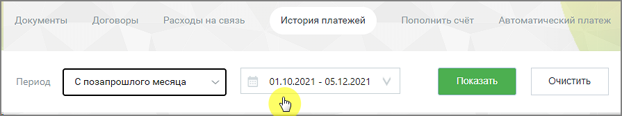
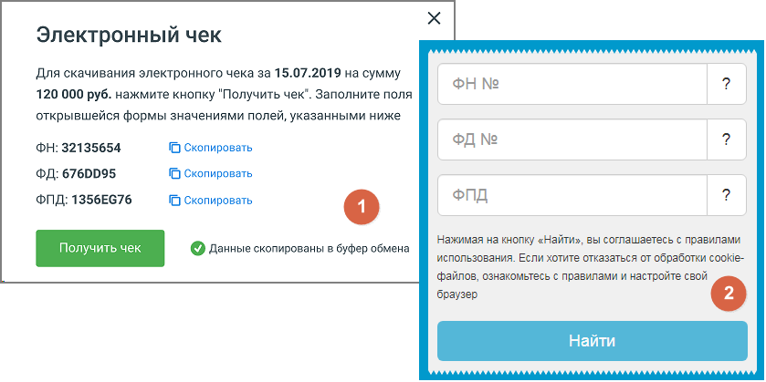

## 2.4. История платежей

> Трассировка: PDF §2.4 · сквозные стр. 33-35 · источники: ч.1 `kb/sources/mango-lk-manual/LK_manual_v-125-1-280.pdf` с.33-35.

Список «Период» позволяет установить вариант выбора дат (по умолчанию предлагается период «Произвольный»), нажав значок календаря, или ввести их в формате дд.мм.гггг в соответствующие поля. Кнопка «Очистить» возвращает к значению по умолчанию.

> **Описание иллюстрации LK-§2.4-1** (к §2.4 «История платежей», стр. 33; 895×168 px). Снимок экрана / схема Личного кабинета.
> Относится к тексту руководства: «…период «Произвольный»), нажав значок календаря, или ввести их в формате дд.мм.гггг в соответствующие поля. Кнопка «Очистить» возвращает к значению по умолчанию.».
> Текст на изображении (OCR, требует сверки): Документы; Договоры; Расходы на связь; История платежей; Пополнить счёт; Автоматический платеж; 01.10.2021 - 05.12.2021; Очистить

Нажмите кнопку «Показать», и появится отчет о платежах, осуществленных в течение указанного периода.

При наведении на строку, соответствующую конкретному платежу, отображется кнопка- ссылка "Электронный чек".

> **Описание иллюстрации LK-§2.4-2** (к §2.4 «История платежей», стр. 34; 839×419 px). Снимок экрана / схема Личного кабинета.
> Относится к тексту руководства: «…При наведении на строку, соответствующую конкретному платежу, отображется кнопка- ссылка "Электронный чек".».
> Текст на изображении (OCR, требует сверки): Электронный чек; Для скачивания электронного чека за 15.07.2019 на сумму; 120 000 руб. нажмите кнопку "Получить чек". Заполните поля; открывшейся формы значениями полей, указанными ниже; ФН: 32135654; (С Скопировать; ФД: 6760095; (С) Скопировать; ФПД; ФПД: 1356Еб 76; Нажимая на кнопку «Найти», вы соглашаетесь с правилами; использования. Если хотите отказаться от обработки cookie-; © диные скопированы в буфер ofan; файлов, ознакомьтесь с правилами и настройте свой; браузер

Нажатие на кнопку открывает форму 1 – Электронный чек, с данными ФН, ФД и ФПД.

Нажатие на кнопку Получить чек открывает форму 2 в новой странице браузера. Скопируйте одноименные данные из формы-1 в форму-2 и нажмите Найти. Сохраните полученный электронный чек.
