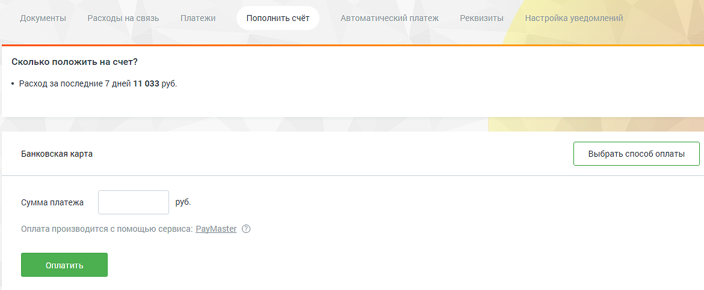
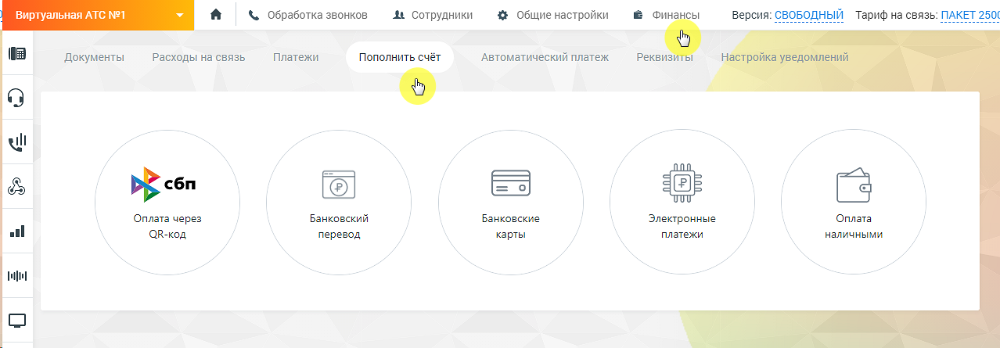

## 2.5. Пополнить счет

> Трассировка: PDF §2.5 · сквозные стр. 35 · источники: ч.1 `kb/sources/mango-lk-manual/LK_manual_v-125-1-280.pdf` с.35.

На вкладке Пополнить счет расположена форма для быстрого зачисления средств через платежную систему PayMaster. Укажите сумму платежа, нажмите кнопку Оплатить и действуйте согласно инструкции в открывшейся форме PayMaster.

> **Описание иллюстрации LK-§2.5-1** (к §2.5 «Пополнить счет», стр. 35; 1170×483 px). Снимок экрана / схема Личного кабинета.
> Относится к тексту руководства: «…сления средств через платежную систему PayMaster. Укажите сумму платежа, нажмите кнопку Оплатить и действуйте согласно инструкции в открывшейся форме PayMaster.».
> Текст на изображении (OCR, требует сверки): Документы; Расходы на связь; Платежи:; Пополнить счёт; ‘Автоматический платеж; Реквизиты; Сколько положить на счет?; + Расход за последние 7 дней 11 033 руб.; a sy; Банковская карта; ‘Сумма платежа; руб.; ‘Оплата производится с помощью сервис:; : PayMaster @

Также пополнять счет можно иными способами. Выберите наиболее удобный для вас.

> **Описание иллюстрации LK-§2.5-2** (к §2.5 «Пополнить счет», стр. 35; 1278×445 px). Снимок экрана / схема Личного кабинета.
> Относится к тексту руководства: «…Также пополнять счет можно иными способами. Выберите наиболее удобный для вас.».
> Текст на изображении (OCR, требует сверки): Виртуальная АТС №1; &. Обработка звонков; At сотрудники; 3+ Общие настройки; 1 Финансы; Версия; Тариф на связь: Г.; Документы; Расходы на связь; Платежи; Пополнить счёт; ‘Автоматический платеж; Pexsusi; wl; bE c6n; Оплата через; Банковский; Банковские; Электронные; Оплата; al; ОВ-код; перевод; карты; наличными

Для того, чтобы вам было легче ориентироваться в своих расходах, на каждой странице с выбранным способом оплаты размещен информационный блок "Сколько положить на счет?". Он содержит информацию о расходах за последние 7 и 30 календарных дней соответственно.

Для новых клиентов блок "Сколько положить на счет" отображается только на 9-ый день использования продукта. Начиная с 32-го дня выводятся две строки о расходах.
