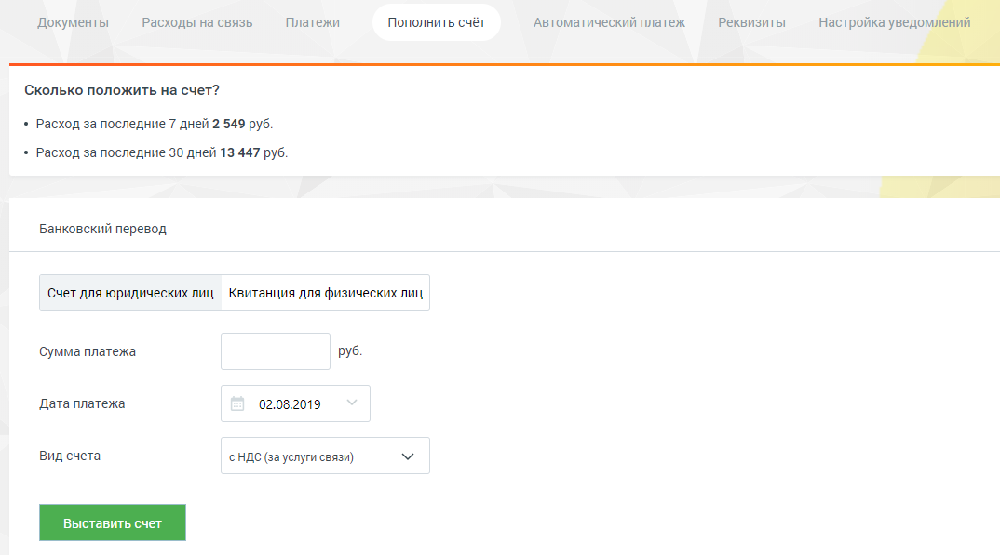

#### 2.5.1.1. Для юридических лиц

> Трассировка: PDF §2.5.1.1 · сквозные стр. 36 · источники: ч.1 `kb/sources/mango-lk-manual/LK_manual_v-125-1-280.pdf` с.36.

Для оплаты услуг «Манго Телеком» юридическими лицами с использованием банковских переводов (ИНН/КПП, банковские реквизиты) выберите вкладку «Счет для юридических лиц».

> **Описание иллюстрации LK-§2.5.1.1-1** (к §2.5.1.1 «Для юридических лиц», стр. 36; 1074×597 px). Снимок экрана / схема Личного кабинета.
> Относится к тексту руководства: «…аты услуг «Манго Телеком» юридическими лицами с использованием банковских переводов (ИНН/КПП, банковские реквизиты) выберите вкладку «Счет для юридических лиц».».
> Текст на изображении (OCR, требует сверки): Документы; Расходы на связь; Платежи; Пополнить счёт; ‘Автоматический платеж; Реквизиты; настройка уведомлений; Сколько положить на счет?; + Расход за последние 7 дней 2 549 руб.; + Расход за последние 30 дней 13 447 руб.; Банковский перевод; Счет для юридических лиц Квитанция для физических лиц; Сумма платежа; руб.; Дата платежа; 02.08.2019; Вид счета; ‘HAC (за услуги связи)

Заполните нужные поля и нажмите кнопку Выставить счет. В результате откроется готовый к печати документ «Счет» в формате PDF. Реквизиты документа заполняются автоматически на основании данных, указанных на вкладке «Реквизиты».
