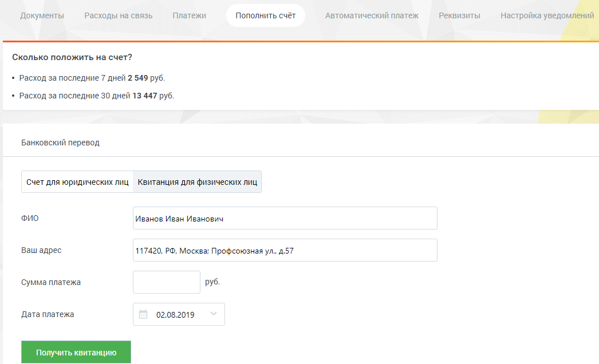

#### 2.5.1.2. Физическим лицам

> Трассировка: PDF §2.5.1.2 · сквозные стр. 36-37 · источники: ч.1 `kb/sources/mango-lk-manual/LK_manual_v-125-1-280.pdf` с.36-37.

Перейдите на вкладку «Квитанция для физических лиц». Укажите ФИО, адрес, сумму платежа в соответствующих полях. Введите дату платежа, нажав значок календаря, или в формате дд.мм.гггг.

> **Описание иллюстрации LK-§2.5.1.2-1** (к §2.5.1.2 «Физическим лицам», стр. 37; 1046×636 px). Снимок экрана / схема Личного кабинета.
> Относится к тексту руководства: «…витанция для физических лиц». Укажите ФИО, адрес, сумму платежа в соответствующих полях. Введите дату платежа, нажав значок календаря, или в формате дд.мм.гггг.».
> Текст на изображении (OCR, требует сверки): Документы; Расходы на связь; Платежи; Пополнить счёт; ‘Автоматический платеж; Реквизиты; настройка уведомлений; Сколько положить на счет?; + Расход за последние 7 дней 2 549 руб.; + Расход за последние 30 дней 13 447 руб.; Банковский перевод; Счет для юридических лиц Квитанция для физических лиц; ФИО; Иванов Иван Иванович; Ваш адрес; 117420, РФ, Москва: Профсоюзная ул. д.57; Сумма платежа; руб.; Дата платежа; 02.08.2019

Нажмите кнопку Получить квитанцию. В зависимости от настроек браузера на новой странице или вкладке откроется готовая к печати квитанция. Проверьте правильность внесенных данных. Нажмите «Распечатать» (при необходимости используйте полосу прокрутки). Откроется стандартное диалоговое окно, позволяющее выбрать параметры печати.
