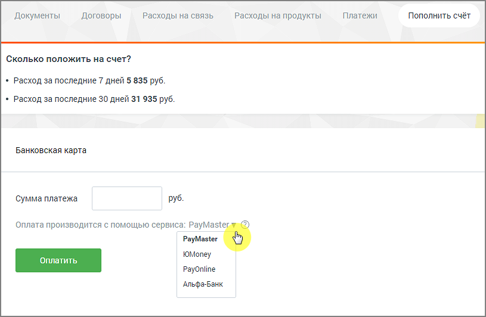

### 2.5.2. Банковские карты

> Трассировка: PDF §2.5.2 · сквозные стр. 37-38 · источники: ч.1 `kb/sources/mango-lk-manual/LK_manual_v-125-1-280.pdf` с.37-38.

Пополнение счета с помощью банковских карт возможно через системы:

 Paymaster;

 PayOnline;

 ЮMoney;

 Альфа-Банк.

> **Описание иллюстрации LK-§2.5.2-1** (к §2.5.2 «Банковские карты», стр. 38; 815×532 px). Снимок экрана / схема Личного кабинета.
> Относится к тексту руководства: «… Альфа-Банк.».
> Текст на изображении (OCR, требует сверки): Платежи; Пополнить счёт; Документы; Договоры; Расходы на связь; Расходы на продукты; Сколько положить на счет?; * Расход за последние 7 дней 5 835 руб.; * Расход за последние 30 дней 31 935 руб.; Банковская карта; Сумма платежа; руб.; Оплата производится с помощью сервиса: PayMaste; PayMaster; ЮМопеу; PayOnline; Альфа-Банк

Введите цифрами сумму платежа в одноименное поле. Выберите сервис, при помощи которого будет произведена оплата. Нажмите Оплатить. В результате будет открыта новая вкладка браузера на странице выбранного сервиса.
