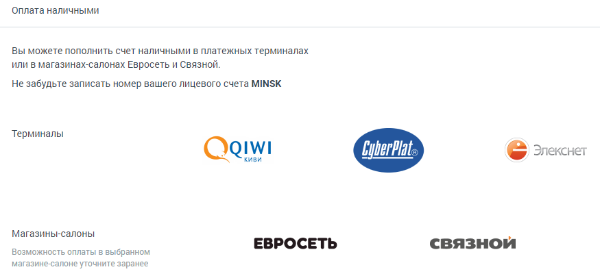

### 2.5.4. Оплата наличными

> Трассировка: PDF §2.5.4 · сквозные стр. 39-41 · источники: ч.1 `kb/sources/mango-lk-manual/LK_manual_v-125-1-280.pdf` с.39-41.

Пополнение счета возможно при помощи наличных денежных средств через платежные терминалы и в магазинах-салонах «Евросеть» и «Связной».

> **Описание иллюстрации LK-§2.5.4-1** (к §2.5.4 «Оплата наличными», стр. 40; 875×403 px). Снимок экрана / схема Личного кабинета.
> Относится к тексту руководства: «…Пополнение счета возможно при помощи наличных денежных средств через платежные терминалы и в магазинах-салонах «Евросеть» и «Связной».».
> Текст на изображении (OCR, требует сверки): Оплата наличными; Вы можете пополнить счет наличными в платежных терминалах; или в магазинах-салонах Евросеть и Связной.; Не забудьте записать номер вашего лицевого счета MINSK; Терминалы; IWI; CyberPlat; е Элекснет; QQ; Киви; Магазины-салоны; ЕВРОСЕТЬ; связной; Возможность оплаты в выбранном; магазине-салоне уточните заранее

Если у вас остались вопросы по внесению платежей, то рекомендуем посетить официальные сайты платежных систем:

 Paymaster – www.paymaster.ru  PayOnline – www.payonline.ru  ЮMoney— www.yoomoney.ru  QIWI – www.qiwi.com
