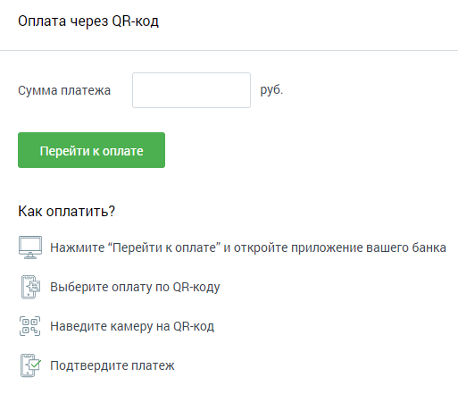

### 2.5.5. Оплата через QR-код

> Трассировка: PDF §2.5.5 · сквозные стр. 41 · источники: ч.1 `kb/sources/mango-lk-manual/LK_manual_v-125-1-280.pdf` с.41.

> **Описание иллюстрации LK-§2.5.5-1** (к §2.5.5 «Оплата через QR-код», стр. 41; 513×441 px). Снимок экрана / схема Личного кабинета.
> Относится к тексту руководства: «…начало раздела».
> Текст на изображении (OCR, требует сверки): Оплата через ОВ-код; Сумма платежа; руб.; Как оплатить?; Нажмите “Перейти к оплате" и откройте приложение вашего банка; Выберите оплату по ОВ-коду; ‘oo; oy; Наведите камеру Ha ОВ-код; | Подтвердите платеж

Пополнение счета через QR-код производится с помощью сервиса PayMaster, без взимания комиссии.

Введите цифрами сумму платежа в одноименное поле. Нажмите кнопку «Перейти к оплате». В результате в новой вкладке браузера откроется страница с QR-кодом.

Откройте на смартфоне мобильное приложение вашего банка. Далее действуйте по приведенной выше инструкции.
