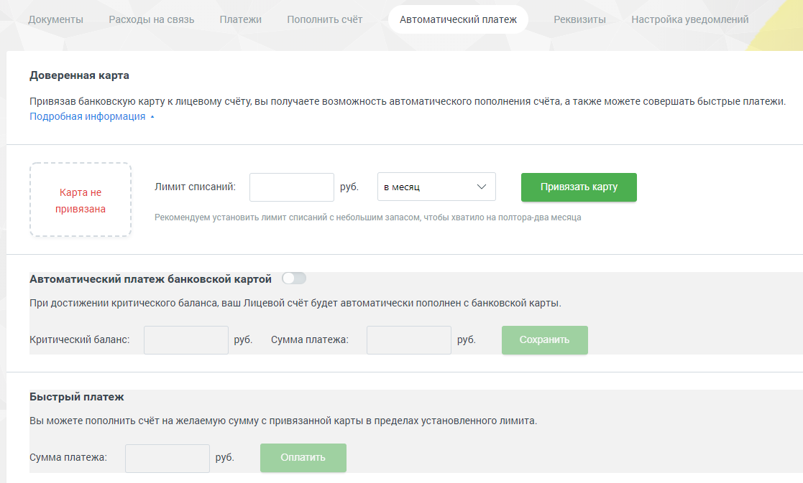

## 2.6. Автоматический платеж

> Трассировка: PDF §2.6 · сквозные стр. 41-43 · источники: ч.1 `kb/sources/mango-lk-manual/LK_manual_v-125-1-280.pdf` с.41-43.

Внимание

Раздел доступен только для пользователей с ролью «Администратор лицевого счета».

Привязка банковской карты позволит настроить автоматическое пополнение платежа в соответствии с указанным лимитом, или совершить быстрый платеж.

Внимание

Сервисы по оплате и подтверждению доверенности на совершение автоматических платежей предоставляются системой электронных платежей компании PayMaster. Компания «Манго-Офис» (www.mango-office.ru) не получает персональные и банковские данные клиента.

Доверенная карта

Для привязки банковской карты установите лимит, минимально допустимое значение – 100 рублей. Затем выберите период и нажмите кнопку Привязать карту. В результате будет выполнена переадресация на соответствующую страницу сайта компании PayMaster для указания необходимых данных.

После того, как вы указали все данные, осуществляется возврат на страницу Личного кабинета с указанием полученной информации.

> **Описание иллюстрации LK-§2.6-1** (к §2.6 «Автоматический платеж», стр. 42; 1117×673 px). Снимок экрана / схема Личного кабинета.
> Относится к тексту руководства: «…После того, как вы указали все данные, осуществляется возврат на страницу Личного кабинета с указанием полученной информации.».
> Текст на изображении (OCR, требует сверки): Документы; Расходы на связь; Платежи; Пополнить счёт; ‘Автоматический платеж; Реквизиты; настройка уведомлений; Доверенная карта; Привязав банковскую карту к лицевому счёту, вы получаете возможность автоматического пополнения счёта, а также можете совершать быстрые платежи.; Подробная информация +; Лимит списаний:; Карта не; руб.; в месяц; Привязать; привязана; Рекомендуем установить лимит списаний с небольшим запасом, чтобы хватило на полтора-два месяца; Автоматический платеж банковской картой; При достижении критического баланса, ваш Лицевой счёт будет автоматически пополнен с банковской кар…

В строке «Лимит обновится» указывается дата и время перехода в новый лимитный период.

Чтобы отвязать банковскую карту, нажмите кнопку «Отвязать карту». Карта будет отвязана после нажатия кнопки без дополнительных предупреждений.

Автоматический платеж банковской картой

Данная настройка позволяет указать величину критического баланса, при достижении которого будет автоматически внесен платеж в указанном размере в рамках лимита списаний.

Для включения функции установите переключатель в положение «Сервис включен». Укажите критический баланс и размер платежа. Сохраните указанные данные.

Внимание

Запрещено указывать сумму платежа, превышающую лимит списаний.

Если в момент достижения критического баланса сумма автоматического платежа превысит сумму доступных средств, то платеж не будет выполнен. Для своевременного информирования о достижении критического баланса рекомендуем настроить соответствующие уведомления.

Быстрый платеж

Данная функция позволяет самостоятельно внести платеж на произвольную сумму в рамках доступного лимита средств без необходимости ввода данных банковской карты.

Укажите сумму платежа. Минимальная сумма – 100 рублей. Нажмите кнопку Сохранить.

Внимание

Если сумма платежа превысит остаток доступных средств, то платеж не будет совершен. Вам будет предложено выполнить обычный платеж со вводом всех данных банковской карты на сайте компании PayMaster.
