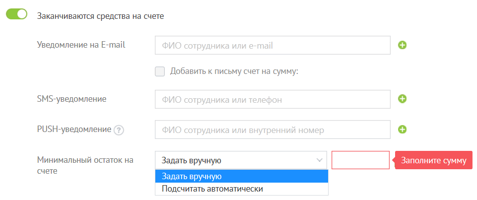
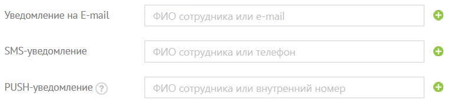

## 2.8. Настройка уведомлений

> Трассировка: PDF §2.8 · сквозные стр. 44-46 · источники: ч.1 `kb/sources/mango-lk-manual/LK_manual_v-125-1-280.pdf` с.44-46.

Уведомления о событиях можно получать по электронной почте, в виде SMS-сообщений и PUSH-уведомлений.

Блок «Заканчиваются средства на счете»

внимание

Рекомендуем настроить уведомление по SMS о критическом остатке на счете. Уведомление о критическом остатке отсылается не чаще одного раза в пять дней.

> **Описание иллюстрации LK-§2.8-1** (к §2.8 «Настройка уведомлений», стр. 44; 961×403 px). Снимок экрана / схема Личного кабинета.
> Относится к тексту руководства: «…Рекомендуем настроить уведомление по SMS о критическом остатке на счете. Уведомление о критическом остатке отсылается не чаще одного раза в пять дней.».
> Текст на изображении (OCR, требует сверки): @® заканчиваются средства на счете; Уведомление на E-mail; Добавить к письму счет на сумму:; SMS-yeenomnenne; РИЗН-уведомление; Минимальный остаток на; Задать вручную; счете; Подсчитать автоматически

Для уведомления о критическом остатке на Лицевом счете выберите из списка нужное значение параметра «Минимальный остаток на счете»:

 задать вручную — критический остаток указывается в соответствующем поле (при выборе этого пункта в поле для ввода суммы по умолчанию подставляется 100 рублей)  подсчитать автоматически — расчет производится на основании информации об использовании услуг «Манго Телеком» по этому Лицевому счету за последнюю неделю (поле для ввода суммы остается неактивным);

Вы можете отметить пункт «Добавить к письму счет на оплату» и ввести сумму (по умолчанию подставляется — 1100 рублей). В этом случае в письме с уведомлением будет содержаться и счет на оплату.

Блоки «Блокировка и разблокировка услуг» и «Зачисление средств на счет»

Отметьте пункты для типов уведомлений, которые хотите получать, проставив галочки в соответствующие поля.

> **Описание иллюстрации LK-§2.8-2** (к §2.8 «Настройка уведомлений», стр. 45; 765×176 px). Снимок экрана / схема Личного кабинета.
> Относится к тексту руководства: «…Отметьте пункты для типов уведомлений, которые хотите получать, проставив галочки в соответствующие поля.».
> Текст на изображении (OCR, требует сверки): Уведомление на E-mail; ФИО сотрудника или e-mail; $М5-уведомление; ФИО сотрудника или телефон; РИ5Н-уведомление (?); ФИО сотрудника или внутренний номер

совет

SMS-сообщения отправляются только на номера российских операторов сотовой связи, записанные в формате +79ххххххххх. Можно указывать несколько адресов электронной почты, разделяя их запятыми. Последние введенные данные автоматически подставляются в аналогичное пустое поле при переходе на него.

Для пользователей с правами «Администратор ВАТС» и «Администратор Лицевого счета» отображается блок «Подписка на бизнес-рецепты».

Используя этот блок, вы можете подписаться на еженедельную рассылку бизнес- рецептов в виде интересных статей и практических советов по настройке и использованию Виртуальной АТС и других продуктов «Манго Телеком». Введите адрес в соответствующее поле и нажмите «Подписаться». На указанный почтовый ящик придет письмо со ссылкой. Перейдите по ней для активации подписки.

Если тумблер блока включен, но при этом не указан ни один адрес для отправки, кнопка Сохранить недоступна для нажатия.

Кнопка Отменить возвращает данные к последнему сохраненному состоянию.
