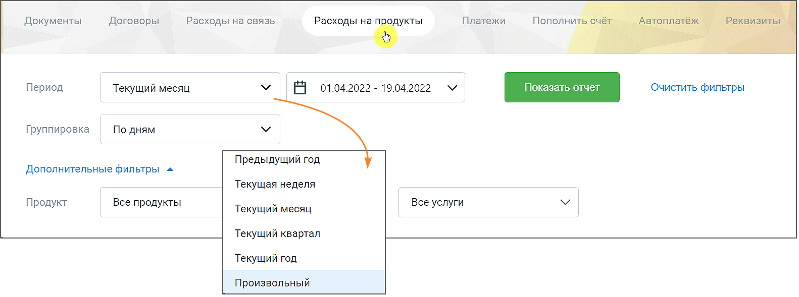
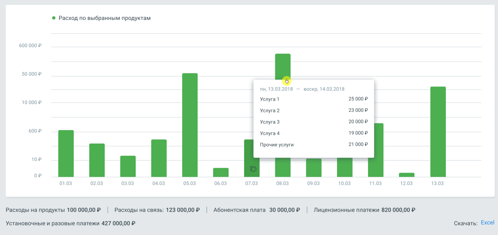
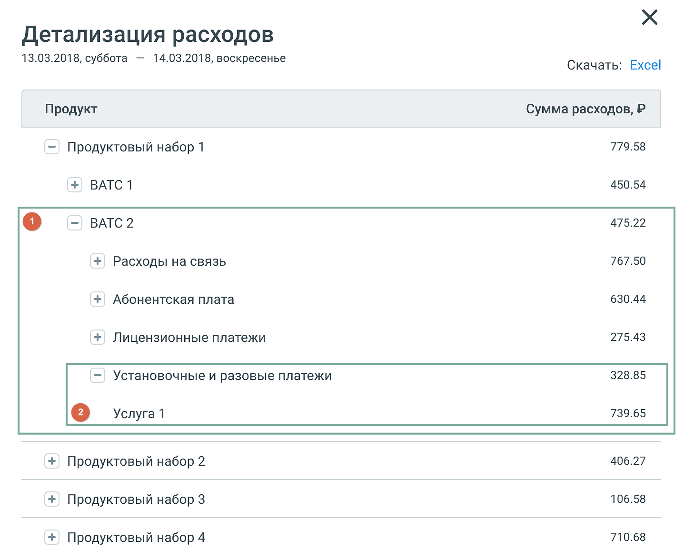
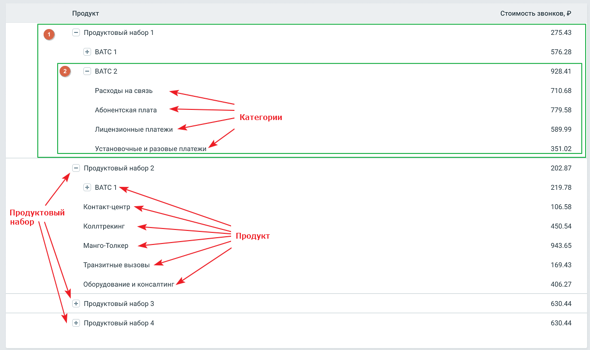

## 2.9. Расходы на продукт

> Трассировка: PDF §2.9 · сквозные стр. 46-50 · источники: ч.1 `kb/sources/mango-lk-manual/LK_manual_v-125-1-280.pdf` с.46-50.

Отчет Расходы на продукт позволяет просмотреть детализацию раходов по выбранному продукту за интересующий период времени.

внимание

Отчет Расходы на продукты отображается в ЛК только если на ВАТС подключена соответствующая услуга.

Отчет состоит из трех элементов:

1) Блок фильтров 2) Гистограмма 3) Таблица детализации

Блок фильтров

> **Описание иллюстрации LK-§2.9-1** (к §2.9 «Расходы на продукт», стр. 46; 1582×589 px). Снимок экрана / схема Личного кабинета.
> Относится к тексту руководства: «…Блок фильтров».
> Подпись в руководстве: «Рис. 2.9.1 Блок фильтров».
> Текст на изображении (OCR, требует сверки): Платежи; Пополни; Документы; Договоры; Расходы на связь; Расходы на a”; Период; Текущий месяц; Е 01.04.2022 - 19.04.2022; Очистить фильтры; Группировка; По дням; Предыдущий год; Дополнительные фильтры ^; Текущая неделя; Продукт; Все продукты; Все услуги; Текущий квартал; Текущий год; Произвольный

Рис. 2.9.1 Блок фильтров

В блоке доступны для выбора следующие фильтры:

Период – период данных, отображаемых в отчете:

 быстрый выбор из выпадающего списка:

 предыдущий год – с первого по последнее число предыдущего года  текущая неделя – с понедельника текущей недели по настоящее время;  текущий месяц – с первого числа текущего месяца по настоящее время;  текущий квартал – с первого числа текущего квартала по настоящее

время;  текущий год – с первого числа текущего год по настоящее время;  произвольный период;

внимание

Дату начала отчётного периода нельзя задать ранее, чем дата создания лицевого счёта

Группировка – группировка данных в отчете по дням, по месяцам;

Продукт - список всех продуктов Личного кабинета пользователя, расходы по которым больше нуля;

Услуга - Список всех услуг для выбранных продуктов Личного кабинета пользователя, расходы по которым больше нуля.

Нажатие на кнопку Показать формирует гистограмму и таблицу детализации.

Нажатие на кнопку Очистить сбрасывает настройки фильтров.

Гистограмма

> **Описание иллюстрации LK-§2.9-2** (к §2.9 «Расходы на продукт», стр. 47; 1299×614 px). Снимок экрана / схема Личного кабинета.
> Относится к тексту руководства: «…Гистограмма».
> Текст на изображении (OCR, требует сверки): © Расход по выбранным продуктам; 600 000 P; 500002; пн, 13.03.2018 — воскр, 14.03.2018; 250002; 100002; Услуга 1; Услуга?; 230002; Услуга 3; 200002; 6002; 190002.; Услуга 4; Прочие услуги; 210002; 10Р; op; treat.; на; 01.03; 02.03; 03.03; 04.03; 05.03; 06.03; 07.03; 08.03; 09.03; 10.03; 11.03; 12.03; 13.03; Расходы на продукты 100 000,00 | Расходы на связь: 123000002 | Абонентская плата 30000,00P | Лицензионные платежи 820 000,00 2; Установочные и разовые платежи 427 000,00 P; Скачать: Excel

Гистограмма содержит:

 по оси X - значения фильтра "Группировка";  по оси Y - сумму расходов в рублях.

При наведении курсора мыши на столбец гистограммы отображается всплывающее окно с описанием периода, списком оказанных услуг и суммой расходов.

Двойной клик на столбец гистограммы открывает окно с детализацией расходов.

> **Описание иллюстрации LK-§2.9-3** (к §2.9 «Расходы на продукт», стр. 47; 32×32 px). Пиктограмма (значок элемента интерфейса).
> Относится к тексту руководства: «…Двойной клик на столбец гистограммы открывает окно с детализацией расходов.».
> Текста на изображении нет; назначение значка — см. текст, к которому он относится.

Клик по пиктограмме разворачивает вложенные элементы отчета, по пиктограмме

> **Описание иллюстрации LK-§2.9-4** (к §2.9 «Расходы на продукт», стр. 47; 32×32 px). Пиктограмма (значок элемента интерфейса).
> Относится к тексту руководства: «…Клик по пиктограмме разворачивает вложенные элементы отчета, по пиктограмме».
> Текста на изображении нет; назначение значка — см. текст, к которому он относится.

- сворачивает.

> **Описание иллюстрации LK-§2.9-5** (к §2.9 «Расходы на продукт», стр. 48; 1437×1176 px). Снимок экрана / схема Личного кабинета.
> Относится к тексту руководства: «…- сворачивает.».
> Подпись в руководстве: «Рис.2.9.2 Блоки 1 и 2 являются вложенными элементами отчета.».
> Текст на изображении (OCR, требует сверки): Детализация расходов; 13.03.2018, суббота — 14.03.2018, воскресенье; Скачать: Excel; Продукт; Сумма расходов, P; —' Продуктовый набор 1; 779.58; + BATC1; 450.54; 475.22; ВАТС 2; + Расходы на связь; 767.50; + Абонентская плата; 630.44; + Лицензионные платежи; 275.43; 328.85; = Установочные и разовые платежи; 739.65; Yenyra 1; 406.27; + Продуктовый набор 2; + Продуктовый набор 3; 106.58; + Продуктовый набор 4; 710.68

Рис.2.9.2 Блоки 1 и 2 являются вложенными элементами отчета.

Под блоком гистограммы содержится следующая информация:

 Расходы на продукты – сумма всех расходов по выбранным продуктам за выбранный период;  Расходы на связь - сумма расходов на связь за выбранный период;  Абонентская плата - сумма расходов на абонентскую плату за выбранный период;  Лицензионные платежи - сумма расходов по лицензионным платежам выбранный период;  Установочные и разовые платежи - сумма расходов по установочным и разовым платежам за выбранный период;  Прочие услуги - сумма расходов по прочим услугам на ВАТС за выбранный период.

Клик на кнопку "Excel" открывает стандартное окно экспорта таблицы детализации в формате CSV (Excel).

Таблица детализации

Таблица содержит детализацию расходов по каждому продуктовому набору ВАТС.

Категории "Расходы на связь", "Абонентская плата", "Лицензионные платежи", "Установочные и разовые платежи" и "Прочие услуги" - представлены для каждого продукта ВАТС.

> **Описание иллюстрации LK-§2.9-6** (к §2.9 «Расходы на продукт», стр. 49; 1218×723 px). Снимок экрана / схема Личного кабинета.
> Относится к тексту руководства: «…ии "Расходы на связь", "Абонентская плата", "Лицензионные платежи", "Установочные и разовые платежи" и "Прочие услуги" - представлены для каждого продукта ВАТС.».
> Подпись в руководстве: «Рис. 2.9.3 Блоки 1 и 2 являются вложенными элементами таблицы детализации.».
> Текст на изображении (OCR, требует сверки): Стоимость звонков, P; Продукт; 275.43; =) Продуктовый набор 1; +) BATC1; 576.28; Ме; 928.41; Расходы на связь.; 710.68; Абонентская плата; 779.58; Лицензионные платежи; .— Категории; 589.99; Установочные и разовые платежи; 351.02; =) Продуктовый набор 2; 202.87; 219.78; Контакт-центр; 106.58; Продуктовый; Коллтрекинг; 450.54; Манго-Толкер; ри — Продукт; 943.65; Sa; 169.43; Транзитные вызовы; 406.27; Оборудование и консалтинг; 630.44; +) Продуктовый набор 3; +) Продуктовый набор 4

Рис. 2.9.3 Блоки 1 и 2 являются вложенными элементами таблицы детализации.

Таблица содержит детализацию данных, отсортированную согласно иерархии. Клик по

> **Описание иллюстрации LK-§2.9-7** (к §2.9 «Расходы на продукт», стр. 49; 32×32 px). Пиктограмма (значок элемента интерфейса).
> Относится к тексту руководства: «…Таблица содержит детализацию данных, отсортированную согласно иерархии. Клик по».
> Текста на изображении нет; назначение значка — см. текст, к которому он относится.

> **Описание иллюстрации LK-§2.9-8** (к §2.9 «Расходы на продукт», стр. 49; 32×32 px). Пиктограмма (значок элемента интерфейса).
> Относится к тексту руководства: «…а содержит детализацию данных, отсортированную согласно иерархии. Клик по». > Текста на изображении нет; назначение значка — см. текст, к которому он относится.».
> Текста на изображении нет; назначение значка — см. текст, к которому он относится.

пиктограмме разворачивает вложенные элементы таблицы, по пиктограмме - сворачивает.

Двойной клик на на продукт или категорию открывает окно с детализацией расходов, аналогичное всплывающему окну в блоке гистограммы.
