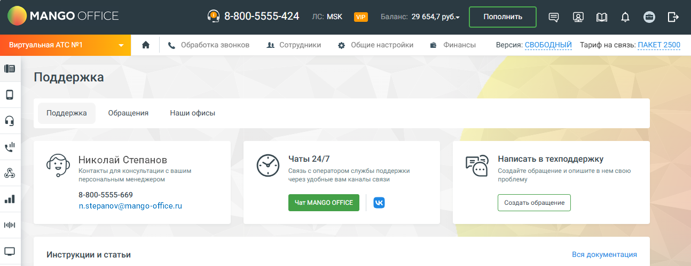

## 3.1. Вкладка «поддержка»

> Трассировка: PDF §3.1 · сквозные стр. 50 · источники: ч.1 `kb/sources/mango-lk-manual/LK_manual_v-125-1-280.pdf` с.50.

> **Описание иллюстрации LK-§3.1-1** (к §3.1 «Вкладка «поддержка»», стр. 50; 1294×500 px). Снимок экрана / схема Личного кабинета.
> Относится к тексту руководства: «…начало раздела».
> Текст на изображении (OCR, требует сверки): MANGO OFFICE; ) 8-800-5555-424; Msk; УР; 29 654,7 py6.~; Пополнить; вес; Виртуальная АТС №1; & Обработка звонков; ди Сотрудники; @ Общие настройки; Финансы; Версия: СВОБОДНЫЙ Тариф на связь: ПАКЕТ 2500; Поддержка; Обращения; Hawn офисы; ul; Чаты 24/7; Николай Степанов; 5) Написать в техподдержку; Контакты для консультации с вашим; Связь с оператором службы поддержки; персональным менеджером; через удобные вам каналы связи; проблему; 8-800-5555-669; n.stepanov@mango-office.ru; mm с; Инструкции и статьи; Вся документация
