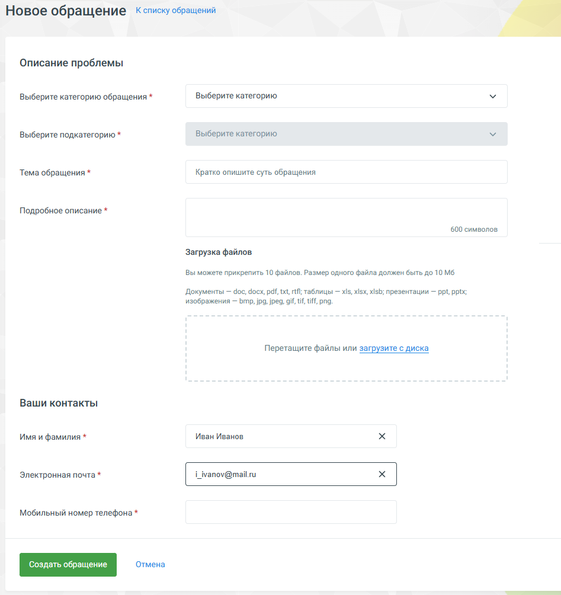

### 3.1.3. Написать в техподдержку

> Трассировка: PDF §3.1.3 · сквозные стр. 51-53 · источники: ч.1 `kb/sources/mango-lk-manual/LK_manual_v-125-1-280.pdf` с.51-53.

Кнопка Создать обращение открывает форму, в которой пользователь может указать:

 Тему обращения  Категорию и подкатегорию обращения  Описание проблемы  Прикрепить файлы (до 10 штук)  Контактную информацию

> **Описание иллюстрации LK-§3.1.3-1** (к §3.1.3 «Написать в техподдержку», стр. 52; 947×1004 px). Снимок экрана / схема Личного кабинета.
> Относится к тексту руководства: «… Тему обращения  Категорию и подкатегорию обращения  Описание проблемы  Прикрепить файлы (до 10 штук)  Контактную информацию».
> Текст на изображении (OCR, требует сверки): Новое обращение кслиску обращений; ‘Описание проблемы; Выберите категорию обращения *; Выберите категорию; Выберите подкатегорию *; Tema обращения *; Кратко опишите суть обращения; Подробное описание *; 600 символов; Загрузка файлов; Вы можете прикрепить 10 файлов. Размер одного файла должен быть до 10 Мб; Документы — doc, docx, pdf, xt, rt; таблицы — xls, хх, 485; презентации — ppt, pplx;; изображения — bmp, jpg, jpeg, aif, tif, tiff, png.; Перетащите файлы или загрузите с диск:; Ваши контакты; Иван Иванов; Имя и фамилия *; Электронная почта *; anov@mail.ru; Мобильный номер телефона *; дать о…

По умолчанию в качестве контактного лица указывается пользователь, осуществивший вход в Личный кабинет под своей учетной записью. Поля для ввода контактных данных заполняются автоматически на основании данных, указанных в карточке сотрудника (при их наличии).

> **Описание иллюстрации LK-§3.1.3-2** (к §3.1.3 «Написать в техподдержку», стр. 52; 15×17 px). Пиктограмма (значок элемента интерфейса).
> Относится к тексту руководства: «…нет под своей учетной записью. Поля для ввода контактных данных заполняются автоматически на основании данных, указанных в карточке сотрудника (при их наличии).».
> Текста на изображении нет; назначение значка — см. текст, к которому он относится.

Для выбора другого контактного лица следует кликнуть по пиктограмме и выбрать из выпадающего списка требуемое контактное лицо. При вводе части имени и/или фамилии сотрудника ВАТС на экране отображается список по совпадениям. При выборе сотрудника ВАТС поля для ввода контактных данных заполняются автоматически на основании данных, указанных в карточке сотрудника (при их наличии).

Чтобы прикрепить к заявке один или несколько файлов нажмите Прикрепить файл и укажите путь к файлу. Допускается одновременная отправка не более пяти файлов размером не более 10 МБ каждый.

Нажмите кнопку Создать обращение. На странице отобразится блок подтверждения с номером созданного обращения, который предназначен для отслеживания его статуса.

В блоке отражается диалог со службой тех.поддержки, с указанием номера и статуса обращения. Также в блоке размещаются присоединенные к обращению файлы.

После закрытия обращения в разделе появляется функционал оценки пользователем качества предоставленного обслуживания.
