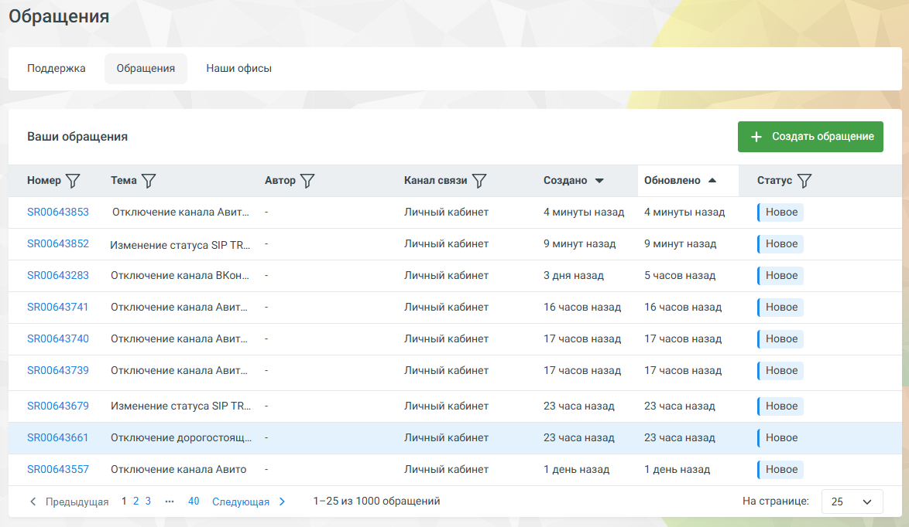

## 3.2. Вкладка «обращения»

> Трассировка: PDF §3.2 · сквозные стр. 53 · источники: ч.1 `kb/sources/mango-lk-manual/LK_manual_v-125-1-280.pdf` с.53.

> **Описание иллюстрации LK-§3.2-1** (к §3.2 «Вкладка «обращения»», стр. 53; 1174×682 px). Снимок экрана / схема Личного кабинета.
> Относится к тексту руководства: «…начало раздела».
> Текст на изображении (OCR, требует сверки): Обращения; Поддержка; Hawn офисы; ваши обращения; Создано *; Обновлено ^; Номер \/; Tema \7; Автор \f; Канал связи \/’; ‘Статус Vf; 3800643853; `Отключение канала Авит.; Личный кабинет; 4 минуты назад; [новое; 3800643852; Изменение статуса SIP TR...; Эминут назад; 3800643283; `Отключение канала ВКон.; З дня назад,; 5 часов назад; 3800643741; 16 часов назад.; 3800643740; 17 часов назад.; 3800643739; 3800643679; 23 часа назад,; 3800643661; Отключение дорогостоящ...; [ новое; 3800643557; `Отключение канала Авито; 1 день назад; -25 из 1000 обращений; На странице:; 25; < Предыдущая 123; 40 Следующа…
