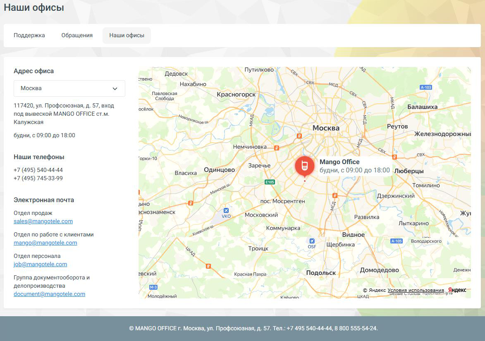

## 3.3. Вкладка «наши офисы»

> Трассировка: PDF §3.3 · сквозные стр. 55-56 · источники: ч.1 `kb/sources/mango-lk-manual/LK_manual_v-125-1-280.pdf` с.55-56.

> **Описание иллюстрации LK-§3.3-1** (к §3.3 «Вкладка «наши офисы»», стр. 55; 1173×825 px). Снимок экрана / схема Личного кабинета.
> Относится к тексту руководства: «…начало раздела».
> Текст на изображении (OCR, требует сверки): Наши офисы; Поддержка; ‘Обращения; Hawn офисы; ‘Адрес офиса; Путилково; creeHo; довск; Нахабино; 'Москва; Павловская; — Красногорск; sige; 117420, yn. Профсоюзная, д. 57, вход; ‚аших:; под вывеской MANGO OFFICE ст.м.; Калужская; tS; Москва; Ре:; будни, с 09:00 до 18:00; Железнодорожны!; Hemun; “Pr aa; ioe; Наши телефоны; ‘орки’; а у; А Mango Office; +7 (495) 540-44-44; Одинцово.; Заречье; Bnacuxa; ‘будни, с 09:00 до 18:00 Люберцы; +7 (495) 745-33-99; La; Томилию; ie; mS; an; жинский; Электронная почта; ыно; 1c: Мосрентген; yi; Отдел продаж; эснознаменск; ~ Московский; inka; Ee; Жу; sales@mango…

Позволяет быстро получить информацию об адресах и контактах офиса:

 Выпадающий список для выбора города  Адрес с временем работы  Телефоны  Email-адреса по отделам: продажи, клиентский отдел, HR, документооборот  Интерактивная карта от Яндекс

Удобно для посещения, звонков, отправки документов.
