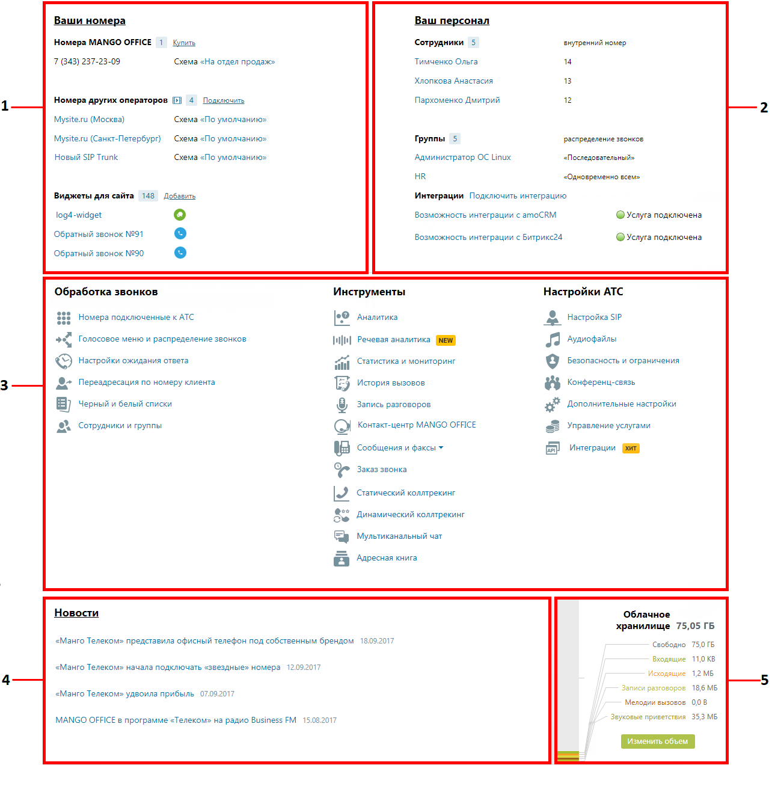

# 4. Продукт «Виртуальная АТС»

> Трассировка: PDF §4 · сквозные стр. 56-58 · источники: ч.1 `kb/sources/mango-lk-manual/LK_manual_v-125-1-280.pdf` с.56-58.

Пример внешнего вида страницы продукта Виртуальной АТС представлен на рисунке ниже.

> **Описание иллюстрации LK-§4-1** (к §4 «Продукт «Виртуальная АТС»», стр. 56; 1284×1307 px). Снимок экрана / схема Личного кабинета.
> Относится к тексту руководства: «…Пример внешнего вида страницы продукта Виртуальной АТС представлен на рисунке ниже.».
> Текст на изображении (OCR, требует сверки): Ваши номер:; Ваш персонал; Номера MANGO OFFICE 1; Купит; Сотрудники 5; внутренний номер; Тимченко Ольга; 7 (43) 237-23-09; Схема «На отдел продаж»; Хлопкова Анастасия; 13; Номера других операторов 2} 4; Подключить; Пархоменко Дмитрий; 12; Mysite.ru (Москва); Схема «По умолчанию»; Mysite.ru (Санкт-Петербург); Группы 5; распределение звонке; Новый SIP Trunk; Администратор ОС Ипих; «Последовательный»; HR; «Одновременно всем»; Виджеты для сайта 148 Добавить; Интеграции Подключить интеграцию; log4-widget; Возможность интеграции с атоС®М; @ Yeayra подключена; Обратный звонок №91; Возможность интегра…

1. Блок «Ваши номера»

2. Блок «Персонал»

3. Блок «Функционал ВАТС»:

 Обработка звонков

 Инструменты

 Настройка АТС

4. Блок «Новости»

5. Блок «Облачное хранилище»

Для возврата к интерфейсу пользовательского рабочего стола следует щелкнуть по

> **Описание иллюстрации LK-§4-2** (к §4 «Продукт «Виртуальная АТС»», стр. 57; 16×14 px). Пиктограмма (значок элемента интерфейса).
> Относится к тексту руководства: «…Для возврата к интерфейсу пользовательского рабочего стола следует щелкнуть по».
> Текста на изображении нет; назначение значка — см. текст, к которому он относится.

кнопке Главная. Описание интерфейса приведено в разделе Главная страница пользователя.

1. Блок «Ваши номера»

Список номеров (способов связи), относящихся к выбранной Виртуальной АТС. Позволяет настраивать новые номера, редактировать и удалять имеющиеся.

2. Блок «Персонал»

Блок содержит:

 список последних добавленных профилей пользователей для сотрудников и групп пользователей, объединенных для перенаправления звонков;

 ссылки для быстрого перехода к страницам «Список сотрудников» и «Группы обзвона»;

 список подключенных сторонних систем.

3. Функционал ВАТС

Это своего рода пульт управления вашей Виртуальной АТС.

4. Блок «Новости»

Информация о последних изменениях в продуктах MANGO OFFICE и свежие предложения нашей компании.

5. Облачное хранилище

Информация о свободном и занятом объеме в персональном облачном хранилище данных (сообщения, записи разговоров, аудиофайлы). Названия, выделенные цветом, являются ссылками на соответствующие разделы Личного кабинета.
