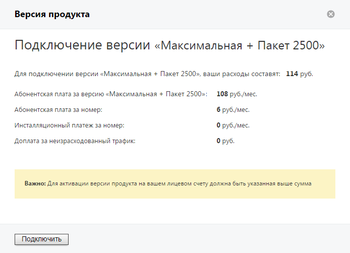

# Демо-версия ватс

> Трассировка: PDF §4 · сквозные стр. 58-59 · источники: ч.1 `kb/sources/mango-lk-manual/LK_manual_v-125-1-280.pdf` с.58-59.

Перед тем, как покупать Виртуальную АТС, вы можете опробовать её возможности на примере демонстрационной версии. Для этого следует подключить демо-версию Виртуальной АТС на сайте компании.

Возможности и ограничения

При подключении демо-версии Виртуальной АТС необходимо выбрать версию продукта. Функционал каждой демо-версии полностью соответствует функционалу полной версии за исключением следующих ограничений:

 длительность демо-периода составляет 14 дней с момента регистрации;  заблокированы исходящие международные вызовы;  заблокировано подключение Контакт-центра;  заблокировано подключение большего количества номеров (сотрудников, схем переадресации и т.д.), чем допускает выбранная версия Виртуальной АТС.

С полным перечнем функций версий Виртуальной АТС MANGO OFFICE и их стоимостью вы можете ознакомиться, скачав этот файл формата PDF.

Внимание

После выполняется блокировка продукта. Через 14 дней с момента блокировки выполняется удаление Виртуальной АТС без возможности восстановления.

О количестве дней до блокировки, а затем до удаления продукта сообщает уведомление вида:

> **Описание иллюстрации LK-§4-1** (к §4 «Демо-версия ватс», стр. 58; 756×40 px). Снимок экрана / схема Личного кабинета.
> Относится к тексту руководства: «…О количестве дней до блокировки, а затем до удаления продукта сообщает уведомление вида:».
> Текст на изображении (OCR, требует сверки): Вы; лЬЗ; OHU; HUA; nla; 12 дне

Переход на полную версию

Переход с демонстрационной на полную версию возможен в течение четырех недель с момента регистрации, в том числе и при заблокированном продукте.

Для перехода на полную версию щелкните по ссылке «Перейти на полную версию», которая отображается в уведомлении. Если вы закрыли уведомление ранее, то перезайдите в данную ВАТС – уведомление отобразится вновь.

После щелчка по ссылке отображается форма с детальным описанием расходов по переходу на полную версию.

> **Описание иллюстрации LK-§4-2** (к §4 «Демо-версия ватс», стр. 59; 694×502 px). Снимок экрана / схема Личного кабинета.
> Относится к тексту руководства: «…После щелчка по ссылке отображается форма с детальным описанием расходов по переходу на полную версию.».
> Текст на изображении (OCR, требует сверки): Версия продукта; Подключение версии «Максимальная + Пакет 2500»; Для подключении версии «Максимальная + Пакет 2500», ваши расходы составят: 114 руб.; ‘Абонентская плата за версию «Максимальная + Пакет 2500»:; 108 руб./мес.; Абонентская плата за номер:; 6 руб./мес.; Инсталляционный платеж за номер:; 0 руб./мес.; Доплата за неизрасходованный трафик:; 0 руб.; ели

Внимание

Если на вашем лицевом счету указанная сумма отсутствует, то кнопка Подключить будет неактивна.

Если при подключении пользователь указал дату плановой активации, она отображается на главной странице Личного кабинета. Как правило, эта опция применяется при необходимости отсроченной активации ВАТС.
