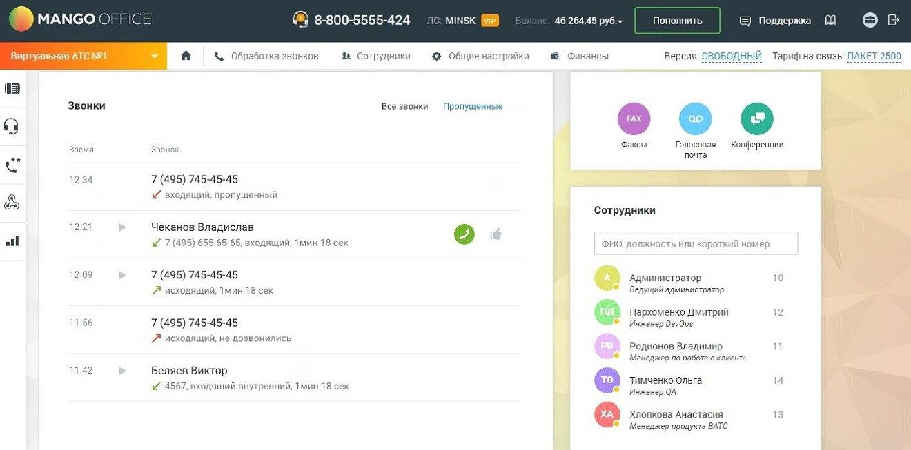

# Главная страница пользователя

> Трассировка: PDF §4 · сквозные стр. 59-60 · источники: ч.1 `kb/sources/mango-lk-manual/LK_manual_v-125-1-280.pdf` с.59-60.

Главная страница пользователя представляет собой персональную рабочую среду пользователя в Личном кабинете. Доступный пользователю функционал настраивается ответственным сотрудником на вкладке «Настройка доступа» раздела «Безопасность и ограничения».

Вид рабочего стола приведен на изображении ниже.

> **Описание иллюстрации LK-§4-1** (к §4 «Главная страница пользователя», стр. 60; 1320×653 px). Снимок экрана / схема Личного кабинета.
> Относится к тексту руководства: «…Вид рабочего стола приведен на изображении ниже.».
> Текст на изображении (OCR, требует сверки): MANGO OFFICE; @ 8-800-5555-424; MINSK; 46 264,45 py6.~; Пополнить; & Поддержка; Bap’; уальная А; %& Обработка звонков:; Ae сотрудники; 4# Общиен; ас; ройки; @ Финансы; Версия: СВОБОДНЫЙ Тариф на связь: ПАКЕТ 2500; Звонки; Все звонки; Пропущенные; ооо; время; Звоной; Факсы; Голосовая; Конференции; почта; 7 (495) 745-45-45; if входящий, пропущенный; Сотрудники; ИИ; 12:2; Чеканов Владислав; М 7 (495) 655-65-65, входящий, 1мин 18 сек; ono,; ость; лер; 12:09; Администратор; Л исходящий, 1мин 18 сек; Be; nun здминистратор; 12; Пархоменко Дмитрий; 56; Инженер DevOps; 7 исходящий, не дозвонились; Роди…

Шапка рабочего стола аналогична стандартной шапке Личного кабинета. Описание панелей приведено в разделе «Раздел 1. Добро пожаловать в Личный кабинет!».

Основная область рабочего стола содержит виджеты:
