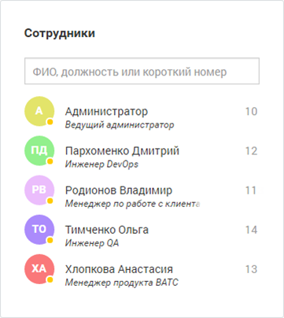
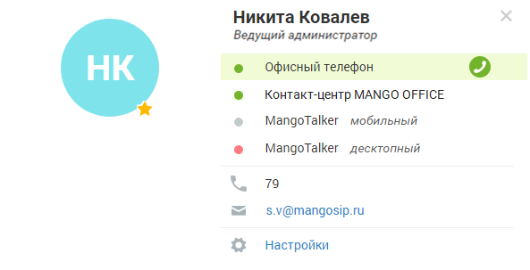

# Виджет «Сотрудники»

> Трассировка: PDF §4 · сквозные стр. 62-63 · источники: ч.1 `kb/sources/mango-lk-manual/LK_manual_v-125-1-280.pdf` с.62-63.

Виджет представляет список всех сотрудников, созданных в текущей ВАТС на момент просмотра виджета.

> **Описание иллюстрации LK-§4-1** (к §4 «Виджет «Сотрудники»», стр. 62; 361×404 px). Снимок экрана / схема Личного кабинета.
> Относится к тексту руководства: «…Виджет представляет список всех сотрудников, созданных в текущей ВАТС на момент просмотра виджета.».
> Текст на изображении (OCR, требует сверки): Сотрудники; ФИО, должность или короткий номер; Администратор; 10; Ведущий администратор; Пархоменко Дмитрий; 12; Инженер DevOps; 11; Родионов Владимир; Менеджер по работе с клиенте; Тимченко Ольга; 14; Инженер QA; Хлопкова Анастасия; 13; Менеджер продукта BATC

Каждая запись списка отображает следующие сведения о сотруднике:

 Аватар с индикатором доступности;

 ФИО сотрудника;

 Должность;

 Внутренний номер.

В верхней области виджета предусмотрено поле для поиска сотрудника по ФИО, должности либо короткому номеру. Фильтрация списка выполняется по мере ввода символов.

Внимание

Функционал добавления сотрудников в список избранных доступен только при входе в Личный кабинет от имени сотрудника.

При щелчке по ФИО сотрудника отображается упрощенная персональная карточка сотрудника, содержащая сведения о коммуникациях.

> **Описание иллюстрации LK-§4-2** (к §4 «Виджет «Сотрудники»», стр. 63; 593×303 px). Снимок экрана / схема Личного кабинета.
> Относится к тексту руководства: «…При щелчке по ФИО сотрудника отображается упрощенная персональная карточка сотрудника, содержащая сведения о коммуникациях.».
> Текст на изображении (OCR, требует сверки): Никита Ковалев; Ведущий администратор; Офисный телефон; Контакт-центр MANGO OFFICE; MangoTalker мобильный; MangoTalker десктопный; 79; bed; s.v@mangosip.ru; Настройки

Для выбора аватара щелкните по пиктограмме фотоаппарата и выберите файл с изображением. Далее при необходимости выберите нужный масштаб и отцентрируйте изображение.

Список коммуникаций включает:

Офисный телефон — учетные записи пользователя, указанные в качестве средств приема звонков. Для каждого из средств приема указывается его статус;

Контакт-центр — отображается в случае наличия связанного с ВАТС продукта Контакт- центр. Отражает статус сотрудника Контакт-центра;

MangoTalker мобильный — статус пользователя в мобильной версии приложения MangoTalker. При отсутствии установленного приложения указывается «Не найден»;

MangoTalker десктопный — статус пользователя в десктопной версии приложения MangoTalker. При отсутствии установленного приложения указывается «Не найден»;

Короткий номер — отображается при наличии номера, указанного в поле «Внутренний номер» в карточке сотрудника.

Телефон — отображается при наличии в списке средств приема звонков хотя бы одного телефонного номера;

Е-mail — отображается при наличии указанного E-mail в карточке сотрудника. При нажатии на адрес выполняется запуск почтового клиента по умолчанию.
