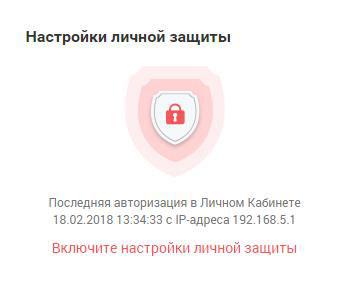
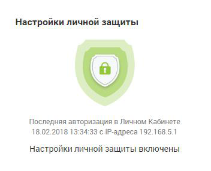
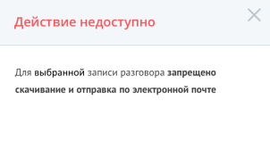

# Виджет «Настройки личной защиты»

> Трассировка: PDF §4 · сквозные стр. 64-65 · источники: ч.1 `kb/sources/mango-lk-manual/LK_manual_v-125-1-280.pdf` с.64-65.

Виджет доступен только для пользователей с ролью «Руководитель компании», а также ролей, созданных на её основе. Виджет позволяет ограничить доступ остальных пользователей к прослушиванию, скачиванию и отправке записей разговоров руководителя, паролю его SIP-учетной записи и т.д.

При выключенных настройках личной защиты виджет отображается в виде:

> **Описание иллюстрации LK-§4-1** (к §4 «Виджет «Настройки личной защиты»», стр. 64; 352×285 px). Снимок экрана / схема Личного кабинета.
> Относится к тексту руководства: «…При выключенных настройках личной защиты виджет отображается в виде:».
> Текст на изображении (OCR, требует сверки): Настройки личной защиты; Последняя авторизация в Личном Кабинете; 18.02.2018 13:34:33 с1Р-адреса 192.168.5.1; Включите настройки личной защиты

> **Описание иллюстрации LK-§4-2** (к §4 «Виджет «Настройки личной защиты»», стр. 64; 23×26 px). Пиктограмма (значок элемента интерфейса).
> Относится к тексту руководства: «… требует сверки): Настройки личной защиты; Последняя авторизация в Личном Кабинете; 18.02.2018 13:34:33 с1Р-адреса 192.168.5.1; Включите настройки личной защиты».
> Текста на изображении нет; назначение значка — см. текст, к которому он относится.

Для включения настроек следует щелкнуть по кнопке и выбрать необходимые настройки. Для получения дополнительных сведений следует навести курсор на

> **Описание иллюстрации LK-§4-3** (к §4 «Виджет «Настройки личной защиты»», стр. 64; 16×17 px). Пиктограмма (значок элемента интерфейса).
> Относится к тексту руководства: «…Для включения настроек следует щелкнуть по кнопке и выбрать необходимые настройки. Для получения дополнительных сведений следует навести курсор на».
> Текста на изображении нет; назначение значка — см. текст, к которому он относится.

пиктограмму напротив наименования настройки:

 Запретить прослушивать записи моих разговоров:

o Запрет на прослушивание записей разговоров;

o Запрет на скачивание записей разговоров;

o Запрет на отправку записей разговоров на E-mail через интерфейс ЛК;

 Запретить автоматическую отправку записей разговоров по API во внешние системы;

 Запретить просматривать и изменять пароль от учетной записи:

o Запрет на просмотр и изменение паролей от SIP-учетных записей, а также

пароля для входа в Личный кабинет и Контакт-центр;

 Запретить изменять роль.

Для сохранения изменений следует нажать на кнопку Применить. При выборе хотя бы одной настройки вид виджета меняется на следующий:

> **Описание иллюстрации LK-§4-4** (к §4 «Виджет «Настройки личной защиты»», стр. 65; 352×285 px). Снимок экрана / схема Личного кабинета.
> Относится к тексту руководства: «…Для сохранения изменений следует нажать на кнопку Применить. При выборе хотя бы одной настройки вид виджета меняется на следующий:».
> Текст на изображении (OCR, требует сверки): Настройки личной защиты; ий; Последняя авторизация в Личном Кабинете; 18.02.2018 13:34:33 с1Р-адреса 192.168.5.1; Настройки личной защиты включены

В общем списке записей разговоров для пользователей с ролью, отличной от роли

> **Описание иллюстрации LK-§4-5** (к §4 «Виджет «Настройки личной защиты»», стр. 65; 15×16 px). Пиктограмма (значок элемента интерфейса).
> Относится к тексту руководства: «…В общем списке записей разговоров для пользователей с ролью, отличной от роли».
> Текста на изображении нет; назначение значка — см. текст, к которому он относится.

«Руководитель компании», защищенные записи отмечаются иконкой и недоступны для прослушивания, скачивания и отправки. При попытке скачивания либо отправке на экране будет отображено соответствующее сообщение:

> **Описание иллюстрации LK-§4-6** (к §4 «Виджет «Настройки личной защиты»», стр. 65; 302×170 px). Снимок экрана / схема Личного кабинета.
> Относится к тексту руководства: «…чаются иконкой и недоступны для прослушивания, скачивания и отправки. При попытке скачивания либо отправке на экране будет отображено соответствующее сообщение:».
> Текст на изображении (OCR, требует сверки): Действие недоступно; Для выбранной записи разговора запрещено; скачивание и отправка по электронной почте
