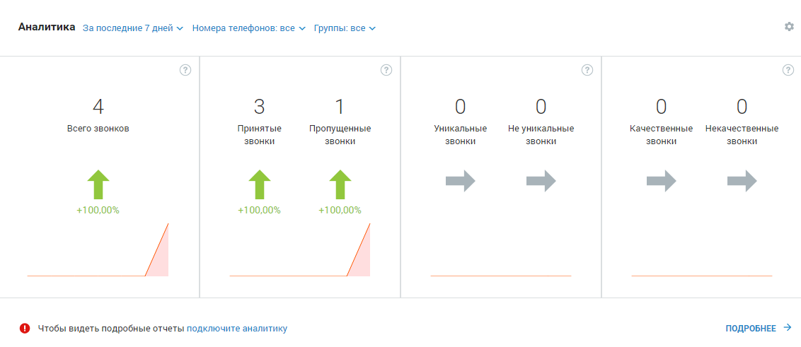
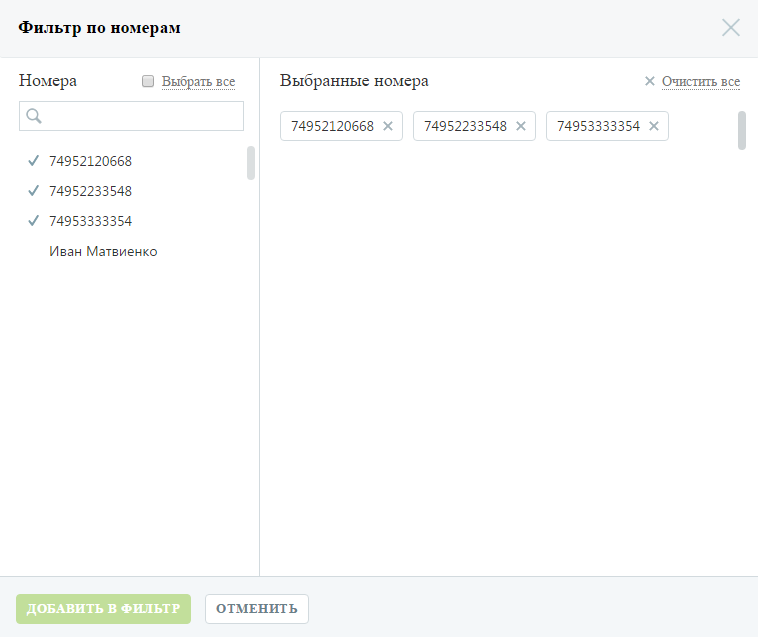

# Виджет «Аналитика»

> Трассировка: PDF §4 · сквозные стр. 65-68 · источники: ч.1 `kb/sources/mango-lk-manual/LK_manual_v-125-1-280.pdf` с.65-68.

Виджет «Аналитика» представляет собой отчет, содержащий краткую аналитическую информацию о поступивших вызовах в соответствии с заданными параметрами фильтрации.

> **Описание иллюстрации LK-§4-1** (к §4 «Виджет «Аналитика»», стр. 66; 1132×491 px). Снимок экрана / схема Личного кабинета.
> Относится к тексту руководства: «…иджет «Аналитика» представляет собой отчет, содержащий краткую аналитическую информацию о поступивших вызовах в соответствии с заданными параметрами фильтрации.».
> Текст на изображении (OCR, требует сверки): Аналитика За последние 7 дней ~ Номера телефонов: все У Группы: все v; Всего звонков; Принятые.; Пропущенные; Уникальные; He уникальные; Качественные; 'Некачественные; ‘звонки; +100,00%; © чтобы видеть подробные отчеты подключите аналитику; ПОДРОБНЕЕ >

Внимание

Виджет отображается для сотрудников с ролями «Руководитель компании» и «Маркетолог», а также для сотрудников с ролями, созданных на основе этих ролей. Виджет отображается только на продуктах с тарифными планами с подключенной либо с доступной для подключения услугой «Аналитика».

Отчет формируется автоматически при входе на рабочий стол пользователя. Для построения отчетов предусмотрены следующие фильтры:

1. Период отчета: 7 дней, 28 дней. Текущий день в отчет не включается;

2. Номера телефонов. Для этого в форме выбора номеров в списке в левой части окна следует щелкнуть по нужным номерам либо установить флаг «Выбрать все» для выбора всех номеров, после чего нажать Добавить в фильтр;

> **Описание иллюстрации LK-§4-2** (к §4 «Виджет «Аналитика»», стр. 66; 758×637 px). Снимок экрана / схема Личного кабинета.
> Относится к тексту руководства: «… в списке в левой части окна следует щелкнуть по нужным номерам либо установить флаг «Выбрать все» для выбора всех номеров, после чего нажать Добавить в фильтр;».
> Текст на изображении (OCR, требует сверки): Фильтр по номерам; GB; Bce; Хх Очистить все; Номера; Выбранные номера; 74952120668 Хх; 74952233548 Хх; 74953333354 Хх; У 74952120668; У 74952233548; У 74953333354; Иван Матвиенко

3. Группа сотрудников. Для этого в форме выбора групп в списке в левой части окна следует щелкнуть по нужным группам, после чего нажать Добавить в фильтр;

> **Описание иллюстрации LK-§4-3** (к §4 «Виджет «Аналитика»», стр. 67; 755×638 px). Снимок экрана / схема Личного кабинета.
> Относится к тексту руководства: «…3. Группа сотрудников. Для этого в форме выбора групп в списке в левой части окна следует щелкнуть по нужным группам, после чего нажать Добавить в фильтр;».
> Текст на изображении (OCR, требует сверки): Фильтр по группам приема звонков; Хх Очистить все; Группы; О Выбрать все; Выбранные группы; ESGX; Ganiev Х; звонок с сайта (55) Х; ESG; Карпович (1) Х; Ganiev; звонок с сайта (55); Карпович (1); Новая группа; ОТМЕНИТЬ

Внимание

Данный фильтр отображается только при подключенной группе отчетов «Продажи» - платно либо в демо режиме.

Отчет будет сформирован автоматически по завершению работы фильтров.

Отчет включает четыре области, отображающие данные в соответствии с выбранными фильтрами:

 Общее количество входящих звонков (принятых и пропущенных);

 Общее количество принятых и пропущенных звонков;

 Общее количество исходящих уникальных и не уникальных звонков;

 Общее количество исходящих качественных и некачественных звонков. Качественным звонком считается принятый вызов с определенной длительностью, указываемой в отчете «Качественные звонки» инструмента «Аналитика».

совет

Более подробная информация по звонкам доступна при использовании инструмента «Аналитика».

Стрелки отчетов указывают на изменение количества звонков по сравнению с аналогичным предшествующим периодом:

 Зеленая – восходящий тренд, количество звонков увеличилось;

 Красная – нисходящий тренд, количество звонков уменьшилось;

 Серая – количество звонков не изменилось.

При наведении на стрелку отображается соответствующая подсказка. При щелчке по стрелке либо числовому показателю в зависимости от выбранного отчета выполняется переход на страницу:

 Отчет «Всего звонков» – переход на страницу отчета «Продажи» - «Пропущенные звонки»;

 Отчет «Принятые и пропущенные звонки» – переход на страницу отчета «Продажи» - «Пропущенные звонки»;

 Отчет «Уникальные и не уникальные звонки» – переход на страницу отчета «Продажи» - «Качественные звонки»;

 Отчет «Качественные и некачественные звонки» – переход на страницу отчета «Продажи» - «Качественные звонки».

В нижней части каждого отчета содержится графическое отображение динамики изменений количества звонков в течение выбранного периода. При наведении курсора на график отображается подсказка, включающая дату и количество звонков в указанный день.

> **Описание иллюстрации LK-§4-4** (к §4 «Виджет «Аналитика»», стр. 68; 19×19 px). Пиктограмма (значок элемента интерфейса).
> Относится к тексту руководства: «… количества звонков в течение выбранного периода. При наведении курсора на график отображается подсказка, включающая дату и количество звонков в указанный день.».
> Текста на изображении нет; назначение значка — см. текст, к которому он относится.

Для того, чтобы скрыть виджет, следует щелкнуть по кнопке и выбрать пункт меню «Скрыть виджет».
