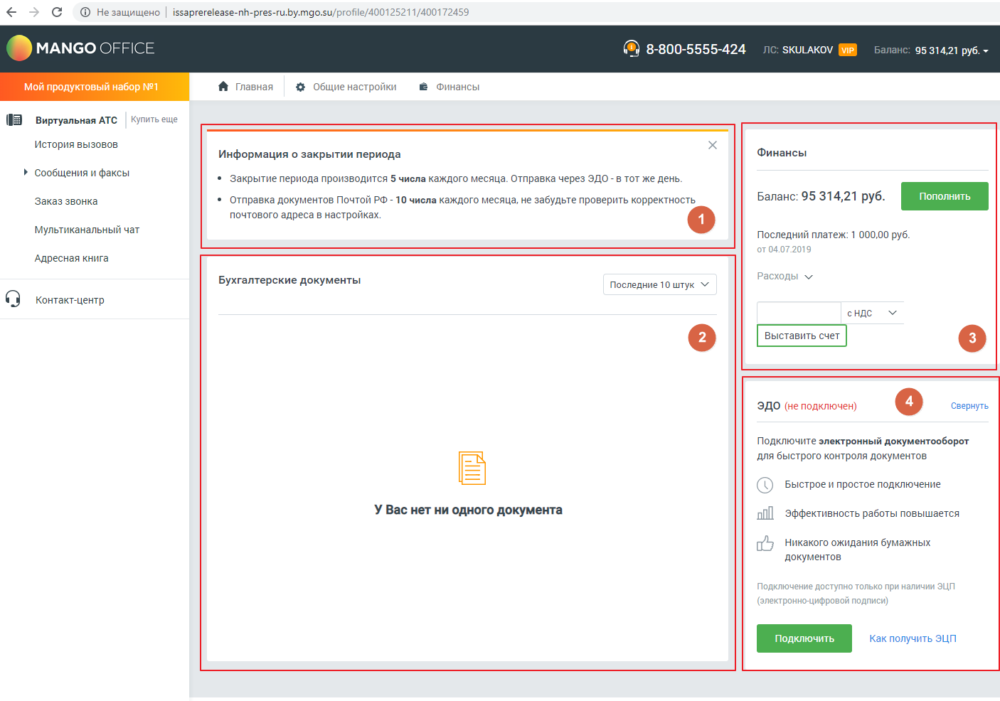

# Виджеты Бухгалтера

> Трассировка: PDF §4 · сквозные стр. 70 · источники: ч.1 `kb/sources/mango-lk-manual/LK_manual_v-125-1-280.pdf` с.70.

> **Описание иллюстрации LK-§4-1** (к §4 «Виджеты Бухгалтера», стр. 70; 1406×986 px). Снимок экрана / схема Личного кабинета.
> Относится к тексту руководства: «…начало раздела».
> Текст на изображении (OCR, требует сверки): С Фне защищено | issaprerelease-nh-pres-ru.by.mgo.su/profile/400125211/400172459; MANGO OFFICE; SKULAKOV; МР; @) 8-800-5555-424; 95 314,21 руб. ~; Главная; @ Финансы; мой продуктовый набор №1; + Общие настройки; (3 виртуальная ATC; Купить еще; История вызовов; Информация о закрытии периода; Финансы; > сообщения и факсы; * Закрытие периода производится 5 числа каждого месяца. Отправка через ЭДО - в тот же день.; Заказ звонка; * Отправка документов Почтой РФ - 10 числа каждого месяца, не забудьте проверить корректность; Баланс: 95 314,21 руб.; почтового адреса в настройках; `Мультиканальный чат;…

Пользователям с ролью Бухгалтер (и производными от этой роли) доступны следующие виджеты:

1. Информация о закрытии периода 2. Бухгалтерские документы - виджет отображает последние 10 документов, или документы за последние 30 дней, по выбору пользователя. 3. Финансы – информация о текущей сумме денежных средств на счету пользователя и последнем платеже. Также имеется поле для выставления новых счетов, с или без НДС. 4. ЭДО (электронный документооборот) - для подключения виджета нажмите кнопку Подключить и заполните данные об организации в открывшейся форме заявки. Сохраните внесенные изменения.

Для подключения виджета ЭДО необходимо наличие электронной цифровой подписи (ЭЦП).
