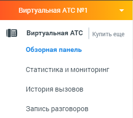

# Начало работы

> Трассировка: PDF §4 · сквозные стр. 71 · источники: ч.1 `kb/sources/mango-lk-manual/LK_manual_v-125-1-280.pdf` с.71.

При первом запуске Виртуальной АТС в левом вертикальном меню откройте подраздел Обзорная панель раздела Виртуальная АТС.

> **Описание иллюстрации LK-§4-1** (к §4 «Начало работы», стр. 71; 271×241 px). Снимок экрана / схема Личного кабинета.
> Относится к тексту руководства: «…При первом запуске Виртуальной АТС в левом вертикальном меню откройте подраздел Обзорная панель раздела Виртуальная АТС.».
> Текст на изображении (OCR, требует сверки): (J виртуальная ATC; Купить еще; Обзорная панель; Статистика и мониторинг; История вызовов; Запись разговоров

Там вы сможете настроить следующие этапы:

 Создание сотрудников

 Создание групп и объединение сотрудников в группы

 Настройка приема звонков

 Подключение телефона

После завершения основных настроек ВАТС готова к работе.
