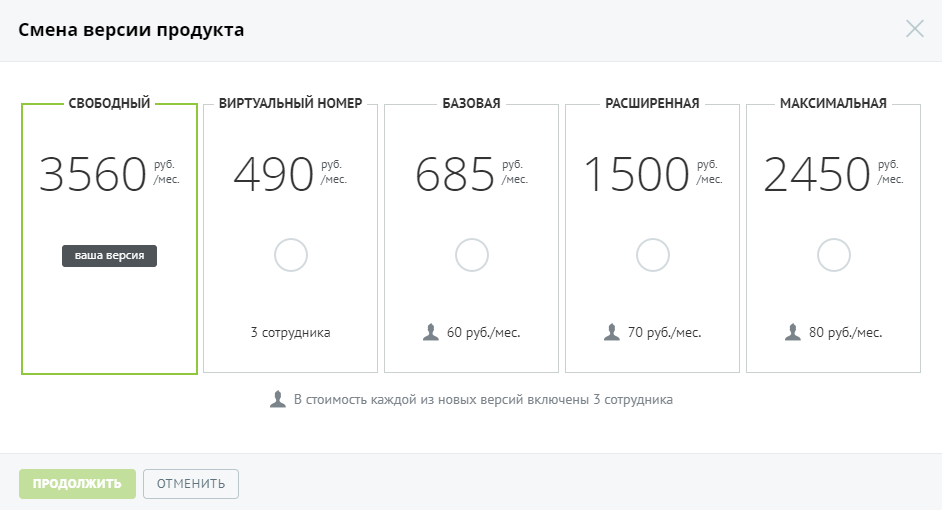
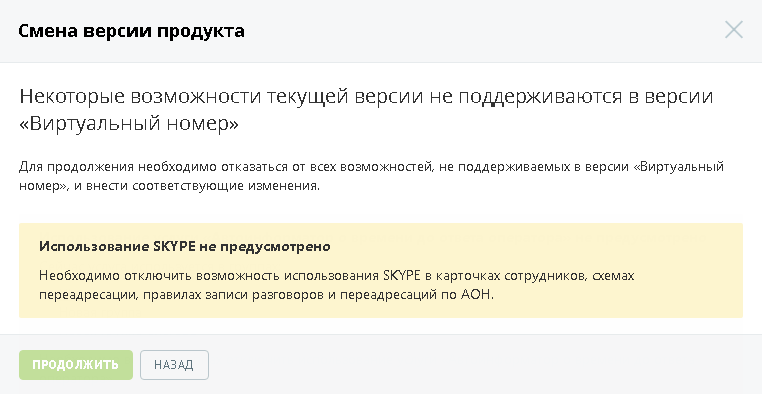
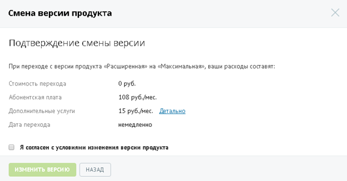
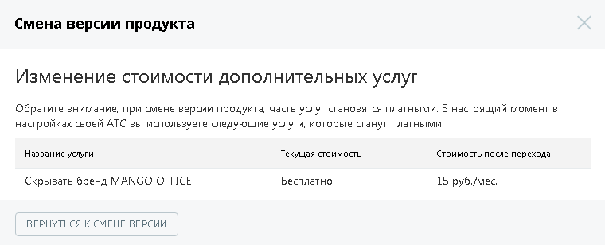
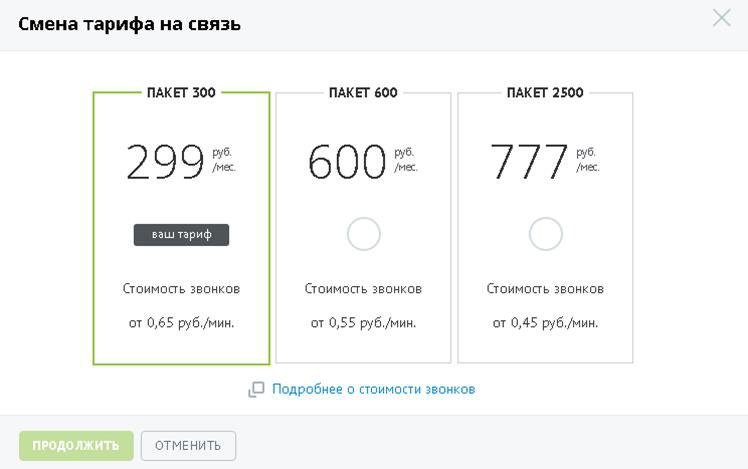
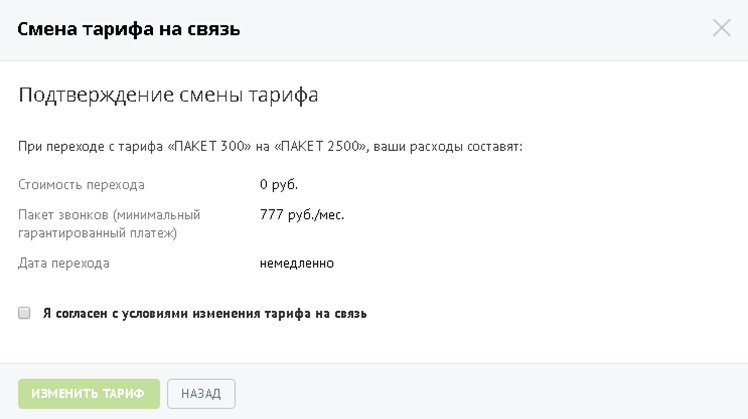

### 4.1.1. Смена версии и тарифа продукта

> Трассировка: PDF §4.1.1 · сквозные стр. 72-76 · источники: ч.1 `kb/sources/mango-lk-manual/LK_manual_v-125-1-280.pdf` с.72-76.

Вы можете изменить версию и тариф продукта на другие, согласно вашим потребностям и расходам. Для этого нажмите на название версии и тарифа соответственно. Ссылки доступны пользователям с ролью Администратор Лицевого счета или Администратор ВАТС.

Смена версии

Название версии продукта, которую вы используете на данный момент, выделено другим цветом с надписью «ваша версия». Выберите новую версию продукта, щелкнув по соответствующему прямоугольнику:

> **Описание иллюстрации LK-§4.1.1-1** (к §4.1.1 «Смена версии и тарифа продукта», стр. 72; 942×510 px). Снимок экрана / схема Личного кабинета.
> Относится к тексту руководства: «…ую вы используете на данный момент, выделено другим цветом с надписью «ваша версия». Выберите новую версию продукта, щелкнув по соответствующему прямоугольнику:».
> Текст на изображении (OCR, требует сверки): Смена версии продукта; своБОДНЫЙ; ВИРТУАЛЬНЫЙ НОМЕР; БАЗОВАЯ; РАСШИРЕННАЯ; МАКСИМАЛЬНАЯ; руб.; мес; унес; 3560; 490; 685; 1500; 2450; 3 сотрудника; 4. 60 py6/mec.; 4. 70 py6/mec.; AL 80 py6/mec.; 4. В стоимость каждой из новых версий включены 3 сотрудника

совет

Для некоторых версий Виртуальной АТС недоступно самостоятельное изменение версии. Для внесения изменений необходимо обратиться к вашему менеджеру по тел. 8-800-555-55-22.

При переходе на более упрощенную версию ВАТС относительно текущей (т.н. понижение версии) на форме с условиями перехода отображается дополнительное предупреждение.

> **Описание иллюстрации LK-§4.1.1-2** (к §4.1.1 «Смена версии и тарифа продукта», стр. 73; 762×394 px). Снимок экрана / схема Личного кабинета.
> Относится к тексту руководства: «… переходе на более упрощенную версию ВАТС относительно текущей (т.н. понижение версии) на форме с условиями перехода отображается дополнительное предупреждение.».
> Текст на изображении (OCR, требует сверки): Смена версии продукта; Некоторые возможности текущей версии не поддерживаются в версии; «Виртуальный номер»; Для продолжения необходимо отказаться от всех возможностей, не поддерживаемых в версии «Виртуальный; номер». и внести соответствующие изменения,; Использование SKYPE не предусмотрено; Необходимо отключить возможность использования SKYPE в карточках сотрудников, схемах; переадресации, правилах записи разговоров и переадресаций по АОН.

Для продолжения выберите другую версию продукта или отключите указанные услуги.

Если новая версия продукта поддерживает все возможности текущей, то на экране отображается форма с условиями перехода на новую версию:

> **Описание иллюстрации LK-§4.1.1-3** (к §4.1.1 «Смена версии и тарифа продукта», стр. 73; 575×301 px). Снимок экрана / схема Личного кабинета.
> Относится к тексту руководства: «…Если новая версия продукта поддерживает все возможности текущей, то на экране отображается форма с условиями перехода на новую версию:».
> Текст на изображении (OCR, требует сверки): Смена версии продукта; Подтверждение смены версии; При переходе с версии продукта «Расширенная» на «Максимальная», ваши расходы составят; Стоимость перехода; 0 руб.; Абонентская плата; 108 руб./мес.; Дополнительные услуги; 15 руб./мес. Детально; Дата перехода; немедленно; |) Я согласен с условиями изменения версии продуктз

внимание

Обратите внимание, что при смене версии продукта сервисы, подключенные вами ранее, могут изменить стоимость.

Для детального ознакомления со стоимостью подключенных дополнительных услуг щелкните по ссылке «Детально»:

> **Описание иллюстрации LK-§4.1.1-4** (к §4.1.1 «Смена версии и тарифа продукта», стр. 74; 760×308 px). Снимок экрана / схема Личного кабинета.
> Относится к тексту руководства: «…Для детального ознакомления со стоимостью подключенных дополнительных услуг щелкните по ссылке «Детально»:».
> Текст на изображении (OCR, требует сверки): Смена версии продукта; Изменение стоимости дополнительных услуг; Обратите внимание, при смене версии продукта, часть услуг становятся платными, В настоящий момент в; настройках своей АТС вы используете следующие услуги, которые станут платными:; Название услуги; Текущая стоимость; Стоимость после перехода; Бесплатно; Скрывать бренд MANGO OFFICE; 15 руб.Имес.; ВЕРНУТЬСЯ К СМЕНЕ ВЕРСИИ

После ознакомления вернитесь к предыдущей форме, нажав на кнопку Вернуться к смене версии.

Если предложенные условия вас устраивают, то установите флажок «Я согласен с условиями изменения версии продукта» и нажмите Изменить версию.

Переход на новую версию продукта осуществляется моментально.

Внимание

Если на вашем счету недостаточно средств для изменения версии, то установка флага «Я согласен с условиями изменения версии продукта» недоступна.

Смена тарифа

Тарифный план, который вы используете на данный момент, выделен другим цветом и помечен надписью «ваш тариф». Выберите новый тарифный план, щелкнув по соответствующему прямоугольнику:

> **Описание иллюстрации LK-§4.1.1-5** (к §4.1.1 «Смена версии и тарифа продукта», стр. 75; 748×469 px). Снимок экрана / схема Личного кабинета.
> Относится к тексту руководства: «…вы используете на данный момент, выделен другим цветом и помечен надписью «ваш тариф». Выберите новый тарифный план, щелкнув по соответствующему прямоугольнику:».
> Текст на изображении (OCR, требует сверки): Смена тарифа на связь; ПАКЕТ 300; ПАКЕТ 600; ПАКЕТ 2500; 299 he; 600 =; 111; Стоимость звонков; от 0,65 руб./мин; от 0,55 руб./мин; от 0,45 руб.Имин; О Подробнее о стоимости звонков; ПРОДОЛЖИТЬ; ОТМЕНИТЬ

совет

В случае, если изменение тарифа недоступно, обратитесь к вашему менеджеру для внесения изменений.

Для получения актуальных сведений о стоимости звонков нажмите на ссылку «Подробнее о стоимости звонков». В результате в браузере будет открыта новая вкладка с описанием тарифов компании.

После выбора тарифа нажмите Продолжить.

> **Описание иллюстрации LK-§4.1.1-6** (к §4.1.1 «Смена версии и тарифа продукта», стр. 75; 748×419 px). Снимок экрана / схема Личного кабинета.
> Относится к тексту руководства: «…После выбора тарифа нажмите Продолжить.».
> Текст на изображении (OCR, требует сверки): Смена тарифа на связь; Подтверждение смены тарифа; При переходе с тарифа «ПАКЕТ 300» на «ПАКЕТ 2500», ваши расходы составят; Стоимость перехода; 0 руб.; Пакет звонков (минимальный; 777 руб./мес.; гарантированный платеж); Дата перехода; немедленно; || Я согласен © условиями изменения тарифа на связь

Ознакомьтесь с условиями изменения тарифа. Для изменения тарифа установите флаг «Я согласен с условиями изменения тарифа на связь» и нажмите Изменить тариф.

Внимание

Если на вашем счету недостаточно средств для изменения тарифа, то установка флага «Я согласен с условиями изменения тарифа на связь» недоступна.

Изменение тарифа осуществляется моментально. Допускается изменение тарифа один раз в календарный месяц. Если в текущем месяце вы уже изменяли тариф, то следующее изменение возможно, начиная с первого числа следующего месяца.
