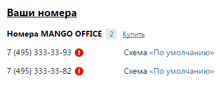

### 4.2.1. Номера MANGO OFFICE

> Трассировка: PDF §4.2.1 · сквозные стр. 76-77 · источники: ч.1 `kb/sources/mango-lk-manual/LK_manual_v-125-1-280.pdf` с.76-77.

Группа содержит информацию о многоканальных номерах (телефонных линиях) MANGO OFFICE, используемых с данной Виртуальной АТС. Одновременно отображается три номера, отсортированных по дате покупки.

При нажатии на кнопку «Купить еще» на новой вкладке браузера откроется страница интернет-магазина «Манго Телеком».

Напротив каждого номера отображается наименование схемы распределения звонков. При нажатии на наименование схемы осуществляется переход на страницу, содержащую настройки данной входящей линии.

> **Описание иллюстрации LK-§4.2.1-1** (к §4.2.1 «Номера MANGO OFFICE», стр. 76; 379×148 px). Снимок экрана / схема Личного кабинета.
> Относится к тексту руководства: «…ется наименование схемы распределения звонков. При нажатии на наименование схемы осуществляется переход на страницу, содержащую настройки данной входящей линии.».
> Текст на изображении (OCR, требует сверки): Ваши номера; Номера MANGO OFFICE 2; Купит; Схема «По умолчанию»

Некоторые номера могут быть отмечены пиктограммой вида

> **Описание иллюстрации LK-§4.2.1-2** (к §4.2.1 «Номера MANGO OFFICE», стр. 77; 16×15 px). Пиктограмма (значок элемента интерфейса).
> Относится к тексту руководства: «…Некоторые номера могут быть отмечены пиктограммой вида».
> Текста на изображении нет; назначение значка — см. текст, к которому он относится.

(см. на рисунке ниже). Это означает, что номер находится в статусе «Новый»: он был зарезервирован для использования с данным продуктом ВАТС, но еще не оплачен. Такой номер нельзя использовать для приема или совершения вызовов до его активации. Номер резервируется на пять дней с момента покупки.
