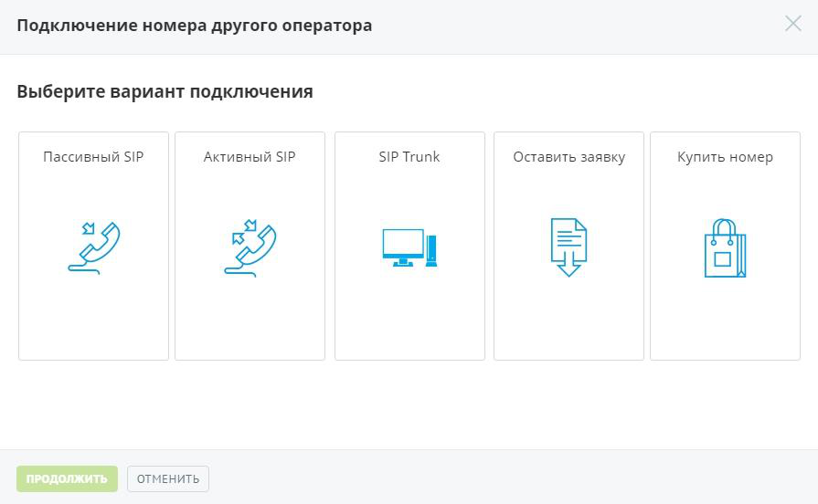

### 4.2.2. Номера других операторов

> Трассировка: PDF §4.2.2 · сквозные стр. 77 · источники: ч.1 `kb/sources/mango-lk-manual/LK_manual_v-125-1-280.pdf` с.77.

Эта группа отображает информацию о номерах других операторов, используемых с данной Виртуальной АТС.

С помощью Виртуальной АТС можно создать свой поддомен SIP. Это позволит добавлять в него учетные записи пользователей SIP.

Для подключения номера другого оператора нажмите кнопку Подключить. Выберите режим работы номера другого оператора и нажмите Продолжить.

> **Описание иллюстрации LK-§4.2.2-1** (к §4.2.2 «Номера других операторов», стр. 77; 895×552 px). Снимок экрана / схема Личного кабинета.
> Относится к тексту руководства: «…Для подключения номера другого оператора нажмите кнопку Подключить. Выберите режим работы номера другого оператора и нажмите Продолжить.».
> Текст на изображении (OCR, требует сверки): Подключение номера другого оператора; Выберите вариант подключения; Пассивный SIP; Активный SIP; SIP Trunk; Оставить заявку; Купить номер; ol; ОТМЕНИТЬ

Также вы можете оставить заявку на подключение номера стороннего оператора нашему сотруднику, который свяжется с вами для обсуждения условий подключения.

Если вы не хотите настраивать и подключать номер самостоятельно, воспользуйтесь предложением покупки номера. Для этого укажите вариант «Купить номер» и на странице официального сайта «Манго-Телеком» выберите один или несколько многоканальных номеров.
