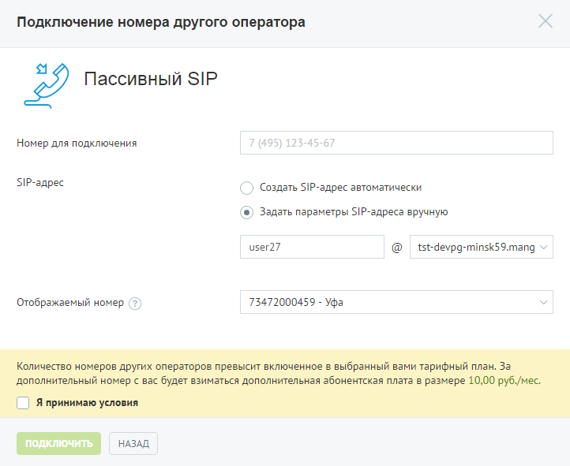

#### 4.2.2.1. Пассивный SIP

> Трассировка: PDF §4.2.2.1 · сквозные стр. 77-79 · источники: ч.1 `kb/sources/mango-lk-manual/LK_manual_v-125-1-280.pdf` с.77-79.

При выборе пассивного режима переадресация звонков на линию осуществляется сторонним оператором. Допускается только получение входящих вызовов.

> **Описание иллюстрации LK-§4.2.2.1-1** (к §4.2.2.1 «Пассивный SIP», стр. 78; 722×591 px). Снимок экрана / схема Личного кабинета.
> Относится к тексту руководства: «…При выборе пассивного режима переадресация звонков на линию осуществляется сторонним оператором. Допускается только получение входящих вызовов.».
> Текст на изображении (OCR, требует сверки): Подключение номера другого оператора; Пассивный SIP; Номер для подключения; 7 (495) 125-45-67; $Р-адрес; ) Создать SIP-agpec автоматически; (®) Задать параметры $!Р-здреса вручную; user27; tst-devpg-minsk59.mang ~; Отображаемый номер (?); 73472000459 - Уфа; ПОДКЛЮЧИТЬ; НАЗАД

Введите необходимые данные в поле «Номер для подключения».

Допускается автоматическое создание SIP-адреса, для этого установите переключатель в соответствующее положение. При установке переключателя в положение «Задать параметры SIP-адреса вручную» необходимо указать имя пользователя и выбрать домен SIP из выпадающего списка.

В поле «Отображаемый номер» указывается линия, по которой будут маршрутизироваться входящие звонки на SIP-линию при переадресации.

Ознакомьтесь с условиями подключения и установите флаг «Я принимаю условия».

Для завершения создания номера другого оператора нажмите Подключить. Сообщите вашему оператору новый SIP-адрес.

внимание

При удалении домена SIP все имена и псевдонимы пользователей, связанные с ним, удаляются без возможности восстановления!

совет

Если выбранное имя домена занято, появится соответствующее предупреждение. В названии можно использовать только строчные буквы. При вводе прописные автоматически заменяются на строчные. Например, M в имени Mydomain преобразуется в m: mydomain.

Удаление номера осуществляется на странице «Номера, подключенные к АТС».
