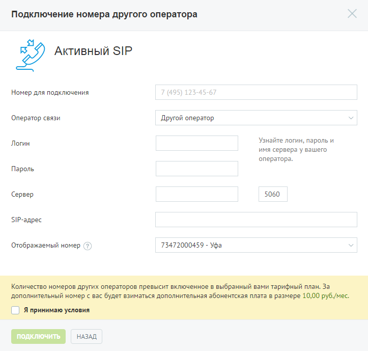
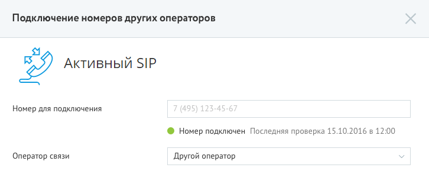

#### 4.2.2.2. Активный SIP

> Трассировка: PDF §4.2.2.2 · сквозные стр. 79-80 · источники: ч.1 `kb/sources/mango-lk-manual/LK_manual_v-125-1-280.pdf` с.79-80.

При выборе активного режима звонки принимаются через активную SIP-учетку стороннего оператора. Доступны входящие и исходящие вызовы.

> **Описание иллюстрации LK-§4.2.2.2-1** (к §4.2.2.2 «Активный SIP», стр. 79; 723×689 px). Снимок экрана / схема Личного кабинета.
> Относится к тексту руководства: «…При выборе активного режима звонки принимаются через активную SIP-учетку стороннего оператора. Доступны входящие и исходящие вызовы.».
> Текст на изображении (OCR, требует сверки): Подключение номера другого оператора; Активный SIP; Номер для подключения; 7 (495) 125-45-67; Оператор связи; Другой оператор; Узнайте логин, пароль и; Логин; имя сервера у вашего; оператора.; Пароль; Сервер; 5060; $Р-адрес; Отображаемый номер (?); 73472000459 - Уфа; ПОДКЛЮЧИТЬ; НАЗАД

Введите необходимые данные в поле «Номер для подключения».

Выберите оператора связи из выпадающего списка. В зависимости от выбора оператора отображается набор дополнительных полей для ввода данных учетной записи. Укажите данные – логин и пароль, при необходимости также следует указать адрес сервера и SIP-адрес. В случае, если поле «SIP-адрес» не отображается, то SIP-адрес формируется автоматически.

В поле «Отображаемый номер» указывается линия, по которой будут маршрутизироваться входящие звонки на SIP-линию при переадресации.

Ознакомьтесь с условиями и установите флаг «Я принимаю условия». Для завершения создания номера другого оператора нажмите Подключить. Сообщите вашему оператору новый SIP-адрес.

После создания номера другого оператора информация в блоке «Номера других операторов» автоматически обновляется. Нажмите на номер другого оператора, если хотите изменить его.

Для удобства использования подключений внешних линий в активном режиме предусмотрен функционал информирования о статусе подключения. Соответствующий

статус подключения отображается при редактировании номера под полем «Номер для подключения»:

> **Описание иллюстрации LK-§4.2.2.2-2** (к §4.2.2.2 «Активный SIP», стр. 80; 726×294 px). Снимок экрана / схема Личного кабинета.
> Относится к тексту руководства: «…статус подключения отображается при редактировании номера под полем «Номер для подключения»:».
> Текст на изображении (OCR, требует сверки): Подключение номеров других операторов; Активный SIP; Номер для подключения; ® Номер подключен Последняя проверка 15.10.2016 в 12:00; Оператор связи; Другой оператор

Удаление номера осуществляется на странице «Номера, подключенные к АТС».
