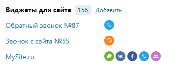

### 4.2.3. Виджеты для сайта

> Трассировка: PDF §4.2.3 · сквозные стр. 80 · источники: ч.1 `kb/sources/mango-lk-manual/LK_manual_v-125-1-280.pdf` с.80.

В этой группе приведена информация о настроенных для текущей Виртуальной АТС виджетах. Инструмент позволяет установить на сайте виджет, с помощью которого посетители этого сайта могут позвонить прямо из браузера либо заказать звонок на определенное время.

> **Описание иллюстрации LK-§4.2.3-1** (к §4.2.3 «Виджеты для сайта», стр. 80; 366×135 px). Снимок экрана / схема Личного кабинета.
> Относится к тексту руководства: «…нт позволяет установить на сайте виджет, с помощью которого посетители этого сайта могут позвонить прямо из браузера либо заказать звонок на определенное время.».
> Текст на изображении (OCR, требует сверки): Виджеты для сайта 156 Добавить; Обратный звонок №87; Звонок с сайта №55; MySite.ru; 0eeee

При щелчке по названию виджета отображается форма для его настройки. Напротив названия расположен список каналов виджета. При наведении курсора на канал отображается дополнительная информация.
