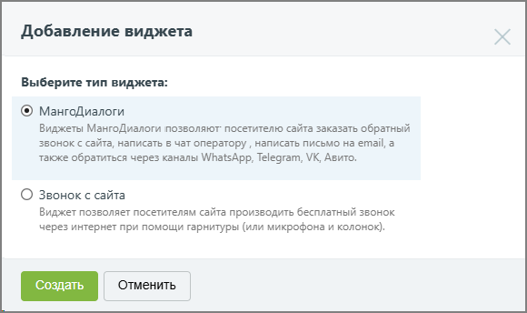

#### 4.2.3.1. Добавление виджета

> Трассировка: PDF §4.2.3.1 · сквозные стр. 80-81 · источники: ч.1 `kb/sources/mango-lk-manual/LK_manual_v-125-1-280.pdf` с.80-81.

Нажмите Добавить, чтобы добавить новый виджет.

При добавлении первого виджета на экране отображается форма с описанием услуги, а также возможностью просмотра обучающего видео по подключению и настройке виджета.

Для продолжения нажмите Создать. Выберите тип виджета.

Предусмотрены следующие типы (см. рис. на следующей странице):

 МангоДиалоги – виджеты, которые позволяют посетителю сайта заказать обратный звонок с сайта, написать в чат оператору, а также обратиться через каналы WhatsApp, MAX, Telegram, VK, Авито;

 Звонок с сайта – виджет, позволяющий посетителям сайта выполнить бесплатный звонок через интернет;

 Обратный звонок – виджет, позволяющий посетителям сайта оставлять запросы на обратный звонок. Тип доступен, если к ВАТС подключена услуга «Заказ обратного звонка».

После выбора типа виджета ознакомьтесь с условиями подключения дополнительной услуги. После ознакомления установите флаг «Я принимаю условия подключения» и нажмите Создать для перехода к настройке виджета.

> **Описание иллюстрации LK-§4.2.3.1-1** (к §4.2.3.1 «Добавление виджета», стр. 81; 580×344 px). Снимок экрана / схема Личного кабинета.
> Относится к тексту руководства: «…виями подключения дополнительной услуги. После ознакомления установите флаг «Я принимаю условия подключения» и нажмите Создать для перехода к настройке виджета.».
> Текст на изображении (OCR, требует сверки): Добавление виджета; Выберите тип виджета:; © МангоДиалоги; Виджеты МангоДиалоги позволяют посетителю сайта заказать обратный; SBOHOK C сайта, написать 6 чат оператору , написать письмо на email, a; также обратиться через каналы WhatsApp, Telegram, VK, Авито.; О Звонок с сайта; Виджет позволяет посетителям сайта производить бесплатный звонок; через интернет при помощи гарнитуры (или микрофона и колонок).; Отменить
