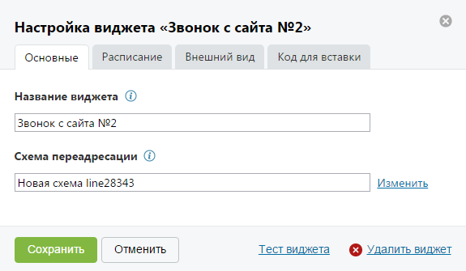

##### 4.2.3.2.1. Вкладка «Основные»

> Трассировка: PDF §4.2.3.2.1 · сквозные стр. 82 · источники: ч.1 `kb/sources/mango-lk-manual/LK_manual_v-125-1-280.pdf` с.82.

Вид вкладки представлен на рисунке ниже.

> **Описание иллюстрации LK-§4.2.3.2.1-1** (к §4.2.3.2.1 «Вкладка «Основные»», стр. 82; 575×335 px). Снимок экрана / схема Личного кабинета.
> Относится к тексту руководства: «…Вид вкладки представлен на рисунке ниже.».
> Текст на изображении (OCR, требует сверки): Настройка виджета «Звонок с сайта №2»; Основные; Расписание; Внешний вид; Код для вставки; Название виджета (i); Звонок с сайта №2; Схема переадресации (0; Новая схема line28343; Изменить; Тест виджета @) Удалить виджет; Отменить

На данной вкладке необходимо указать:

 Название виджета – название виджета на странице текущей ВАТС;

 Схема переадресации – наименование используемой схемы переадресации. Для редактирования или выбора другой схемы нажмите на ссылку «Изменить». В результате будет выполнен переход на страницу настройки голосового меню и распределения звонков.

Для сохранения введенных данных нажмите Сохранить.
