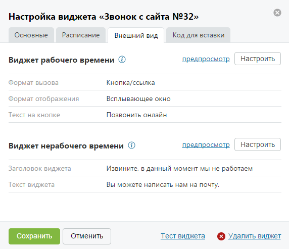
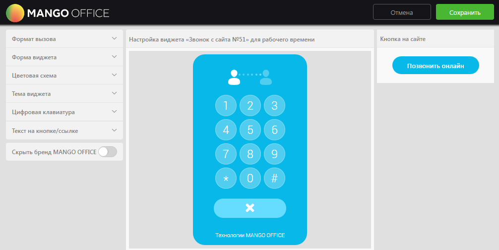
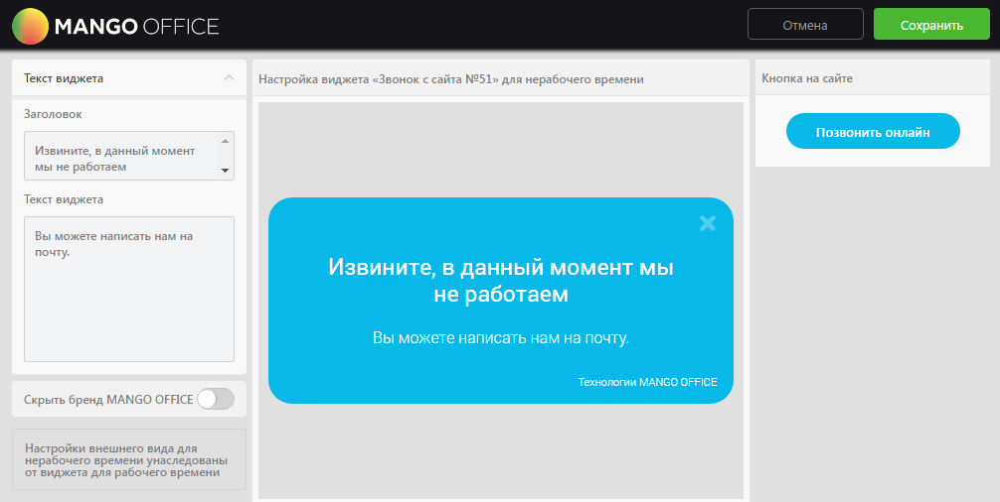

##### 4.2.3.2.3. Вкладка «Внешний вид»

> Трассировка: PDF §4.2.3.2.3 · сквозные стр. 84-87 · источники: ч.1 `kb/sources/mango-lk-manual/LK_manual_v-125-1-280.pdf` с.84-87.

На данной вкладке указаны основные элементы настройки внешнего вида для виджетов рабочего и нерабочего времени. Вид вкладки представлен на рисунке на следующей странице.

> **Описание иллюстрации LK-§4.2.3.2.3-1** (к §4.2.3.2.3 «Вкладка «Внешний вид»», стр. 84; 572×493 px). Снимок экрана / схема Личного кабинета.
> Относится к тексту руководства: «… вкладке указаны основные элементы настройки внешнего вида для виджетов рабочего и нерабочего времени. Вид вкладки представлен на рисунке на следующей странице.».
> Текст на изображении (OCR, требует сверки): Настройка виджета «Звонок с сайта №32»; Основные; Расписание; Внешний вид; Код для вставки; Виджет рабочего времени @; предпросмотр; Настроить; Формат вызова; Кнопка/ссылка; Формат отображения; Всплывающее окно; Текст на кнопке; Позвонить онлайн; Виджет нерабочего времени ©; Заголовок виджета; Извините, в данный момент мы не работаем; Текст виджета; Вы можете написать нам на почту.; Тест виджета @) Удалить виджет; Отменить

Для предпросмотра внешнего вида настроенного виджета нажмите «предпросмотр» в блоке соответствующего виджета. В результате в новом окне браузера отображается виджет для рабочего/нерабочего времени соответственно.

Для настройки внешнего вида нажмите Настроить в блоке соответствующего виджета. Настройка осуществляется в отдельной форме «Настройка внешнего вида виджета для рабочего времени» или «Настройка внешнего вида виджета для нерабочего времени» соответственно.

Виджет рабочего времени

Вид формы для настройки виджета для рабочего времени представлен на рисунке ниже.

> **Описание иллюстрации LK-§4.2.3.2.3-2** (к §4.2.3.2.3 «Вкладка «Внешний вид»», стр. 85; 1006×506 px). Снимок экрана / схема Личного кабинета.
> Относится к тексту руководства: «…Вид формы для настройки виджета для рабочего времени представлен на рисунке ниже.».
> Текст на изображении (OCR, требует сверки): MANGO; 'Сохрань; Фор; (aT Bb; Настройка виджета «Звонок; сайта №51> для pa; его вре; ени; Кн; на сайте; виджета; Цветовая схема; Тема виджета; Цифр; я клавиату,; Текст Ha кнопке/ссылке; Скрыть; pena МАМС; OFFICE

Для настройки используйте набор переключателей в левой области формы. Изменения внешнего вида виджета отображаются в режиме реального времени в центральной области формы. В правой области отображается внешний вид кнопки в том виде, в котором она будет отображаться на сайте.

Набор переключателей содержит следующие элементы:

Форма вызова

 Всплывающее окно – виджет реализован в виде всплывающего окна, вызывается нажатием кнопки/ссылки.

Форма виджета

 Квадратная – прямые углы виджета/кнопки/ярлыка;

 Закругленная – закругленные углы виджета/кнопки/ярлыка.

Цветовая схема

 Основной цвет – выбор цвета основной области виджета/кнопки/ярлыка;

 Дополнительный цвет – выбор цвета дополнительных элементов виджета.

Тема виджета

 Тема виджета – тема оформления виджета.

Цифровая клавиатура

 Отображать – включить/отключить отображение цифровой клавиатуры на виджете.

Текст на кнопке/ярлыке

 Текст на кнопке/ярлыке – текст, который будет указан на кнопке/ярлыке.

Сохранение настроек выполняется после нажатия кнопки Сохранить. При этом форма настройки внешнего вида закрывается и осуществляется возврат к вкладке «Внешний вид».

Скрыть бренд MANGO OFFICE

 Скрыть бренд MANGO OFFICE – включение/выключение отображения бренда компании на виджете.

Виджет нерабочего времени

Настройки внешнего вида виджета для нерабочего времени унаследованы от виджета для рабочего времени.

Вид формы для настройки виджета для нерабочего времени представлен на рисунке на следующей странице.

> **Описание иллюстрации LK-§4.2.3.2.3-3** (к §4.2.3.2.3 «Вкладка «Внешний вид»», стр. 86; 1006×506 px). Снимок экрана / схема Личного кабинета.
> Относится к тексту руководства: «…Вид формы для настройки виджета для нерабочего времени представлен на рисунке на следующей странице.».
> Текст на изображении (OCR, требует сверки): MANGO OFFICE; Сохранит; Текст виджета; Hacr; ка виджета «Звонок с сайта №51» ana нер; чего времени; Кн; на сай; Заголовок; Извини;; нный момен; ы не раб; зем; виджета; вы; ожете написать нам на; почт); Скрыть бренд М; OFFICE; Ha; и внешн; а для; его вре; едованы; мени; ‘джета для pat

Набор переключателей содержит следующие элементы:

Текст виджета

 Заголовок – текст, который отображается в заголовке виджета;

 Текст виджета – дополнительный текст с меньшим размером шрифта.

Скрыть бренд MANGO OFFICE

 Скрыть бренд MANGO OFFICE – включение/выключение отображения бренда компании на виджете.

Сохранение настроек выполняется после нажатия кнопки Сохранить. При этом форма настройки внешнего вида закрывается и осуществляется возврат к вкладке «Внешний вид».
