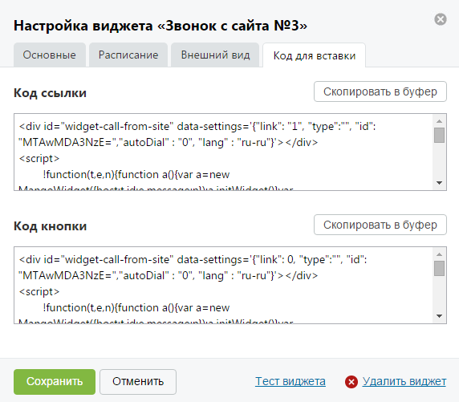

##### 4.2.3.2.4. Вкладка «Код для вставки»

> Трассировка: PDF §4.2.3.2.4 · сквозные стр. 87 · источники: ч.1 `kb/sources/mango-lk-manual/LK_manual_v-125-1-280.pdf` с.87.

Поля вкладки содержат код, формируемый системой для совокупности настроек работы виджета и настроек внешнего вида виджета. Данный код используется для внедрения виджета на сайт.

Набор полей зависит от формата отображения виджета. При формате отображения «Всплывающее окно» на вкладке расположены поля «Код ссылки» и «Код кнопки».

Вид вкладки представлен на рисунке на следующей странице.

> **Описание иллюстрации LK-§4.2.3.2.4-1** (к §4.2.3.2.4 «Вкладка «Код для вставки»», стр. 87; 572×501 px). Снимок экрана / схема Личного кабинета.
> Относится к тексту руководства: «…Вид вкладки представлен на рисунке на следующей странице.».
> Текст на изображении (OCR, требует сверки): Настройка виджета «Звонок с сайта №3»; Основные; Расписание; Внешний вид; Код для вставки; Код ссылки; Скопировать в буфер; 
; !function(t,e,n){function a(){var a=new; ГВ А к Пра коли Ан jit Айни Mi rme; Код кнопки; <div id="widget-call-from-site" data-settings="{"link": 0, “type’:"", “id":; Тест виджета @) Удалить виджет; Отменить

При формате отображения «Ярлык» на вкладке расположено единственное поле «Код ярлыка».

Для копирования нужного кода в буфер обмена нажмите кнопку Скопировать в буфер, расположенную в соответствующем блоке.
