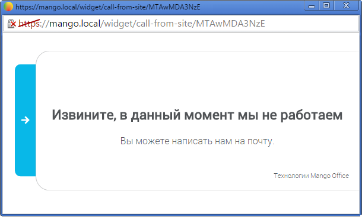

##### 4.2.3.2.5. Тест виджета

> Трассировка: PDF §4.2.3.2.5 · сквозные стр. 87-88 · источники: ч.1 `kb/sources/mango-lk-manual/LK_manual_v-125-1-280.pdf` с.87-88.

На каждой вкладке расположена ссылка «Тест виджета». Она используется для тестирования виджета согласно установленному расписанию и настройкам внешнего вида.

При нажатии ссылки виджет открывается в отдельном окне браузера. Нажмите на кнопку или ярлык для отображения виджета.

> **Описание иллюстрации LK-§4.2.3.2.5-1** (к §4.2.3.2.5 «Тест виджета», стр. 88; 610×367 px). Снимок экрана / схема Личного кабинета.
> Относится к тексту руководства: «…При нажатии ссылки виджет открывается в отдельном окне браузера. Нажмите на кнопку или ярлык для отображения виджета.».
> Текст на изображении (OCR, требует сверки): xX; 6% betps://mango.local/widget/call-from-site/MTAWMDA3NzE; Извините, в данный момент мы He работаем; Вы можете написать нам на почту.; Технологии Mango Office
