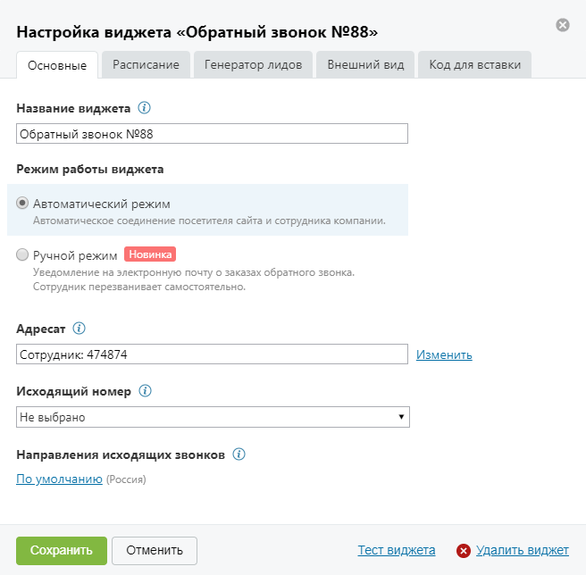

##### 4.2.3.3.1. Вкладка «Основные»

> Трассировка: PDF §4.2.3.3.1 · сквозные стр. 88-90 · источники: ч.1 `kb/sources/mango-lk-manual/LK_manual_v-125-1-280.pdf` с.88-90.

Вид вкладки представлен на рисунке на следующей странице.

> **Описание иллюстрации LK-§4.2.3.3.1-1** (к §4.2.3.3.1 «Вкладка «Основные»», стр. 89; 656×644 px). Снимок экрана / схема Личного кабинета.
> Относится к тексту руководства: «…Вид вкладки представлен на рисунке на следующей странице.».
> Текст на изображении (OCR, требует сверки): Настройка виджета «Обратный звонок №88»; Основные; Расписание; Генератор лидов; Внешний вид; Код для вставки; Название виджета @; Обратный звонок №88; Режим работы виджета; @ Автоматический режим; Автоматическое соединение посетителя сайта и сотрудника компании.; О Ручной режим; Уведомление на электронную почту о заказах обратного звонка.; Сотрудн ик перезванивает самостоятельно.; Адресат @; Изменить; Сотрудник: 474874; Исходящий номер (i); Не выбрано; Направления исходящих звонков (i); По умолчанию (Россия); Отменить; Тест виджета; © Удалить виджет

На данной вкладке необходимо указать:

 Название виджета – название виджета на странице текущей ВАТС;

 Режим работы виджета – выбор режима дозвона до абонента, заказавшего обратный звонок:

o Автоматический – соединение абонента и сотрудника компании

выполняется автоматически;

o Ручной – сотрудник компании получает уведомление о запросе обратного

звонка и сам выбирает время для вызова.

Для автоматического режима следует задать следующие настройки:

 Адресат – выбор группы, сотрудника или внешнего номера для обработки заявок;

 Исходящий номер – отображается на определителе номера у абонента;

 Направления исходящих звонков – ограничения на исходящие звонки сотрудников.

Для ручного режима следует задать следующие настройки:

 Электронная почта для получения заявок – один или несколько адресов электронной почты для получения уведомлений о запросах обратного звонка;

 Номер телефона для получения заявок через SMS – один или несколько телефонных номеров для получения уведомлений о запросах обратного звонка в виде SMS-сообщений.

Для сохранения введенных данных нажмите Сохранить.
