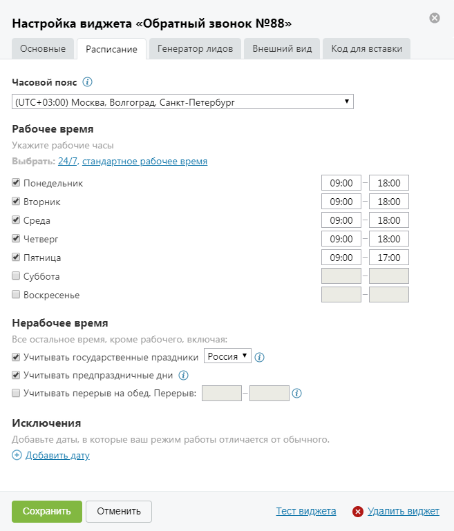

##### 4.2.3.3.2. Вкладка «Расписание»

> Трассировка: PDF §4.2.3.3.2 · сквозные стр. 90-91 · источники: ч.1 `kb/sources/mango-lk-manual/LK_manual_v-125-1-280.pdf` с.90-91.

В зависимости от того, в какое время – рабочее или нерабочее – звонит посетитель сайта, вид и функционал виджета различаются. Данная вкладка предназначена для гибкой настройки расписания.

> **Описание иллюстрации LK-§4.2.3.3.2-1** (к §4.2.3.3.2 «Вкладка «Расписание»», стр. 90; 657×769 px). Снимок экрана / схема Личного кабинета.
> Относится к тексту руководства: «…кое время – рабочее или нерабочее – звонит посетитель сайта, вид и функционал виджета различаются. Данная вкладка предназначена для гибкой настройки расписания.».
> Текст на изображении (OCR, требует сверки): Настройка виджета «Обратный звонок №88»; Основные; Расписание; Генератор лидов; Внешний вид; Код для вставки; Часовой пояс @; (UTC+03:00) Москва, Волгоград, Санкт-Петербург; Рабочее время; Укажите рабочие часы; Выбрать: 24/7, стандартное рабочее время; Понедельник; 09:00; 18:00; Вторник; Среда; Четверг; Пятница; 17:00; С) Суббота; С) Воскресенье; Нерабочее время; Все остальное время, кроме рабочего, включая:; М Учитывать государственные праздники | Россия * | (2); М Учитывать предпраздничные дни @; [ Учитывать перерыв на обед. Перерыв:; Исключения; Добавьте даты, в которые ваш режим работы отл…

Часовой пояс

Из выпадающего списка следует выбрать часовой пояс, соответствующий часовому поясу сотрудника ВАТС. По умолчанию часовой пояс указывается согласно системному времени, установленному на устройстве пользователя.

В дальнейшем правильная настройка часового пояса необходима для синхронизации времени между сотрудниками ВАТС и посетителями сайта, которые находятся в других часовых поясах.

Рабочее время

В данном блоке следует указать дни и часы, которые будут считаться рабочими.

Для упрощения настройки расписания предусмотрены шаблоны «24/7» и «стандартное рабочее время»:

 24/7 – рабочими считаются все дни недели с 00.00 до 23.59

 стандартное рабочее время – рабочими считаются будние дни с 9.00 до 18.00, в пятницу – с 9.00 до 17.00.

Нерабочее время

Всё остальное время, не указанное в предыдущем блоке, считается нерабочим. Также вы можете указать, учитывать ли в расписании:

 государственные праздники страны;

 предпраздничные дни;

 перерыв на обед.

Исключения

В данном блоке указываются определенные дни-исключения, расписание которых отличается от обычного еженедельного расписания.

Дни исключения с пустыми датами при сохранении виджета удаляются.
