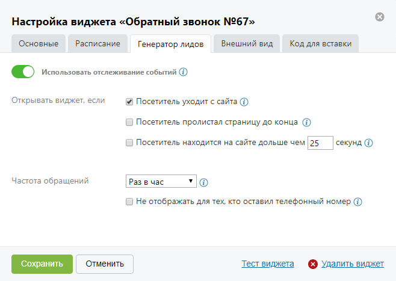

##### 4.2.3.3.3. Вкладка «Генератор лидов»

> Трассировка: PDF §4.2.3.3.3 · сквозные стр. 91-92 · источники: ч.1 `kb/sources/mango-lk-manual/LK_manual_v-125-1-280.pdf` с.91-92.

Внимание

Функционирование генератора лидов доступно только при автоматическом режиме работы виджета.

На данной вкладке осуществляется настройка отслеживания событий. Данная услуга позволяет отобразить виджет при определенных действиях посетителя сайта.

> **Описание иллюстрации LK-§4.2.3.3.3-1** (к §4.2.3.3.3 «Вкладка «Генератор лидов»», стр. 92; 658×467 px). Снимок экрана / схема Личного кабинета.
> Относится к тексту руководства: «…На данной вкладке осуществляется настройка отслеживания событий. Данная услуга позволяет отобразить виджет при определенных действиях посетителя сайта.».
> Текст на изображении (OCR, требует сверки): Настройка виджета «Обратный звонок №67»; Основные; Расписание; Генератор лидов; Внешний вид; Код для вставки; «> Использовать отслеживание событий @); Открывать виджет, если; &/ Посетитель уходит с сайта (1); С) Посетитель пролистал страницу до конца (0); Г] Посетитель находится на сайте дольше чем 25; секунд (©; Частота обращений; Раз в час; "ОФ; Г) Не отображать для тех, кто оставил телефонный номер (7); Отменить; Тест виджета; Сохранить; © Удалить виджет

Предусмотрены следующие настройки лидогенерации:

 Открывать виджет, если – выбор отслеживаемых действий посетителя;

 Частота обращений – период, через который виджет отображается повторно.

Для сохранения настроек нажмите Сохранить.
